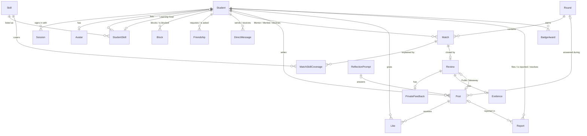

_This project has been created as part of the 42 curriculum by ahmmanso, kabbas, hdakdouk._

# 21 Beirut

## Description

**21 Beirut** is a peer-learning platform for 42 students. Its earlier name, **42 PeerConnect**, is
still the one the code, the specification and the design records use.

42 students learn from each other all the time, but nothing helps them find who can teach them,
whom they can help, or what was actually learned when they met. 21 Beirut runs that loop. An
Admin opens a **Round**, and the platform pairs Students into **Matches**, one **Mentor** and one
**Mentee**, by the Skills one can teach and the other wants to learn. Each Match shows its
**Compatibility Score** with a plain explanation, and suggests a **Mission**: a way to meet, such as
pair programming or a code review. After meeting, the Mentee writes a **Review**: a
**Learning Outcome** (what they learned), **Private Feedback** to the Mentor, and a **Public
Takeaway** that appears in the feed.
**Reflection Prompts**, questions an Admin publishes, give every Student a second way to share what
they learned. Both loops earn XP. It is not a social network: Friends, Direct Messages and the feed
are there to serve the loop.

Key features:

- Rounds and Matches paired by a skill-only Compatibility Score, each with a suggested Mission.
- Reviews in three parts, with an optional Evidence file (PDF, PNG or JPEG).
- XP, ten Levels, three Badges, a Streak and a Leaderboard.
- Friends with live online status, one-to-one Direct Messages, and a feed with Likes.
- Reports, a Peer Moderator role, and an Admin Users table with role changes, Suspension and
  Removal.
- Learning Analytics for Admins: which Skills are wanted and offered, where teachers are missing,
  and how many Matches end in a Review.
- Sign-up with email and password, and Sign in with 42.
- English, French and Arabic, with Arabic laid out right to left.
- One command starts everything: `make up`, or `docker compose up --build`.

The domain words (Student, Round, Match, Mentor, Review, Post, …) are defined in
[`CONTEXT.md`](CONTEXT.md). Each design decision and the reason for it is an ADR in
[`docs/adr/`](docs/adr/), and [`docs/spec.md`](docs/spec.md) is the specification the code is built
from.

**Contents:** [Instructions](#instructions) · [Credentials and demo accounts](#credentials-and-demo-accounts)
· [Resources](#resources) · [Team Information](#team-information) ·
[Project Management](#project-management) · [Technical Stack](#technical-stack) ·
[Database Schema](#database-schema) · [Features List](#features-list) · [Modules](#modules) ·
[Individual Contributions](#individual-contributions)

## Instructions

### Prerequisites

Install Docker Engine with the Compose plugin, Compose version 2.27.2 or newer, and Node 22 (22.12 or a later 22.x release). Docker runs the application, proxy and local Supabase services. Node on the host runs only the Vite development server used by the dev overlay.

The repository checks out every text file with LF on every machine, Windows included, through `.gitattributes`. Without it Windows checkouts would use CRLF, which breaks shell scripts run from the checkout. A Windows checkout made before `.gitattributes` was added keeps its CRLF files until they are checked out again. `git status` stays clean on such a checkout, so check it with:

```bash
git ls-files --eol | grep w/crlf
```

It prints nothing once the checkout uses LF.

`git reset --hard` discards uncommitted changes, so commit or stash them first. To fix an old checkout once, run from the repository root:

```bash
git rm --cached -r -q .
git reset --hard
```

or clone the repository again.

### The `.env` model

`.env.example` lists every variable the stack reads, with no values. Copy it to `.env` and fill in every line: the values pass between team members privately and are never committed. Every target that starts a stack stops at once when `.env` is missing.

`.env` holds two sets of values. The team project's go under the variables' own names, and `make up`, bare `docker compose up --build` and `make reset-team` use them. The local Supabase fallback's values for the eleven variables that differ go under the same names with a `LOCAL_` prefix (`LOCAL_DATABASE_URL`, `LOCAL_SUPABASE_URL`, `LOCAL_SUPABASE_PUBLISHABLE_KEY`, `LOCAL_SUPABASE_SECRET_KEY`, `LOCAL_PUBLIC_ORIGIN`, `LOCAL_BIND_ADDRESS`, the three `LOCAL_` passwords and the `LOCAL_FT_OAUTH_*` pair), with `LOCAL_DEV_PUBLIC_ORIGIN` for `make dev` and `make test`. `make local`, `make dev`, `make test` and `make reset-local` give every service the `LOCAL_` values in place of the team's, and stop first, naming each fallback value `.env` lacks. The fallback's own Postgres, Auth, Storage and gateway services run only under those commands. They read the fallback database's user, password and name and the nine keys its Supabase services sign with from `.env` too; those carry no prefix, since every command uses the same ones. `POSTGRES_PASSWORD` may hold only letters, digits and `. _ ~ -`, because Compose writes it into the fallback's database URLs as it is; `make local`, `make dev`, `make test` and `make reset-local` refuse any other.

Set the three team passwords before the first boot on the team project. Paste `DATABASE_URL` as the dashboard's Session pooler string with no TLS settings: on the team project the `api` and `prisma migrate` replace any TLS setting it carries and verify the connection themselves against Supabase's certificate, `supabase/prod-ca-2021.crt`. Add no other query parameter: the boot check refuses every one but the TLS settings, because `pg` takes the user, password, host and port from a parameter before the URL's own, so it could connect somewhere the check never saw. That includes `connect_timeout`: `prisma migrate` already waits up to 30 seconds for the pooler, so remove it if your `.env` has one. *Running the team project*, below, says how it boots. The `FT_OAUTH_CLIENT_ID` and `FT_OAUTH_CLIENT_SECRET` pair, and its `LOCAL_` twin, may stay empty: the platform works without them. If this checkout has a database volume created by the former plain Postgres image, run `make wipe` once before booting: Supabase's Postgres image cannot reuse that data directory.

The team project's settings, its members' roles and the few changes ever made to it by hand are recorded in [`supabase/team-project.md`](supabase/team-project.md).

### Boot commands

Production path, with `.env` filled in:

```bash
docker compose up --build
```

The same stack through the convenience target, which stops first when `.env` is missing:

```bash
make up
```

Both serve the application at `https://localhost:8443`. Port 8080 only redirects to it. Two lines in `.env` open them to the local network instead (*Open it from other laptops on the same network*, below).

To run the production image on the fallback, with `.env`'s `LOCAL_` values:

```bash
make local
```

Development path:

```bash
docker compose --env-file .env --profile local -f compose.yaml -f compose.local.yaml -f compose.dev.yaml up --build
```

or:

```bash
make dev
```

It serves the application at `http://localhost:8081`.

### Running the team project

With the team `.env` in place, `make up` boots the team project, and so does bare `docker compose up --build`, which reads the same `.env`. `make local`, `make dev` and `make test` always run the fallback, on `.env`'s `LOCAL_` values.

The boot check runs first, before anything touches a database. It checks, in order, that the values are present and well formed, that `DATABASE_URL` and `SUPABASE_URL` name one target, that Supabase Auth and Storage accept the two keys, and that the database accepts `DATABASE_URL`. A failure stops the boot and names the problem, never printing a key, a password or a whole URL:

```text
Supabase check failed: Auth rejected SUPABASE_SECRET_KEY (401)
Supabase check failed: https://<ref>.supabase.co answered 540: the project is paused
```

A paused project answers `540`, and only Kamel, its Owner, can resume it ([`supabase/team-project.md`](supabase/team-project.md)). The boot never falls back by itself: to use the fallback on purpose, run `make local` or `make dev`.

Branch work runs under `make dev` or `make local`. A branch that changes the database (a migration, which any boot applies, or written data) never runs `make up` on the team project: migrations reach it only through `make up` on `main`, after review ([`CONTRIBUTING.md`](CONTRIBUTING.md) → *Schema changes* → *Supabase*). A branch that only reads data may run `make up` to see the team project's data, without hot reload.

A boot that writes the seed's fixture on the team project can take minutes, so the `api` has up to 15 minutes to turn healthy.

### The two resets

`make reset-local` empties the local fallback and `make reset-team` empties the team project, so the next boot seeds afresh. Each deletes the rows of our tables, every Supabase Auth user and every file in `avatars` and `evidence`, not only what the seed made, through the seed's own emptying. Each keeps the tables and migrations, the project or the stack, its settings, the buckets and the keys. There is no single command for both, and neither runs inside `make up`. `make wipe` is different again: it drops the fallback's volumes.

Each checks the values it reads as the boot check's first two steps do, and refuses unless they name its own target. Each takes the seed's lock and refuses, deleting nothing, while a seed is running on that target. Then it reads Supabase Auth's user list once, so a wrong `SUPABASE_SECRET_KEY` or an Auth that does not answer refuses before anything is deleted. Its first write clears the seed's completion record, so a reset that stops partway is finished by running it again.

- **`make reset-local`** reads `.env`'s `LOCAL_` values, as `make local` does, so the team's values never reach it. Stop the stack first with `make down`, which keeps the volumes: a running `api` would go on serving the emptied database. Then boot again with `make local` or `make dev`.
- **`make reset-team`** is Kamel's to run ([`supabase/team-project.md`](supabase/team-project.md) → *Changes by hand*). It runs only from `main` with no uncommitted change, untracked files included, equal to `origin/main` after a fetch. It reads `.env`, refuses unless `DATABASE_URL` and `SUPABASE_URL` name the team project with one ref, then prints that ref and asks for it to be typed. Every stack connected to the team project is stopped first. Then run `make up` from the same checkout, and keep every other stack stopped until that boot has written the fixture.

### Certificate interstitial

The production proxy uses a self-signed certificate generated at image build time. The browser shows a trust warning on first visit. Accept the exception for `localhost`, or for the laptop's IP while the site is open to the network, to continue. The key and certificate exist only inside the local image and are never committed.

### Open it from other laptops on the same network

By default `make up` answers on this computer only. Two lines in your own `.env` let anyone on the same Wi-Fi open the site from their laptop, for testing or a demo. Only `make up` and bare `docker compose up --build` read them: `make local`, `make dev` and `make test` use `LOCAL_BIND_ADDRESS` and `LOCAL_PUBLIC_ORIGIN` instead, which stay on localhost. Nothing else changes: the same code and the same team project. `make dev` cannot be opened from the network: it serves plain HTTP, and browsers drop the `Secure` session cookie on any HTTP address but localhost, so nobody could stay signed in.

The app trusts exactly one address, `PUBLIC_ORIGIN`: live updates, uploads, the port 8080 redirect and Sign in with 42 all compare against it. So while the site is open to the network, everyone opens it at this laptop's IP, you included. `https://localhost:8443` still loads, but its live updates stop under a banner that starts *This address can't reach*, its uploads fail and 42 cannot send you back to it.

Anyone on the same network can then reach the sign-in page and sign up, and their account lands in the team's database. Turn it on at home or for a demo, and off on a shared network such as campus Wi-Fi.

**1. Find this laptop's IP** on the Wi-Fi:

- Linux: `ip -4 -br addr`, the address on the Wi-Fi interface, whose name starts with `wl` (such as `wlp0s20f3`), written before the `/`: for example `192.168.1.102`.
- macOS: `networksetup -listallhardwareports` names the Wi-Fi device under *Wi-Fi* (usually `en0`, on some Macs `en1`). Then `ipconfig getifaddr en0`, with that device's name in place of `en0`.
- Windows: `ipconfig`, the *IPv4 Address* under the Wi-Fi adapter.

Use the Wi-Fi address, never a VPN's (Cloudflare WARP's `172.16.0.2`, for example) or a Docker network's (`172.17.0.1` and its neighbours).

**2. Set two lines in `.env`.** Change them where `.env` already has them:

```bash
BIND_ADDRESS=0.0.0.0
PUBLIC_ORIGIN=https://192.168.1.102:8443
```

`BIND_ADDRESS=0.0.0.0` makes the proxy's ports 8443 and 8080 listen on every network the laptop is on, not only on itself. `PUBLIC_ORIGIN` is the address everyone types: `https://`, the IP, then `:8443`, with no trailing slash. The boot check catches some mistakes: a path or a trailing slash fails on `PUBLIC_ORIGIN`, and a missing `:8443` fails on `HTTPS_PORT`. It does not catch `http://` written instead of `https://`: the site boots, but port 8080 then redirects to plain HTTP on the HTTPS port, and live updates stop under the banner.

**3. Check the passwords.** `make up` seeds the team project with `.env`'s own `ADMIN_PASSWORD`, `MODERATOR_PASSWORD` and `SEED_STUDENT_PASSWORD`, which are the team's and never public, so there is nothing to change here.

**4. Restart:** `make down`, then `make up`.

**5. Ask Kamel to register the 42 callback** for this IP, the first time you use it. Only he can, because the PeerConnect application is under his 42 account:

1. Sign in at `https://profile.intra.42.fr/oauth/applications` and open **PeerConnect**.
2. Click **Edit**. In **Redirect URI**, add `https://192.168.1.102:8443/api/auth/42/callback` on a line of its own, and keep every line already there, `https://localhost:8443/api/auth/42/callback` included.
3. Click **Save**.

The application's UID and secret stay the same, so nobody's `.env` changes. Until the line is there, the 42 button lands on a 42 error page about the redirect URI, while email and password still work. A home router usually gives a laptop the same IP every time, so each place needs its line once.

**6. Open it from another laptop** at `https://192.168.1.102:8443`. Each browser warns once, because the certificate is self-signed and made for `localhost` (*Certificate interstitial*, above): choose *Advanced*, then *Proceed* (Chrome, Brave) or *Accept the Risk and Continue* (Firefox). `http://192.168.1.102:8080` redirects there.

**After changing Wi-Fi, or on another computer**, the laptop has a new IP. Find it (step 1), change the `PUBLIC_ORIGIN` line (`BIND_ADDRESS` stays), restart (step 4), and ask Kamel for the new callback if 42 should work there (step 5). Visitors accept the warning again, since a new address is a new site to the browser.

**To turn it off**, set the two lines back to `BIND_ADDRESS=127.0.0.1` and `PUBLIC_ORIGIN=https://localhost:8443`, then restart (step 4). Do this before a defense: the evaluator opens `https://localhost:8443`.

**When it does not work:**

- **The *This address can't reach …* banner:** the address in the browser is not `PUBLIC_ORIGIN`. Usually the IP changed: follow *After changing Wi-Fi*. Or the page was opened at `localhost`, or `PUBLIC_ORIGIN` starts with `http://` (step 2).
- **This laptop opens it but the others cannot connect:** check they are on the same network. Some networks, such as guest Wi-Fi and many campus and office networks, stop devices from reaching each other, and nothing in the project can change that: use another network, or a phone's hotspot. Otherwise check the firewall. On Linux, Docker usually opens its published ports itself. macOS and Windows may ask whether Docker may accept incoming connections: allow it on private networks.
- **42 shows an error about the redirect URI:** the callback for this IP is not registered yet (step 5).

### Dev overlay and host Vite

`make dev` brings up the base services with the dev and local overlays. It does not start Vite. Run Vite on the host as a separate step. From a fresh clone, install the web dependencies first:

```bash
npm --prefix web ci
```

Then start Vite:

```bash
npm --prefix web run dev -- --host <address> --port 5173 --strictPort
```

Replace `<address>` with the verified host-side bridge address, the address the proxy container reaches as `host.docker.internal`. On the reference machine this verified as `172.17.0.1`, which is an observation about that machine, not a constant.

Find and verify the address in this order. Resolve the name from inside the dev proxy container:

```bash
docker compose --env-file .env --profile local -f compose.yaml -f compose.local.yaml -f compose.dev.yaml exec proxy getent hosts host.docker.internal
```

Confirm the host owns that address:

```bash
ip -4 addr
```

Start Vite bound to it with the command above, then confirm Vite listens only there:

```bash
ss -ltn
```

Confirm the overlay reaches it: `http://localhost:8081/` returns the Vite page and `http://localhost:8081/api/health` returns `{"status":"ok"}`. If `http://localhost:8081` answers 502 with "Host Vite is not answering", host Vite is not running or is not bound to the verified address. Confirm HMR through the proxy: with the page open at `http://localhost:8081`, edit a file under `web/src` and the page updates in place without a full reload. Confirm Vite is bound only to the bridge address: `ss -ltn` shows port 5173 only there, and a request to the machine's own LAN address on port 5173 is refused. That refusal is not proof of isolation: Linux accepts a packet for any of its own addresses on any interface, so a LAN peer that routes the bridge address via this host still reaches Vite whenever the LAN-facing firewall zone admits TCP 5173. Close it on the LAN-facing zone or interface, never on the Docker bridges (the proxy reaches Vite through one, which firewalld places in its `docker` zone):

```bash
sudo firewall-cmd --zone=<LAN zone> --add-rich-rule='rule port port="5173" protocol="tcp" reject'
```

Find the zone with `firewall-cmd --get-zone-of-interface=<LAN interface>` and add `--permanent` to keep the rule. Without firewalld:

```bash
sudo iptables -I INPUT -i <LAN interface> -p tcp --dport 5173 -j REJECT
```

Test it from a second machine on the LAN: `sudo ip route add <address>/32 via <host LAN address>`, then `curl -m 3 http://<address>:5173/` must fail; remove the route after. On the reference machine the HMR check and the bind check passed, the LAN zone (`FedoraWorkstation`) carries the reject rule at runtime and permanently, and a phone on the same Wi-Fi could not reach `http://<host LAN address>:5173`. A phone cannot add a route, so the routed test itself was not run there; the zone rule covers that case, because it rejects TCP 5173 arriving on the LAN interface whatever the destination address. The Vite configuration sets `server.hmr.clientPort` to 8081 and allows the repository root for file serving. Do not set `server.host` in the configuration and do not pass a bare `--host` flag.

LAN restriction: never bind Vite to `0.0.0.0`, `::` or a bare `--host` without an address. A bridge address alone is not proof of isolation on a routed LAN, so check from another machine on the same network that Vite is not reachable there, and use the host firewall if needed. Vite must never be a separately reachable LAN service.

### After a dependency change

The dev overlay's `api` keeps `/app/node_modules` in an anonymous volume, and `up` reuses that volume from the previous container. After a change to the root `package.json` or `package-lock.json`, a new dependency stays missing until the volume is replaced. Stop the stack before starting the overlay again:

```bash
make down
make dev
```

or replace the volume in one step:

```bash
docker compose --env-file .env --profile local -f compose.yaml -f compose.local.yaml -f compose.dev.yaml up --build -V
```

After a change to `web/package.json` or `web/package-lock.json`, run `npm --prefix web ci` again before starting host Vite.

### Makefile targets

Each target is convenience over Compose. The full command runs as written.

```bash
make up
# make env, then docker compose up --build

make local
# make local-env, then docker compose --env-file .env --profile local -f compose.yaml -f compose.local.yaml up --build

make dev
# make dev-env, then docker compose --env-file .env --profile local -f compose.yaml -f compose.local.yaml -f compose.dev.yaml up --build

make down
# make env, then docker compose --profile local down

make wipe
# make env, then docker compose --profile local down --volumes --remove-orphans (includes the Storage volume)

make seed
# docker compose exec api npx prisma db seed --config prisma.config.ts

make reset-team
# sh prisma/reset/require-main.sh
# docker compose run --rm --build --no-deps api node dist/prisma/reset/main.js team

make reset-local
# make local-env, then docker compose --env-file .env --profile local -f compose.yaml -f compose.local.yaml run --rm --build api node dist/prisma/reset/main.js local

make test
# make dev-env, then:
# docker compose -p peerconnect-test --env-file .env --profile local -f compose.yaml -f compose.local.yaml -f compose.dev.yaml down --volumes --remove-orphans
# docker compose -p peerconnect-test --env-file .env --profile local -f compose.yaml -f compose.local.yaml -f compose.dev.yaml build api
# docker compose -p peerconnect-test --env-file .env --profile local -f compose.yaml -f compose.local.yaml -f compose.dev.yaml up -d db auth storage api-gw
# docker compose -p peerconnect-test --env-file .env --profile local -f compose.yaml -f compose.local.yaml -f compose.dev.yaml run --rm api npx vitest run
# The down command runs again on every exit, even after failure. Run one copy at a time; proxy is never started.

make logs
# docker compose logs -f

make env
# test -f .env
# (stops with "missing .env: copy .env.example to .env and fill in every value" if it is absent)

make local-env
# make env, then stops naming every fallback value .env lacks

make dev-env
# make local-env's check, plus LOCAL_DEV_PUBLIC_ORIGIN, which make dev and make test need
```

## Credentials and demo accounts

Every credential reaches the application as an environment variable (*The `.env` model*, above).
`.env.example` is committed with the variables' names only. Every value, the team project's and
the local fallback's, is kept only in the gitignored `.env`.

| Variable | What it holds | Under `make local`, `make dev` and `make test` |
| --- | --- | --- |
| `DATABASE_URL` | The Postgres connection used by the API, Prisma's migrations and the seed | `LOCAL_DATABASE_URL`, the fallback's `db` |
| `SUPABASE_URL` | Where the API reaches Supabase Auth and Storage | `LOCAL_SUPABASE_URL`, the fallback's gateway |
| `SUPABASE_PUBLISHABLE_KEY` | The key the API sends with each password check to Supabase Auth | `LOCAL_SUPABASE_PUBLISHABLE_KEY`, the fallback's |
| `SUPABASE_SECRET_KEY` | The key that creates and changes accounts and reads and writes files. Only the API uses it; the browser never receives it | `LOCAL_SUPABASE_SECRET_KEY`, the fallback's |
| `ADMIN_EMAIL`, `ADMIN_PASSWORD` | The bootstrap Admin the seed creates | `ADMIN_EMAIL` and `LOCAL_ADMIN_PASSWORD` |
| `MODERATOR_EMAIL`, `MODERATOR_PASSWORD` | The Peer Moderator the seed creates, *Yara* | `MODERATOR_EMAIL` and `LOCAL_MODERATOR_PASSWORD` |
| `SEED_STUDENT_PASSWORD` | The password of the thirty seeded Students | `LOCAL_SEED_STUDENT_PASSWORD` |
| `FT_OAUTH_CLIENT_ID`, `FT_OAUTH_CLIENT_SECRET` | The 42 application's UID and secret, for Sign in with 42 | `LOCAL_FT_OAUTH_CLIENT_ID` and `LOCAL_FT_OAUTH_CLIENT_SECRET`, which may stay empty: the platform then shows no 42 button |

The other entries of `.env.example` are settings, not credentials of the team project: the mode, the
ports and the public address with their `LOCAL_` twins, the fallback database's user, password and
name, and the nine keys the fallback's Supabase services sign with. Section 15.4 of
[`docs/spec.md`](docs/spec.md) describes each.

**Which passwords apply.** Under `make local` and `make dev`, the accounts below sign in with
`.env`'s `LOCAL_` passwords. A defense runs on a team member's own computer, on the team project,
with the team's `.env`, which stays with the team. There the team tells the evaluator `ADMIN_PASSWORD`, `MODERATOR_PASSWORD` and `SEED_STUDENT_PASSWORD`, with the demo
Student's email below.

| Account | Email | Password |
| --- | --- | --- |
| Admin | `admin@peerconnect.test` | `ADMIN_PASSWORD` |
| Peer Moderator | `moderator@peerconnect.test` | `MODERATOR_PASSWORD` |
| **Demo Student** | `youssef.04@peerconnect.test` | `SEED_STUDENT_PASSWORD` |

The demo Student, *Youssef*, is the seeded Student with something on every page: a Streak of at
least 3, a Badge, a Match completed as Mentee with its Review, Private Feedback with a rating
received as Mentor, six Friends, two friend requests waiting, and two unread Direct Messages. The
seed prints their email when it runs, as `seed: demo Student`. Every other seeded Student signs in
with the same password at `<name>.<number>@peerconnect.test`, such as `karim.01@peerconnect.test`,
except the one the seed suspends and the one it removes, whom sign-in refuses.

## Resources

### References

The official documentation of each part of the stack:

- [NestJS](https://docs.nestjs.com/), with its [WebSocket gateways](https://docs.nestjs.com/websockets/gateways)
  and [validation](https://docs.nestjs.com/techniques/validation) chapters.
- [React](https://react.dev/), [Vite](https://vite.dev/guide/) and its
  [server options](https://vite.dev/config/server-options.html), and [Tailwind CSS](https://tailwindcss.com/docs).
- [TanStack Query](https://tanstack.com/query/latest), [TanStack Router](https://tanstack.com/router/latest)
  and [TanStack Table](https://tanstack.com/table/latest); [Recharts](https://github.com/recharts/recharts).
- [Prisma ORM 7](https://www.prisma.io/docs/orm), with its
  [configuration](https://www.prisma.io/docs/orm/v7/reference/prisma-config-reference) and
  [schema](https://www.prisma.io/docs/orm/v7/reference/prisma-schema-reference) references.
- [PostgreSQL 17](https://www.postgresql.org/docs/17/), in particular
  [transaction isolation](https://www.postgresql.org/docs/17/transaction-iso.html), on which every
  write's `SERIALIZABLE` transaction rests.
- Supabase [Auth](https://supabase.com/docs/guides/auth), [Storage](https://supabase.com/docs/guides/storage)
  and [self-hosting with Docker](https://supabase.com/docs/guides/self-hosting/docker), the base of the
  local fallback.
- [Socket.IO 4](https://socket.io/docs/v4/).
- The [42 API](https://api.intra.42.fr/apidoc) and its
  [web application flow](https://api.intra.42.fr/apidoc/guides/web_application_flow), with
  [RFC 6749, OAuth 2.0](https://www.rfc-editor.org/rfc/rfc6749), for Sign in with 42.
- [nginx](https://nginx.org/en/docs/) and [Docker Compose](https://docs.docker.com/compose/).
- [Vitest](https://vitest.dev/).
- [MDN Web Docs](https://developer.mozilla.org/) on cookies, Content Security Policy and `Intl`,
  and the W3C's [Structural markup and right-to-left text in HTML](https://www.w3.org/International/questions/qa-html-dir).

The project's own records are part of its documentation: [`CONTEXT.md`](CONTEXT.md) (the glossary),
[`docs/adr/`](docs/adr/) (twenty decision records, each with its reasons),
[`docs/spec.md`](docs/spec.md) (the specification), [`docs/research/`](docs/research/) (the research
notes the decisions cite), [`CONTRIBUTING.md`](CONTRIBUTING.md) (how the team works) and the legal
pages in [`docs/legal/`](docs/legal/).

### How AI was used

The team used AI assistants during the project, as the subject allows, under one rule: whoever
commits a change has read it, run it and can explain it.

- **Records**: drafting ADRs, the specification, tickets and their dated notes from decisions the
  team had taken, and checking that an issue, its ADR and the map say the same thing. The decisions
  themselves, from the product and the module list to the division of work, were the team's.
- **Code and tests**: drafting implementation and tests from a ticket and the specification, in the
  API, the SPA, the seed and the test suite. The author then read the diff and ran the type checks,
  the test suite and the browser checks before opening the PR.
- **Review**: a first reading of a diff before it went to a teammate, looking for bugs, rules of
  the specification the code missed, and missing tests. Each finding was checked against the code
  before it was acted on, and every merge still needed a completed review from another member.

## Team Information

The team is three members. Fadel started with the team as Scrum Master and Developer and left on
2026-10-01; Ahmad took over the Scrum Master role and Fadel's tickets. Hussein joined on 2026-10-04.
42 Beirut accepts a team smaller than the subject's four to five people
([`document/en.subject.md`](document/en.subject.md), line 123).

| Member | 42 login | GitHub | Roles | Responsibilities |
| --- | --- | --- | --- | --- |
| **Ahmad Mansour** | `ahmmanso` | `ahmadmnsur` | Product Owner, Scrum Master, Developer | As Product Owner, decides what the platform does and in what order, accepts finished work, and signed off the Privacy Policy and the Terms of Service. As Scrum Master, keeps the plan and the tickets current, watches for blocked work, and keeps the records in step with each other. Deputises at the schema gate, reviewing Kamel's own gated PRs, owns the browser pass, and builds vertical slices. |
| **Kamel Abbas** | `kabbas` | `UchihaKim` | Technical Lead / Architect, Developer | Owns the architecture and the infrastructure: the Compose stack, the HTTPS proxy, the boot and its checks. Holds the schema gate: reviews every other member's PR that touches the schema and its migrations, the seed, the resets, Supabase's files or the Compose files. Owns the team Supabase project: keeps it available and is the only member who changes it by hand. Reviewed the legal pages' corrections for their sign-off, and builds vertical slices. |
| **Hussein Dakdouk** | `hdakdouk` | `hdakdouk42` | Developer | Builds vertical slices. Drives the French, Arabic and right-to-left work and owns those two modules: proposed their decisions, built their foundation, and proofreads the translations. |

## Project Management

### How the work was organized

1. **Decisions before code.** From 2026-09-18 the team settled the product and its rules first.
   Each open question became a GitHub issue, and each answer was recorded on its issue; most also
   became an ADR in [`docs/adr/`](docs/adr/).
   The map, [issue #1](https://github.com/ahmadmnsur/ft_transcendence/issues/1), indexes every
   decision, what is still open and what is out of scope.
2. **One specification, then tickets.** On 2026-09-23 the ADRs became one buildable specification,
   [`docs/spec.md`](docs/spec.md), and then a plan of 45 tickets in dependency order,
   [`docs/ticket-plan.md`](docs/ticket-plan.md). Each ticket is a GitHub issue with its acceptance
   criteria, its blockers and the member who owns it.
3. **Vertical slices.** Each developer builds a feature end to end, from the migration to the page.
   A member claims a ticket by assigning themself, builds it on its own branch, and opens one PR
   for it.
4. **Review.** Every PR needs one completed review from another member and is squash-merged, so each
   ticket lands on `main` as one commit by its author. Reviews go round-robin, except that a PR
   inside the schema gate (the schema and its migrations, the seed, the resets, Supabase's files
   and the Compose files) goes to Kamel, and Kamel's own gated PRs go to Ahmad, the gate's deputy.
5. **Changes of plan are recorded, never overwritten.** When the team moved to Supabase
   (2026-09-30) and added French and Arabic (2026-10-11), the ADRs were annotated with dated notes
   and the open tickets rewritten before anyone built on them.

### Tools

- **GitHub Issues** for every ticket and every open question, with the map (#1) as their index.
- **GitHub Pull Requests** with a template whose checklist names the extra checks a change
  triggers: the schema gate, a boot from two clean clones, and text in three languages.
- **GitHub Actions**: a CI workflow that type-checks, builds the SPA and the API, boots the local
  fallback, seeds it twice and runs the test suite; and a required check that keeps bot and AI text
  out of PR titles, descriptions and commits.
- **Rules on `main`**: changes arrive only through a squash-merged PR, and nobody can push to it or
  rewrite it.
- [`CONTRIBUTING.md`](CONTRIBUTING.md), the team's working rules.

### Meetings and communication

- **Meetings** on campus at 42 Beirut whenever a decision or a blocker needed one, with no fixed
  schedule.
- **WhatsApp** for day-to-day coordination.
- **GitHub issue and PR comments** for anything that decides something. A decision agreed on campus
  or on WhatsApp is written into its issue or ADR with its date, so the records say who decided what
  and when.

### Timeline

The plan gave the project about six weeks from 2026-09-18. Week 1 is 2026-09-18 to 09-24, and each
week after it starts on a Friday. The records date only weeks 1, 2, 4 and 5; the other milestones
had a place in the order, not a date. Dates are in UTC, as GitHub records them; Beirut is two or
three hours ahead, so `git log` shows a late merge on the next day. Each milestone, its deadline,
and when it was met:

| Milestone | Owner | Deadline | Done |
| --- | --- | --- | --- |
| The decisions, ADR-0001 to ADR-0018, then the specification | the team | before the build | specification locked on 2026-09-23 |
| Week 1: the infrastructure gate, one command and both boot paths | Kamel | 2026-09-24 | 2026-09-27 |
| Week 2: the cohort fixture and the matcher's tests | Ahmad, after Fadel left | 2026-10-01 | 2026-10-01 |
| The move to Supabase: the database, the files and the passwords | Kamel | before anyone built on it | decided 2026-09-30; ADR-0019 on 2026-10-13; tickets rewritten on 2026-10-14 |
| French, Arabic and right to left, claimed and planned | Hussein | before anyone built on it | claimed 2026-10-11; ADR-0020 on 2026-10-15; tickets on 2026-10-16 |
| The Privacy Policy and the Terms of Service, live and signed off | Ahmad, Kamel checking the technical claims | 2026-10-15 (end of week 4), moved to 2026-10-25 | live on 2026-10-11; signed off on 2026-10-25 |
| Every feature merged | the team | before the browser pass | 2026-10-26, the last being the legal pages in French and Arabic |
| Week 5: the browser pass in Chrome, Firefox and Brave | Ahmad | 2026-10-22 | still open on 2026-10-27 |
| The evaluation | the team | no date set on 2026-10-27 | — |

## Technical Stack

### Frontend

| Technology | Why |
| --- | --- |
| **React 19** with **TypeScript 5.9** (strict) | One of the two frameworks of the *framework on both ends* Major. Components carry the design system's reusable parts. |
| **Vite 8** | The development server with hot reload, behind the dev proxy, and the production build that nginx serves. |
| **Tailwind CSS 4** | The CSS framework the subject requires. Its flow-relative classes (`ms-`, `pe-`, `start-`) mirror the whole layout for Arabic, and a build check refuses any left or right class. |
| **TanStack Query 5, Router 1, Table 8** | Query caches what the API returns and refreshes it after a write or a live event. Router gives typed routes, with search filters kept in the URL. Table runs the Users table and the search results. |
| **Recharts 3** | The charts on `/admin/analytics`, its only page. |
| **socket.io-client 4** | The live half of the feed, Rounds, Matches, Direct Messages and online status. |
| A typed dictionary of our own over **`Intl`** | Text in English, French and Arabic with no translation package. The type checker refuses a missing text, plural form or placeholder, so the build fails before a gap reaches the screen. |
| **Noto Sans Arabic**, bundled | The one web font, for Arabic characters only. It is served from our own origin, because the Content Security Policy loads nothing from third parties. |

### Backend

| Technology | Why |
| --- | --- |
| **Node.js 22 LTS** with **TypeScript 5.9** (strict) | The runtime Prisma 7 needs, and one language on both ends. |
| **NestJS 11** on Express | The backend half of the *framework on both ends* Major. Its modules, guards and pipes give each concern one place: sessions, roles and CSRF are guards, and a global `ValidationPipe` with `class-validator` checks every input. |
| **Socket.IO 4** through `@nestjs/websockets` | The *real-time* Major: rooms, broadcasts, reconnection, and a grace window before a Student shows as offline. |
| **Prisma 7** with `@prisma/adapter-pg` | The *ORM* Minor: a typed client and versioned migrations. Every operation that writes runs in a PostgreSQL `SERIALIZABLE` transaction through our own Unit of Work, retried on a serialization failure, so concurrent requests cannot break an invariant. |
| Session cookies, not JWT | A random token in one `HttpOnly`, `Secure`, `SameSite=Lax` cookie, stored only as its SHA-256 hash in the `Session` table. A Suspension, a Removal or a password change ends every session at once by deleting its rows; a JWT would need a server-side denylist to do the same, which is a session table anyway. A role change applies on the next request, since the role is read on each request, never carried in the session ([ADR-0003](docs/adr/0003-session-cookies-over-jwt.md)). |
| `pngjs`, `jpeg-js`, `pdf-lib` | Uploads are decoded, not trusted: an avatar must parse as a PNG or a JPEG, and Evidence as a PDF, a PNG or a JPEG. |

### Database and storage

| Technology | Why |
| --- | --- |
| **PostgreSQL 17**, Supabase's | The database. On the team project it is Supabase's hosted Postgres in Frankfurt (`eu-central-1`), reached through its session pooler with TLS checked against Supabase's certificate. On the local fallback it is Supabase's own Postgres image. |
| **Supabase Auth** | Keeps each password, hashed and salted with bcrypt, and checks it at sign-in. Only the API calls it. |
| **Supabase Storage** | Two private buckets, `avatars` and `evidence`. Every file passes through an authorised NestJS route; the browser never talks to Supabase. |

**Why this database system** ([ADR-0019](docs/adr/0019-supabase-hosts-the-data-and-peerconnect-keeps-the-rest.md)).
Until 2026-09-30 each member's copy kept its own data on their own computer. As Technical Lead,
Kamel saw two things missing: **one copy of the data the whole team shares**, the same from any
member's computer and at the defense, and **a hosted place for that data**. The team chose
Supabase's Postgres, with Storage beside it and Auth as the place each password is kept: Supabase
was the first choice for a hosted database with file storage beside it, and no other provider was
compared. 21 Beirut uses those three stores and
nothing else Supabase offers: Prisma, the session cookie, Socket.IO and Sign in with 42 stay the
team's own code, since four claimed modules (ORM, WebSockets, OAuth and file upload) are scored on
that code. PostgreSQL itself was in the stack from the start, and the design rests on it: its constraints
and its `SERIALIZABLE` isolation hold the platform's invariants (spec sections 3.6 and 4.5). Without the team's `.env`,
Compose runs Supabase's open-source images as a local fallback, so a clean clone boots with no
account anywhere.

### Infrastructure and tests

| Technology | Why |
| --- | --- |
| **Docker Compose** 2.27.2 or newer | One command boots six services: `proxy`, `api`, and the fallback's `db`, `auth`, `storage` and `api-gw`. |
| **nginx** | The only entry point. It serves the SPA, terminates HTTPS with a self-signed certificate made when the image is built, forwards `/api` and the socket to the API, and sets the security headers. |
| **Vitest 5**, `supertest`, `socket.io-client` | One test runner. The suite runs against the local fallback only and covers what fails silently: the matcher, the migrations, concurrency, file access, sanctions and sign-in. |
| **GitHub Actions** | The CI workflow and the required check named under *Tools*, above. |

## Database Schema

The schema is [`prisma/schema.prisma`](prisma/schema.prisma), applied by the migrations in
[`prisma/migrations/`](prisma/migrations/); [`docs/spec.md`](docs/spec.md) section 4 specifies each
table. The diagram shows every table and how they relate; a label with a slash names several foreign
keys between the same two tables. The key fields follow it.



Every id is a UUID (version 7, so ids sort by creation), except `Session.id`. Every time is a
`timestamptz` with millisecond precision. Every foreign key is `ON DELETE RESTRICT`: rows are never
deleted in cascade, and a Removal is a timestamp on the `Student` row, not a deletion.

| Table | Key fields and types | What it holds |
| --- | --- | --- |
| `Student` | `id` uuid PK; `email` text, unique; `display_name` text (ICU collation); `role` Role; `xp` int; `streak` int; `forty_two_id` int, unique, nullable; `password_version` int; `learning_goal_student_skill_id` uuid, nullable; `suspended_at`, `removed_at` timestamptz, nullable | The account; every person, Admins included, is one. Its id is also its Supabase Auth user's id. |
| `Session` | `id` text PK, the SHA-256 of the cookie's token; `student_id` FK; `expires_at` | One signed-in browser. |
| `Skill` | `id` uuid PK; `name` text, unique | The shared catalogue of 27 Skills. |
| `StudentSkill` | `student_id` FK; `skill_id` FK; `kind` SkillKind; unique (`student_id`, `skill_id`, `kind`) | A Skill on a Student's teach or learn list. A Learning Goal points at one of the Student's own rows, held by a composite foreign key. |
| `Avatar` | `student_id` FK, unique; `token` uuid, unique; `mime` text; `size` int | 0 or 1 per Student; the file is in the `avatars` bucket, named by `token`. |
| `Block` | `blocker_id` FK; `blocked_id` FK; unique (`blocker_id`, `blocked_id`) | A standing refusal, stored one way and checked both ways. |
| `Friendship` | `requester_id` FK; `addressee_id` FK; `status` FriendshipStatus; `responded_at` nullable | A request, then a Friendship; at most one row per pair, in either direction. |
| `DirectMessage` | `sender_id` FK; `recipient_id` FK; `body` text; `read_at` nullable | One message between two Students. |
| `Round` | `opened_at`; `closed_at` nullable | One matching cycle; at most one is open. |
| `Match` | `round_id` FK; `mentor_id` FK; `mentee_id` FK; `status` MatchStatus; `mission` Mission; `compatibility_score` smallint, nullable; `goal_bonus_applied` bool; `declined_by_id` FK, nullable | Two Students in one Round. The score is null only for a Match an Admin made by hand. |
| `MatchSkillCoverage` | PK (`match_id`, `skill_id`, `direction` CoverageDirection) | The Skills each side can teach the other, frozen when the Match is made. |
| `Review` | `match_id` FK, unique; `learned` text; `can_now_do` text | The Mentee's Learning Outcome; one per Match, never edited. |
| `PrivateFeedback` | `review_id` FK, unique; two answers, text; `rating` smallint 1 to 5, nullable | The Mentee's private feedback to the Mentor. |
| `Evidence` | `review_id` FK, unique; `token` uuid, unique; `mime`; `size`; `filename` | 0 or 1 file per Review, in the `evidence` bucket. |
| `ReflectionPrompt` | `question` text; `publication_order` bigint, unique | A question an Admin publishes; the live one has the greatest order. |
| `Post` | `author_id` FK; `body` text; `prompt_id` FK or `review_id` FK, exactly one; `answer_round_id` FK, nullable; `removed_at` nullable; unique (`prompt_id`, `author_id`) | A feed item: a Prompt answer or a Review's Public Takeaway. |
| `Like` | PK (`post_id`, `student_id`) | One Student's Like of one Post. |
| `Report` | `reporter_id` FK; `post_id` FK or `reported_student_id` FK, exactly one; `reason` ReportReason; `state` ReportState; `resolved_by_id` FK, nullable; `resolved_at` nullable | A report of a Post or a Student; one per reporter and target. |
| `BadgeAward` | PK (`student_id`, `badge` Badge); `awarded_at` | A Badge, earned once and never revoked. |

The enums: **Role** (`STUDENT`, `PEER_MODERATOR`, `ADMIN`); **SkillKind** (`TEACH`, `LEARN`);
**FriendshipStatus** (`PENDING`, `ACCEPTED`); **MatchStatus** (`MATCHED`, `ACCEPTED`, `COMPLETED`,
`LAPSED`, `DECLINED`, `TERMINATED_BY_ADMIN`); **Mission** (`TECHNICAL_CONCEPT`, `PROJECT_PROBLEM`,
`PAIR_PROGRAMMING`, `CODE_REVIEW`, `TECHNOLOGY_DISCUSSION`, `ADVICE`); **CoverageDirection**
(`FORWARD`, `REVERSE`); **ReportReason** (`HARASSMENT`, `SPAM`, `INAPPROPRIATE_CONTENT`, `OTHER`);
**ReportState** (`OPEN`, `ACTIONED`, `DISMISSED`); **Badge** (`FIRST_MENTOR`, `KNOWLEDGE_SHARER`,
`CONSISTENT_LEARNER`).

Prisma cannot express nine of the rules, so the migrations add them in SQL, and a test fails if one
is missing: a Post has exactly one origin; a Report has exactly one target, never its own reporter,
and a resolver exactly when it is resolved; a rating is 1 to 5; one Friendship per unordered pair;
at most one open Round; an index over each Match's unordered pair; and an ICU collation on display
names, so they sort the same on every database.

Two stores sit beside the schema. **Supabase Auth** keeps each password, under the same id as its
`Student`, with no foreign key between them. **Supabase Storage** keeps the avatar and Evidence
files; the tables hold only each file's token, type and size.

## Features List

Each feature, what it does, and who built it. A feature built in several pull requests names each
member who built a part.

| Feature | What it does | Built by |
| --- | --- | --- |
| **Accounts** | Sign-up with an email, a password and a display name; sign-in, sign-out and password change; a password visibility toggle and a sign-up confirmation. | Ahmad |
| **Sign in with 42** | Signs in through 42's OAuth. A 42 account finds its Student by 42's account id, never by email; a new one gets a sign-up form. A signed-in Student can connect or disconnect 42. | Ahmad |
| **Recovery through 42** | A Student who forgot their password and connected 42 sets a new one after confirming with 42. | Kamel |
| **Profiles, Skills and the Learning Goal** | A profile page; Skills to teach and to learn from the shared catalogue; one Learning Goal, which raises the Compatibility Score. | Hussein |
| **Avatars** | Upload a PNG or a JPEG with a preview and a progress bar, replace it or delete it; a default avatar otherwise. | Hussein |
| **Advanced search** | `/students`: filter by Skills to teach and to learn, sort and page the results. | Ahmad |
| **Friends and online status** | Friend requests, accepting, declining and ending; the Friends list; live online status. | Ahmad |
| **Blocks** | Block a Student from their profile, and lift it from the Blocks list. A Block ends a Friendship, stops new friend requests and Direct Messages, and keeps the pair from being matched. | Hussein |
| **Direct Messages** | One-to-one messages, delivered live, on `/messages` and from a profile, with unread counts. | Ahmad |
| **Live updates** | The socket gateway, its rooms and the online-status registry; the pages react live to a new Post, a Round opening or closing, a new Match, friend requests, a partner's Match answer or Review, and like counts. | Ahmad (gateway), Hussein (live reactions), Kamel (friend, Match and Like events) |
| **Rounds and Matches** | An Admin opens and closes Rounds. Opening one pairs Students by the Compatibility Score with a Mission; each side accepts or declines. | Kamel (Rounds and Matches), Ahmad (the matcher and its tests) |
| **Hand-made Matches** | An Admin pairs two Students the matcher left unmatched. | Ahmad |
| **Reviews and Private Feedback** | The Mentee's three-part Review closes the Match: the Learning Outcome, Private Feedback to the Mentor with an optional rating, and a Public Takeaway. | Ahmad |
| **Evidence** | An optional PDF, PNG or JPEG on a Review, seen only by the pair and Admins. | Kamel |
| **Feed and Likes** | The feed of Public Takeaways and Prompt answers, with Likes and who liked, on `/`, on profiles and under each Prompt, in pages of 20. | Hussein (feed and Likes), Kamel (pages) |
| **Reflection Prompts** | An Admin publishes a question; each Student answers it once, as a Post. | Ahmad |
| **XP, Levels, Badges and Streaks** | XP for a Review and for a Prompt answer; ten Levels with a progress bar; three Badges; a Streak counted at each Round close; earn panels and a `/rules` page. | Ahmad |
| **Leaderboard** | The top ten by XP, with the viewer's own rank pinned below. | Ahmad |
| **Reports** | Report a Post or a Student, with a reason. | Hussein |
| **Moderation** | Reports grouped by what they target, in a queue: a Peer Moderator sees the reported Posts, an Admin every group. A Post's group is resolved by removing the Post or dismissing the Reports; a Student's group is actioned or dismissed by an Admin, who applies any sanction from the Users table. Admins also read the audit of resolved Reports. | Ahmad |
| **Users table and roles** | The Admin's table of every account: view, edit, and change a role. | Kamel |
| **Suspension and Removal** | From the Users table, an Admin suspends, reinstates or removes a Student. | Ahmad |
| **Learning Analytics** | `/admin/analytics`: the most wanted and most offered Skills, the gaps between them, completion per Round and how Matches ended, with charts and plain sentences. | Ahmad |
| **Three languages, right to left** | English, French and Arabic everywhere, chosen in the header; Arabic laid out right to left. | Hussein, and every member for their own slices' text |
| **Light and dark themes** | A dark theme beside the light one. It follows the computer's setting until a person picks one with the header's moon or sun button. | Hussein |
| **Design system** | The palette, type scale, icons and reusable components every page is built from, in all three languages. | Ahmad, Hussein (French, Arabic and right to left) |
| **App shell** | Routes and their guards, the layout, the header with its bar, account menu and Admin tools page, and the API client. | Ahmad (shell), Kamel (header) |
| **Landing page and name** | What a signed-out visitor sees at `/`, and the name 21 Beirut with its logo. | Ahmad |
| **Privacy Policy and Terms of Service** | Both pages, linked from every page's footer, in three languages. | Ahmad (pages and sign-off), Hussein (corrections and translations), Kamel (technical check) |
| **Seed and demo data** | Each first boot creates the Admin, the Peer Moderator, thirty Students, four closed Rounds with their Matches and Reviews, Prompts, Friends, messages, Reports, a Suspension and a Removal, then checks the result. | Kamel, Ahmad, Hussein |
| **One-command boot** | `make up` on the team project or the local fallback; the boot check; HTTPS through the proxy; the two resets; opening `make up` to the local network. | Kamel, Ahmad (the local fallback, the network access) |
| **Test suite** | The test harness and its twelve categories, run in CI. | Hussein (harness), every member for their own tests |

## Modules

22 points are claimed, against the 14 required: 6 Majors (2 points each), one of them a Module of
choice, and 10 Minors (1 point each). The line numbers are those of
[`document/en.subject.md`](document/en.subject.md). The list was settled in [issue
#7](https://github.com/ahmadmnsur/ft_transcendence/issues/7) at 18 points; the two language Minors
joined on 2026-10-15 ([ADR-0020](docs/adr/0020-peerconnect-speaks-english-french-and-arabic.md)),
and the matching engine joined as a Module of choice on 2026-10-27, the fallback issue #7 had named
on 2026-09-18. The margin is deliberate: if two Majors failed at evaluation, 18 points would remain.

| Module | Type | Points | Built by |
| --- | --- | --- | --- |
| Use a framework for both the frontend and backend (`:478`) | Major | 2 | Kamel, Ahmad |
| Implement real-time features using WebSockets (`:490`) | Major | 2 | Ahmad, Hussein |
| Allow users to interact with other users (`:498`) | Major | 2 | Ahmad, Hussein |
| Standard user management and authentication (`:592`) | Major | 2 | Hussein, Ahmad |
| Advanced permissions system (`:622`) | Major | 2 | Kamel, Ahmad |
| Module of choice: the matching engine and its validation method (`:937`) | Major | 2 | Ahmad; Kamel (the Round opening that runs it) |
| Use an ORM for the database (`:516`) | Minor | 1 | Kamel, every member |
| Advanced search with filters, sorting and pagination (`:534`) | Minor | 1 | Ahmad |
| A gamification system (`:848`) | Minor | 1 | Ahmad |
| Custom-made design system with reusable components (`:526`) | Minor | 1 | Ahmad, Hussein |
| File upload and management system (`:536`) | Minor | 1 | Hussein, Kamel |
| Remote authentication with OAuth 2.0, through 42 (`:620`) | Minor | 1 | Ahmad, Kamel |
| Support for additional browsers (`:574`) | Minor | 1 | Ahmad (the browser pass, open on 2026-10-27) |
| User activity analytics and insights dashboard (`:642`) | Minor | 1 | Ahmad |
| Support for multiple languages (`:554`) | Minor | 1 | Hussein, and every member for their own slices' text |
| Right-to-left (RTL) language support (`:564`) | Minor | 1 | Hussein |
| **Total** | 6 Majors, 10 Minors | **22** | |

**Point calculation:** 6 Majors × 2 = 12, plus 10 Minors × 1 = 10, so **22 points**. The subject
requires 14 and counts at most 5 bonus points above them, so 19 is the most that can count; the
three points above it are margin, not score.

Each module, why it was chosen and how it was built:

**Framework on both ends (Major).** *Why:* the platform needs a structured API and a structured SPA
either way, and this Major covers both. The two framework Minors would count the same two frameworks
again, so they are not also claimed. *How:* a NestJS 11 API ([`src/`](src/)), with one module per
concern and a shared core of guards, the response envelope, the Unit of Work and the logger; and a
React 19 SPA ([`web/`](web/)) with TanStack Router and Query.

**Real-time WebSockets (Major).** *Why:* Matches, messages and online status lose their point if a
Student must reload to see them. *How:* one Socket.IO gateway with rooms (`feed`, `rounds`, `staff`
and one per Student) broadcasts `post:created`, `post:removed`, `prompt:published`,
`round:opened`, `round:closed`, `match:ready` and `dm:message` after the database commits.
`friends:changed` goes to both Students of the request or Friendship, `match:changed` to the
Match's Mentor and Mentee, `post:likes` to every signed-in Student in `feed`, and
`reports:changed` to the Peer Moderators and Admins in `staff`. A reconnecting client is admitted
again by its session cookie, a short grace window keeps a reload from flickering the online status,
and a Suspension or a password change disconnects the socket.

**User interaction (Major).** *Why:* meeting a Match needs a way to talk, and a peer-learning
platform needs profiles and Friends. *How:* one-to-one Direct Messages, persisted and delivered
live; profile pages; Friend requests with accept, decline and end, and a Friends list. A Block, in
either direction, ends a Friendship and stops new friend requests and Direct Messages between the
two; their past messages stay readable to both.

**Standard user management (Major).** *Why:* every Student needs an account they can edit, an
avatar and a profile others can see. *How:* profile editing, avatar upload with a default avatar,
Friends with live online status, and a profile page for each Student.

**Advanced permissions (Major).** *Why:* Rounds need an Admin, and the feed needs moderation that
does not rest on Admins alone. *How:* three roles, `STUDENT`, `PEER_MODERATOR` and `ADMIN`, checked
on the server on every staff route. Students see neither staff page; Peer Moderators get `/moderation`;
Admins get `/admin/*`, with a Users table to view and edit accounts, change roles, and suspend,
reinstate or remove a Student.

**Module of choice: the matching engine and its validation method (Major, `:937`).** This module is
the engine that turns a Round's candidates into Matches, and the method that proved it works. It is
not the platform's matching feature counted again: the feature is the Round and its pages, and no
other module here counts the engine. WebSockets delivers `match:ready` and `match:changed`,
Advanced search is `/students`, and Learning Analytics reads how Matches ended.

- *Why we chose it.* Pairing Students is the hardest problem the platform has, and the subject
  lists no module for it. The closest, the recommendation system (`:686`), needs machine learning;
  the Compatibility Score is a deterministic rule on purpose, so that a Student can be told exactly
  why they were paired.
- *What technical challenges it addresses.*
  - **Coverage.** A Round should match as many Students as it can. Plain greedy selection takes
    the top-scoring pair first, even when those two are the only possible partners of two other
    Students, who are then left with nobody; it loses about 9% of the Matches available each
    Round. The engine picks most-constrained-first: after every Match it
    recomputes each unmatched Student's viable partners, and the Student with the fewest picks
    first.
  - **An exact, explainable Score.** The Score counts the Skills one Student can teach and the
    other wants to learn, 70% weight for what the Mentee gains and 30% for what the Mentor gains,
    each with diminishing returns, plus 10 when a Match covers the Mentee's Learning Goal. It is
    computed in integers, with an exact round-half-up, so the API, the tests and any SQL show the
    same number; the Skills behind it are frozen on the Match and shown as its explanation.
  - **Fairness that never shows.** A large Level gap lowers a pair's selection priority, never the
    Score a Student sees.
  - **Determinism and hard rules.** One total order, `priority DESC, Score DESC, pair key ASC`, so a
    Round re-runs identically; a blocked pair, or a pair that has ever had a Match, is never
    paired; one Match per Student per Round is a loop invariant, not a filter.
- *The validation method.* Ahmad committed the success criteria before the first run, then a
  prototype on the branch `prototype/compatibility-score` (2026-09-19) measured the rule on
  generated cohorts. Most-constrained-first reached the best coverage observed on every fixture,
  measured against the best of 600 randomized re-runs of the same Round, across 8 seeds and cohorts
  of 12, 20 and 30 Students: it reached 96–99% coverage, against greedy's 87–91%
  ([ADR-0006](docs/adr/0006-the-matching-rule.md), decision 6). The cohort generator became the test
  fixture, and test category 1, [`test/01-matcher/`](test/01-matcher/), checks the engine: nobody
  stranded on the prototype's starvation cohort, the recount after every Match, the Level penalty
  and each tie-break, six Rounds that come out the same whatever the input order, and the pairs it
  must never make.
- *How it adds value.* The Match is the product. Every Round, every Review, the XP Reviews pay and
  Learning Analytics' completion rate start from the pairs this engine makes, and the explanation it
  freezes is what a Student reads on their Match.
- *Why it deserves Major status.* It is an algorithm with its own correctness argument, an exact
  scoring rule shared by the code and the tests, a reproducible validation against a randomized
  benchmark, and a test category of its own: the substance of a module, not one feature of another.
- *How it was implemented.* [`src/matching/engine/`](src/matching/engine/) is a pure engine with no
  database access: `score.ts` scores a pair and `run-matcher.ts` selects the Matches. When an Admin
  opens a Round, `src/matching/` reads the candidates, the past pairs and the Blocks in one
  `SERIALIZABLE` transaction, runs the engine, writes the Matches with their Missions and frozen
  Skills, and lists the unmatched Students for the Admin.
- *Who.* Ahmad built the prototype and its validation (2026-09-19) and the engine with its tests
  (2026-10-01); Kamel built the Round opening that runs it (2026-10-20).

**ORM (Minor).** *Why:* typed queries and versioned migrations for nineteen tables, kept in step
across three developers. *How:* Prisma 7 on Supabase's Postgres. Each slice adds its own migration,
and Kamel's schema gate reviews every one.

**Advanced search (Minor).** *Why:* finding who can teach a Skill is the platform's first question.
*How:* `/students` filters by Skills to teach and to learn and by name, sorts, and pages the
results, with the filters kept in the URL and the results in a TanStack Table.

**Gamification (Minor).** *Why:* 42 students already know levels and XP, and the loop needs a reason
to come back each Round. *How:* three of the subject's mechanics: XP with ten Levels, three Badges,
and one Leaderboard. XP, Streaks and Badges are stored in the database; a Level and a place on the
Leaderboard are computed from the stored XP. A progress bar, earn panels after each Review and
Prompt answer, and a `/rules` page show them.

**Design system (Minor).** *Why:* three developers building pages in parallel need the same parts.
*How:* the project's own palette, type scale and icon set, and more than ten reusable components,
in three languages, both directions and a light and a dark theme. They are in
[`web/src/design/`](web/src/design/), and [`docs/spec.md`](docs/spec.md) section 3.5.3 describes
them.

**File upload (Minor).** *Why:* avatars, and Evidence of what was learned. *How:* avatars (PNG or
JPEG) and Evidence (PDF, PNG or JPEG), checked in the browser and again on the server by decoding
the bytes, with a preview, a progress bar and deletion. The files sit in two private Supabase
Storage buckets, and every byte passes through an authorised NestJS route.

**OAuth 2.0 (Minor).** *Why:* 21 Beirut is for 42 students, and every 42 student has a 42 account.
*How:* Sign in with 42, run by NestJS itself with no part for Supabase Auth. A 42 login finds its
Student by 42's account id, never by an email or a 42 login, which can change, so no email edit, an
Admin's included, can steer a 42 login to another account.

**Additional browsers (Minor).** *Why:* students use Firefox and Brave as well as Chrome. *How:* the
browser pass runs the platform in Firefox and Brave as in Chrome, with a clean console in each, and
adds the limitations it finds to this README. It is Ahmad's ([issue
#72](https://github.com/ahmadmnsur/ft_transcendence/issues/72)), and still open on 2026-10-27.

**User activity analytics (Minor).** *Why:* an Admin running Rounds needs to see whether the loop
works. *How:* `/admin/analytics` reads the live data in one read-only transaction: the most wanted
and most offered Skills, the gaps between them, the completion rate per Round, and how Matches
ended, with Recharts charts and plain sentences. It is always about the community, never a named
Student.

**Multiple languages (Minor).** *Why:* 42 Beirut is in Lebanon, where Arabic, French and English are
all in daily use, so a student may prefer any of them. *How:* every text the SPA shows or gives to a
screen reader is in English, French and Arabic, from a typed dictionary of our own; the type checker
refuses a missing text. The Privacy Policy and the Terms have one Markdown file per language. The
switcher is in the header on every page.

**Right to left (Minor).** *Why:* Arabic reads right to left, so supporting it means mirroring the
layout, not only translating it. *How:* the page's `dir` is set before the first render and
changes with the language without a reload. The layout mirrors through flow-relative classes only,
and a build check refuses a left or right class. The progress bar, the arrow keys, the tables and
the chart are mirrored as well.

## Individual Contributions

What each member built, with the date each part was merged. Dates are in UTC, as GitHub records
them: for a pull request, the day it merged. Beirut is two or three hours ahead, so `git log` shows
a late merge on the next day. Most items are pull requests. The rest are in the issues and the
reviews, like the legal pages' sign-off on [issue
#69](https://github.com/ahmadmnsur/ft_transcendence/issues/69), or, for the planning, in commits
made straight to `main` before pull requests were required on 2026-09-27.

### Ahmad Mansour (`ahmmanso`)

- **Planning, 2026-09-18 → 09-25**: wrote most of ADR-0001 to ADR-0018, the glossary, the
  specification (locked 2026-09-23) and the ticket plan (2026-09-25); built the Compatibility Score
  prototype and its validation, with the success criteria committed before the first run
  (2026-09-19).
- **Two questions of the move to Supabase**: how the browser and the socket prove who is signed in
  (2026-10-01), and what the database stores in French and Arabic, which settled how display names
  sort and search (2026-10-02).
- **Foundations**: the design system (2026-09-30); `PersonName`, for names written in any direction
  (2026-10-02); the cohort fixture port and the matcher with its tests (2026-10-01, Fadel's
  tickets); the local Supabase fallback (2026-10-04); the SPA shell, with its routes, guards and
  API client (2026-10-09).
- **Legal pages**: rendering the Privacy Policy and the Terms from their Markdown (2026-10-11), and
  the sign-off (2026-10-25).
- **Accounts and 42**: sign-up, sign-in, sign-out and password change (2026-10-14); password
  visibility and the sign-up confirmation (2026-10-17); Sign in with 42's transport (2026-10-17) and
  how a 42 login finds its Student, with the 42 sign-up form and Connect 42 (2026-10-19).
- **Social and live**: the socket gateway and the online-status registry (2026-10-18); Friends and
  live online status (2026-10-19); Direct Messages (2026-10-20); Advanced search (2026-10-18).
- **The loop**: hand-made Matches (2026-10-20); Reflection Prompts, and Reviews with Private
  Feedback (2026-10-21); XP, Levels and Badges (2026-10-21); Streaks and the Leaderboard
  (2026-10-22); Learning Analytics (2026-10-23).
- **Moderation**: the moderation queue and the resolved audit, and Suspension and Removal
  (2026-10-24).
- **Seed**: the Block fixture and four closed Rounds (2026-10-20).
- **Landing and access**: the landing page, opening `make up` to the local network, and the name
  21 Beirut (2026-10-25).
- **This README's sections** other than the Instructions and the browser limitations: written on
  2026-10-27, not yet merged on that date.

*Challenges.* Fadel left on 2026-10-01 with the week-2 tickets due that day; Ahmad took them and
both merged that day. In the socket gateway, Socket.IO reports a reconnect before the socket has
joined its rooms, so an event could be lost or arrive twice; the gateway now holds a socket's events
until it has joined its rooms, then sends them. A server that accepted every socket and then dropped it made the client reconnect with no
pause, 119 handshakes in 5 seconds, so the backoff now resets only after 10 seconds connected. In
moderation, an Admin demoted to Peer Moderator could briefly see the cached Admin queue, reporters
included, until the cache was keyed by role.

### Kamel Abbas (`kabbas`)

- **Infrastructure**: the infrastructure gate, with the Compose stack, the HTTPS proxy, the Makefile
  and the Prisma setup (2026-09-27); the core platform, with the Unit of Work, the response
  envelope, the guards and the logger (2026-10-02).
- **The move to Supabase, 2026-09-30 → 10-14**: proposed it as Technical Lead and settled it ticket
  by ticket, all but the two questions Ahmad settled, then wrote ADR-0019, updated the specification
  and rewrote the tickets.
- **The team project**: verified TLS and the API's connection pool (2026-10-06); the boot check of
  Supabase's keys and the database (2026-10-14); `make reset-local` and `make reset-team`
  (2026-10-18); refusing a `DATABASE_URL` that could move the connection (2026-10-19).
- **Seed**: its skeleton, with the completion record, the guard and the lock (2026-10-15); the
  cohort and its Skill lists (2026-10-18); the Reviews (2026-10-21); the social graph, Likes,
  messages and Report fixtures (2026-10-24); the Suspension and the Removal with its files
  (2026-10-25); the check that each Round shows its own number (2026-10-26).
- **Features**: recovery through Confirm with 42, and Rounds and Matches with their pages
  (2026-10-20); Evidence (2026-10-22); the Users table and role changes (2026-10-23); the feed in
  pages of 20, and the header's bar, account menu and Admin tools page (2026-10-24).
- **Fixes**: the account menu's label (2026-10-15); the Confirm with 42 test moved onto the
  harness clock (2026-10-20); the legal pages waiting for the session, and Remove Post's red border
  (2026-10-27).
- **Gate and checks**: reviewed the other members' PRs inside the schema gate, and the legal
  pages' corrections for their sign-off.

*Challenges.* The move to Supabase came after the specification was locked, so every affected
decision had to be found and annotated, and the tickets rewritten, before anyone built on it. Two
members' stacks share the team project's session pooler, whose pool is small, so the API's own pool
is capped to leave room for both, the migrations and the seed; and every connection to it is
encrypted and verified against Supabase's certificate, committed in the repository. A clock step back during one seed on
2026-10-25 swapped two Round numbers in a clean clone; the seed now stops when a Round shows another
Round's number.

### Hussein Dakdouk (`hdakdouk`)

- **First tickets, after joining on 2026-10-04**: every text file checked out with LF, Windows
  included (2026-10-08); the test harness, which runs on the local fallback only (2026-10-10).
- **Languages, 2026-10-13 → 10-16**: proposed what counts as user-facing text, how the legal pages
  exist in three languages and how each slice ships its text, then wrote ADR-0020 and the tickets.
- **Languages, built**: the dictionary, the switcher and the locale table, and the SPA shell in
  French and Arabic, right to left (2026-10-17); the design system in French and Arabic
  (2026-10-18); the Privacy Policy and the Terms in French and Arabic (2026-10-26).
- **Features**: profiles, Skill lists and the Learning Goal (2026-10-17); Blocks (2026-10-19);
  avatars and the Storage buckets, and the Post table (2026-10-20); the feed and Likes
  (2026-10-21); Reports (2026-10-22); live reactions to new Posts, Rounds and Matches (2026-10-24);
  the dark theme (2026-10-31).
- **Seed**: the four Prompts and their answers, and the demo Student and Badge checks (2026-10-23).
- **Legal pages**: corrected against the merged code for the sign-off (2026-10-25).
- **Fixes**: the health checks' start period, the password hint, the header kept at the top while
  the page scrolls, and the profile and Block buttons (2026-10-19 → 10-27).

*Challenges.* Hussein joined in week 3, with the specification locked and the code started: the
first ticket Hussein took fixed Windows checkouts, whose CRLF line endings broke the gateway's start script.
Arabic needed the whole layout mirrored, not only translated, so a build check now refuses any left
or right class, and the Arabic font is bundled, since the Content Security Policy loads nothing
from third parties.
