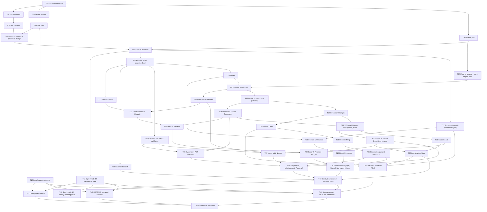

# 42 PeerConnect — Ticket plan

**Status: revision 7, published 2026-09-25 as GitHub issues #29–#73. Committed with the records.**
Built from `docs/spec.md` (locked, at `cb5116c`), the ADRs, `CONTEXT.md`,
`CONTRIBUTING.md`, the PR template and map #1. It adds no rule, product decision or requirement:
every acceptance criterion cites the spec section it comes from.

**Published 2026-09-25.** Each ticket is a GitHub issue, in the same order: ticket T*nn* is issue
#(*nn* + 28), so T01 is #29 and T45 is #73.
- Every issue is a sub-issue of map #1 and carries the `ticket` label.
- Every issue has a native blocked-by edge for every edge in B, plus #24 on #69 (T41) and #70 (T42).
- Only the owners the records name are assigned: Kamel on #29; Fadel on #34, #35 and #72; Ahmad
  and Kamel on #69.

The issues are the live record from here. This file keeps the plan's reasoning.

> **Changed 2026-10-13 for the move to Supabase** ([ADR-0019](adr/0019-supabase-hosts-the-data-and-peerconnect-keeps-the-rest.md);
> [`docs/spec.md`](spec.md) as updated that day by [Update the spec and the legal pages for
> Supabase](https://github.com/ahmadmnsur/ft_transcendence/issues/103)). The reasoning below predates
> the move. Where it names argon2id, `password_hash`, `bytea`, `postgres:17-alpine`, three Compose
> services, fifteen `.env.example` entries, ten test categories, a Postgres service container in CI,
> or #24 as an open blocker, the spec now says otherwise: Supabase Auth keeps the passwords (§5.1),
> files live in two Storage buckets (§9.8), six services and twenty-seven entries (§15.1, §15.4),
> twelve categories on `make test`'s own copy of the local fallback (§16), and #24 closed on
> 2026-10-12, its questions answered on 2026-10-08 (§5.6). The issues stay the live record:
> [Rewrite the Test harness and SPA shell tickets for Supabase](https://github.com/ahmadmnsur/ft_transcendence/issues/106)
> rewrote T03 (#31) and T05 (#33); [Local Supabase fallback: Compose services, make targets,
> environment check and CI](https://github.com/ahmadmnsur/ft_transcendence/issues/121) and [Team
> project database: verified TLS and the api's pool cap](https://github.com/ahmadmnsur/ft_transcendence/issues/124)
> changed T01's and T02's merged code; [Design system: PersonName and text
> direction](https://github.com/ahmadmnsur/ft_transcendence/issues/116) added to T04's; and [Rewrite
> the affected build tickets for Supabase](https://github.com/ahmadmnsur/ft_transcendence/issues/104)
> rewrites the open tickets the move changes and opens the ones it adds. The notes below mark the
> places that issues #99 and #106 named.
>
> **Done 2026-10-14:** [Rewrite the affected build tickets for
> Supabase](https://github.com/ahmadmnsur/ft_transcendence/issues/104) rewrote the seventeen open
> tickets the move changes (T08, T09, T11–T15, T17, T26, T37, T38 and T40–T45), each changed
> criterion under a dated note citing the spec, and opened three outside this plan: [Team project
> boot: the boot check's steps 3 and 4](https://github.com/ahmadmnsur/ft_transcendence/issues/155),
> [The two resets: make reset-local and make
> reset-team](https://github.com/ahmadmnsur/ft_transcendence/issues/156), and [Sign in with 42:
> recovery through Confirm with 42](https://github.com/ahmadmnsur/ft_transcendence/issues/157), so
> recovery is not in T42. T15 builds the seed's bucket step, which T09 does not.

**Revision 2 applies the review of revision 1.**
- **Gap decisions:** A-1, A-2 and A-3 are each decided as option (a).
- **Accounts:** password change is merged into accounts.
- **Early gates:** the frontend-only tickets, the fixture port and the pure matcher engine sit
  outside the core/harness gate.
- **§18 item 9** is split by its own reasons.
- **The seed's tail** is rebuilt: social graph and reports first, then sanctions and files as the
  end state.
- **Socket reactions:** one client-reactions ticket replaces the socket edges into four slices.
- **The seed's table set** is read from the migrated schema.
- **Section G** keeps Kamel off the critical path.

Tickets are renumbered: **45 tickets** (was 46), a critical path **17 deep** (was 20).

**Revision 3 applies the review of revision 2.** No ticket is added, removed or renumbered.
- **Edges:** the sanctions ticket (T38) no longer waits on the socket gateway (T17). The Users-table
  ticket (T37) keeps its edge to Avatars (T15).
- **Gateway:** T17's `revokeSessions` criterion now covers every caller of the port.
- **`vitest.config.ts`:** whichever of T03 and T07 merges first creates it, and the other extends
  it — the same pattern as CI step 7.
- **Section G:** gains the critical-path tickets per person by week, with the weeks that
  overload one person flagged.
- **Wording:** A-3's count of tables arriving early is corrected.
- **Closing checklist:** a line to re-point the spec and ADR citations once issues exist.

**Revision 4 applies an independent readiness review.** No ticket is added, removed or renumbered.
- **T41** (the legal sign-off) is blocked by #24: ADR-0018 *Consequences* makes sign-off wait on
  #24's field for the Privacy Policy's 42 sentence. Sections C, D and E follow.
- **Category 1's C6 across fresh databases** moves from T20 to T24. §16.3 defines it over six
  Rounds with every Match reviewed, and Reviews exist from T24. F.4 and the ADR-0016 d10 annotation
  follow.

**Revision 5 applies the second readiness-review round.** No ticket is added, removed or renumbered.
- **A-2's records:** #25 and map #1 were posted on 2026-09-24. A correction on #25 (2026-09-25)
  moves C6 to Reviews and adds the hand-made blocked-pair refusal.
- **T02:** the three multipart upload routes skip the JSON rule (§5.4).
- **T09:** Skill rows come from the seed's catalogue step and from migrations (§4.3.4).
- **T38:** the Removed-row case is scoped to the Student row (§4.3.1, §4.5), and the kept-data
  criterion states what Removal writes (§12.7).
- **T42 and T44:** if the successful Sign in with 42 lands after the browser pass, T42 carries its
  own Firefox and Brave pass (§16.7). T44 does not wait on T42, so #24 directly blocks only T41 and
  T42. Revision 6 notes its reach to T45 through T41.
- **T39:** the *R* wording holds at every seed version.
- **F.3:** four stale pointers are corrected, including §3.3's Vitest pointer, which now names
  whichever of T03 and T07 merges first.

**Revision 6 applies a further readiness review.** No ticket is added, removed or renumbered.
- **#24's reach:** #24 directly blocks T41 and T42. Through T41 it also reaches T45, pre-defense
  readiness. T41's 2026-10-15 date is unchanged, and no defense date is invented.
- **Category 1:** T24's six-Round service and DB run asserts all of §16.3's C3, C4, C6 and C7. T07
  keeps its engine-level assertions, and T20 its early C4 check.
- **Records:** the spec's Remaining Dependencies 1 and its §20 entry, the ADR-0016 d10 annotation,
  and an addendum on #25 now match.
- **T42:** its conditional browser pass is run by Fadel, with Ahmad deputising (ADR-0016 d9). T42's
  implementation stays unassigned.
- **T39 and T40:** v6 excludes *D*, *S*, *R* and the reserved positions by §14.6's rule, and
  identifies *S* and *R* by §14.5's selection rules, so it needs no sanctions code. v7 then applies
  the Suspension and the Removal.
- **D:** the week-1 row states `main`'s state as a dated observation, as of 2026-09-25.

**Revision 7 applies a full re-read.** No ticket is added, removed or renumbered.
- **Wording:** A.3 item 7, Section C and T33 no longer say that T28, T30 and T32 emit events. They
  show events that T20, T21, T24 and T27 emit.
- **T39:** its *Blocked by* line gives the current reason, the §14.5 selection rules.
- **T37:** the role change's Removed-target refusal names `student_removed` (§12.7).
- **T43:** also blocked by T10, since the README's Features List needs the legal pages. T33 stays a
  blocker of T44 only, as decided.
- **Formatting:** three headings gain the blank line above them.

Precedence is the spec's own (*How to read this document*): on a **rule**, the ADR wins; on a
**mechanism** listed in §2.2, the spec wins.

## How to read this plan

- **One ticket = one PR.** IDs are in dependency order: every blocker has a lower number.
- **Gate shorthands.** Items 1 and 2 gate every slice; item 3 gates every signed-in feature.
  - **G1** = T01 (§18 item 1). **G2** = T02 + T03 (§18 item 2). **G3** = T08 + T09 (§18 item 3).
  - "G1–G3" in a *Blocked by* line means all five.
  - **Not slices, so not behind G2:** the frontend-only T04 (design system), T05 (SPA shell) and
    T10 (legal pages); the fixture port T06 (a pure copy); and the pure matcher engine T07. T06
    and T07 are blocked by T01 (and T07 by T06) only, per §18 item 4's *"independent of the
    database layer for the pure part"*.
- **Edge tags.** `[§18 n]` is an edge §18 item *n* states. `[derived: …]` is an edge that another
  section of the spec forces (a foreign key, a test seam, a screen), with the reason. `[A-n]` is an
  edge that follows from a decided gap (A.2). Section C lists every edge.
- **Schema gate** (§17.2): *yes* when the PR's file list touches `prisma/**` or matches
  `/prisma.config*`, `/prisma7.config*` or `/.config/prisma*`.
  - Kamel reviews. Ahmad deputises after 24 h, and **reviews every gated PR Kamel authors** (§17.2,
    ADR-0005 d3).
  - A gated PR also ticks the template's gate boxes: `schema.prisma` and its migration together,
    `prisma generate` run explicitly, migration named `<slice>_<change>`, no merged migration
    edited, and no generated statement that drops or alters one of the raw objects (§4.4, §17.2).
- **Owners** are filled only where a record assigns one. Everything else is *unassigned*. Section G
  proposes a split. It is only a proposal.
- **Suite box** (§16.8):
  - *not applicable* while the rebased branch holds no `test/<NN>-<category>/*.test.ts`;
  - required on every PR from the first PR that adds one. That is T07 in the planned order: it now
    needs only T01 and T06, so it can come first. T15, T17 or another tested ticket takes that
    role if it merges first;
  - whichever PR adds the first test file also adds CI step 7 (§16.4). `passWithNoTests` is never
    set.
- **Tests** name only §16.3 categories, with the assertions of the category the ticket owns
  (F.4 maps every assertion to one ticket). Otherwise: *none — fails loudly (§16.1)*.

### Clean-clone criteria (§16.5 steps 5–6)

Triggered by a PR touching `prisma/**`, `prisma.config.ts`, `compose.yaml`, `compose.dev.yaml`,
`Dockerfile` or `proxy/Dockerfile` (§16.5).
- Each check runs in its own fresh clone after `make wipe`: Clone 1 runs `make up`, Clone 2 runs
  bare `docker compose up --build` with no `.env` (§16.5 steps 1–4).
- A criterion binds from the ticket whose slice creates its surface.
- A triggered PR checks **every criterion that has joined by the time it merges** and lists them
  in the PR template's clean-clone box.
- The per-ticket sets below are for the planned order.

| ID | Criterion | Joins from |
| --- | --- | --- |
| CC1 | Both boot paths come up from an empty database, nothing run first | T01 (§18 item 1) |
| CC2 | The §15.5 chain runs in order — `migrate deploy`, the seed entry, `main.js` — and `api` turns healthy only after it | T01 |
| CC3 | `https://localhost:8443` serves the bundle after the certificate interstitial; port 8080 redirects to it | T01 |
| CC4 | The console is clean | T01 |
| CC5 | The seed logs completion of the fixture version as it stands, from an empty database (§14.9) | T09 (§18 item 3) |
| CC6 | The bootstrap Admin can sign in | T09 (needs T08's sign-in) |
| CC7 | That page is the sign-in page | T08 (the SPA's sign-in slice) |
| CC8 | The demo Student signs in with `SEED_STUDENT_PASSWORD` | T40 (§18 item 12 complete) |
| CC9 | `/admin/rounds` shows four closed Rounds and none open | T40 |

### The seed, slice by slice (§14.9, §18 item 12)

**Every seed increment is a follow-up ticket, never inside its slice's ticket**, and the increments
form one serial chain. The reasons:
- each slice ticket stays within one working session;
- the application code the seed drives stays round-robin review (§17.2), so slices with no schema
  change (T21, T27, T30, T36, T38) stay outside the gate;
- one chain means fixture versions never collide (§14.9);
- each increment is a clean-clone trigger anyway.

The cost is one more gated PR and clean-clone check per increment. Between a slice merging and its
seed increment, CI's seed-from-empty does not yet drive the new path, so a seed ticket should be
picked up as soon as its slice lands.

| Version | Ticket | Seed steps it adds (§14.4–§14.7) | §14.8 checks it adds | Slices it waits for |
| --- | --- | --- | --- | --- |
| v1 | T09 | Catalogue (27 Skills), bootstrap Admin and Peer Moderator, completion record, truncation, stale-record clearing | none | T06 fixture, T08 accounts |
| v2 | T13 | The thirty sign-ups in position order and the id-order check; Skill lists with *G*; Learning Goals; the Peer Moderator's lists | 7 | T12 Profiles |
| v3 | T22 | *X* Blocks *Y* before Round 1; Rounds 1–4: open, declines, hand-made repairs, lapses, acceptances, close | 1 (Round half), 2, 8 | T16 Blocks, T20 Rounds, T21 hand-made |
| v4 | T25 | Every Review (repairs, then step h), with the §14.5 sentences and ratings | 4 | T24 Reviews |
| v5 | T34 | Prompts 1–4 and their answers | 1 (Prompt half), 3 (names *D*), 9 | T27 Prompts, T29 XP/Badges, T30 Streak |
| v6 | T39 | Social graph, Likes, Direct Messages (§14.6) and the report fixtures (§14.7) | 6 | T18 Friends, T19 DMs, T28 Likes, T36 moderation |
| v7 | T40 | *S* suspended in Round 3; *R*'s avatar and Evidence, then *R* removed in Round 4 — **ADR-0017's complete end state** | 5 (all nine now pass) | T38 sanctions, T15 avatars, T26 Evidence, and every §18 item 5–9 ticket |

> **Corrected 2026-10-14:** v1 adds §14.8's check 10, every Student's `display_name_search`
> equals `foldName(display_name)`, which came with #95's refinement of 2026-10-02 (T09, [#37](https://github.com/ahmadmnsur/ft_transcendence/issues/37)).
> So §14.8 has ten checks, and v7 makes all ten pass.

Each version runs its steps in §14.4's order. v6 (T39) needs no sanctions code. It excludes *D*,
*S*, *R* and the reserved positions from the eligible Students by §14.6's rule, and it identifies
*S* and *R* by §14.5's selection rules over the Round script, not by their status. v7 (T40), which
lands after v6, then applies the Suspension in Round 3 and the Removal in Round 4 to the Students
those rules select.

Slices the seed does not drive, so they have no increment:
- T14 search;
- T17 gateway (§14.10: no Presence);
- T31 Leaderboard;
- T32 Analytics;
- T33 live client reactions;
- T37 roles (staff are inserted directly, §14.1);
- T11 and T42, Sign in with 42;
- T10 legal pages.

A slice PR that changes what an unchanged seed script produces bumps nothing, because the record
certifies the steps and checks it ran (§14.9). For example, T29 makes seeded Reviews pay XP. A
developer whose database predates it runs `make wipe` to see the new state.

---

## A. Spec gaps

### A.1 Pre-flight: all three are settled by the spec, with every other record in agreement

1. **The suite box before the first test file.** Settled by §16.8 (*The suite box binds from the
   first test file*), ADR-0016 d6's 2026-09-24 annotation, `CONTRIBUTING.md` → *Done* and the PR
   template.
   - It is *not applicable* until a PR's rebased branch holds a `test/<NN>-<category>/*.test.ts`,
     and required on every PR from the one that adds the first.
   - That is at the latest §18 item 4, category 1: T07 here, which may now land first.
   - `passWithNoTests` is never set (§16.4).
2. **Where CI sits and which steps bind from where.** Settled by §16.4 (*The workflow grows with the
   slices*), §18 items 1, 3 and 4, and ADR-0016 d8's 2026-09-24 annotation.
   - `ci.yml` lands in the infrastructure gate (§18 item 1 → **T01**) with steps 1–5: install, env,
     generate, typecheck, `nest build`, `migrate deploy` from empty, seed from empty.
   - Step 6 (seed idempotence) is added by the PR that lands the seed skeleton's completion record
     (§18 item 3 → **T09**).
   - Step 7 (`nginx` + `npx vitest run`) is added by the PR that adds the first test file (**T07**
     planned).
   - A step is never made conditional or tolerant. CI stays advisory (#28).
3. **Who reviews a gated PR its gate holder authors.** Settled by §17.2, §18 item 1, ADR-0005 d3's
   2026-09-24 annotation, `CONTRIBUTING.md` → *Review*, and the PR template's gate box: **Ahmad
   reviews it**. Nobody reviews their own PR. "In week 1 nobody writes schema" means feature
   schema: T01 carries `prisma.config.ts`, a model-less `schema.prisma` and a seed entry that only
   logs completion, and no table or migration.

   Checked alongside: a model-less schema is buildable. Prisma has generated a client with no
   models since 5.14 (prisma/prisma#11582, closed by #24160).

### A.2 Gaps found while planning — decided 2026-09-24

**A-1 — The seed skeleton needs the fixture's Skill lists. Decided: option (a).** The fixture port
(**T06**, Fadel) is its own gated ticket, **blocked by T01 only**: the module is a pure copy, and
§18 item 4's pure part is independent of the database layer. The seed skeleton (**T09**) is blocked
by it, because ADR-0017 d8 makes the catalogue the fixture's `SKILLS` + `RARE_SKILLS`. T06 has two
tickets of slack before T09 needs it.
*Recorded:* spec §18 note; map #1 note.

**A-2 — Which part of category 1 is Fadel's week-2 deliverable. Decided: option (a).**
- **T07** (Fadel, week 2) ships the engine and category 1's engine-level assertions:
  - §8.2 arithmetic and the five halves;
  - C3, C7 and C6 over `generateCohort({ size: 20, seed: 42 })` across six engine Rounds;
  - no-repeats and blocked pairs as engine inputs;
  - most-constrained-first on `starvation`.
- The service and DB assertions land with the tickets that create their seams: **T20** Rounds and
  Matches, **T21** hand-made Matches, **T24** Reviews, **T38** Suspension/Removal (F.4).

*Recorded:* ADR-0016 d10 annotated; spec §18 note; #25 comment and map #1 annotation (posted
2026-09-24). A correction on #25 (posted 2026-09-25) moves C6 to Reviews and adds the hand-made
blocked-pair refusal. An addendum on #25 (posted 2026-09-25) gives the Reviews run all of C3, C4,
C6 and C7, matching F.4.

**A-3 — Which slice's migration creates `Post`. Decided: option (a).** **T23** is a gated,
behaviour-free ticket after Rounds.
- One migration creates `ReflectionPrompt`, `Review` and `Post`, with `post_exactly_one_origin`
  written in that creating migration (§4.4).
- Reviews (T24) and Prompts (T27) both build on it and stay parallel.
- Prompts is also blocked by Rounds, for `answer_round_id` (§4.3.16, §8.12).
- The migration creates `ReflectionPrompt`, `Review` and `Post` one PR ahead of the slices that
  write them. The spec note records that exception to §17.2.

*Recorded:* spec §18 note; map #1 note.

### A.3 Planning choices where the spec is silent (reviewable; not gaps)

1. **Outside the core/harness gate** (decided on review): T04, T05, T10, T06 and T07, as the legend
   states. Because T07 no longer waits on T03, either can land first. **Whichever of T03 and T07
   merges first creates `vitest.config.ts` and the Vitest dev dependencies, with the §16
   invariants; the other extends it.** The invariants are:
   - files at `test/<NN>-<category>/*.test.ts`;
   - `fileParallelism: false`;
   - `unplugin-swc`;
   - `passWithNoTests` never set.

   This is the same pattern as CI step 7 (§16.3, §16.4).
2. **Items split into several PRs.**
   - Item 2 → T02 core + T03 harness.
   - Item 3 → T08 accounts (with password change, merged on review) + T09 seed skeleton.
   - Item 4 → T06 fixture port + T07 engine and category 1.
   - "Rounds and Matches" → T20 + T21 hand-made.
   - "XP, Badges, Streak at close, Leaderboard" → T29 + T30 + T31.
   - Reports → T35 filing + T36 moderation.
   - Item 9 → T37 roles + T38 sanctions.
   - Files → T15 avatar + T26 Evidence.
3. **`SessionGuard` and `RolesGuard` land with T08, not T02.** §5.3's query joins `Session` and
   `Student`, which T08 creates. §18 item 2's "guards" is read as the table-free ones
   (JSON-mutation, upload-CSRF).
4. **T08 creates every `Student` column except the two Learning Goal columns.** Those need
   `StudentSkill` for the composite FK (M5) and come with T12.
5. **`GET /api/config` goes in T02; `src/shared/limits.ts` goes in T05.**
6. **The harness can create staff the way the seed bootstraps them (§14.1).** Tests need an Admin
   and a Peer Moderator before any role-change path exists.

   > **No longer so since 2026-10-04, noted 2026-10-13** ([Rewrite the Test harness and SPA shell tickets for
   > Supabase](https://github.com/ahmadmnsur/ft_transcendence/issues/106); spec §16.2): every account
   > is made through Supabase Auth, so the harness ships no account helper. The Student and session
   > helpers land with T08, and the staff helper with T09, which builds the bootstrap function the
   > seed and the harness share.
7. **Socket reactions** (decided on review):
   - T17 implements every `RealtimePublisher` event.
   - T18 (`presence:update`) and T19 (`dm:message`) wire their own reactions, after the gateway
     per §18 item 7.
   - T20, T28, T30 and T32 do not wait on the gateway. The events their surfaces show go out
     through the port, emitted by T20, T21, T24 and T27, and T33 wires the client reactions.
   - **T33** wires `round:*`, `match:ready`, `post:created`, the profile refetch and the Analytics
     re-query, and blocks the browser pass.
8. **XP for both earning paths lands in T29**, through the `gamification` module's `tx` helpers
   (§3.4). T24 and T27 ship their transactions without XP. Reviews → XP is §18's edge; Prompts →
   XP is derived from §8.12's single transaction.
9. **§18 item 9 split by its own reasons** (decided on review; spec §18 note):
   - **T37** (Users table and roles) needs Matches — T20, T21 — and the slices whose cases its
     tests carry, T29 and T31. It does not need Reports.
   - **T38** (sanctions) needs Reports for Remove Student's auto-action. It waits on **T36**, not
     only T35, because its category-10 cases use the queue and the resolved audit. That includes
     the *stale queue read followed by demotion* case, moved here from T37 in revision 2. That
     case needs both the role change (T37) and moderation (T36), and T38 waits on both.
   - Other cross-slice test cases go with the later ticket, with an edge to make that ticket
     deterministic (F.4).
10. **§14.8 check 1 is split**: its Round half in T22, its Prompt half in T34.
11. **Defects the browser pass finds** are fixed in their own `fix/` PRs, not inside T44.
12. **The seed's table set** (decided on review). "Every domain table", in T09's emptiness and
    truncation checks, is every table in the migrated schema except `_prisma_migrations`, read at
    run time. The checks then hold at every seed version, and equal §14.9's nineteen at the end.
    §14.9's wording is not annotated: this is the only buildable reading while fewer tables exist.
13. **Two derived edges, settled on review of revision 2.**
    - **T37 ← T15, kept:** the Admin avatar routes reuse the `Avatar` table, the validators and the
      upload path.
    - **T38 ← T17, dropped:** `revokeSessions` goes through the `RealtimePublisher` port, which is
      a no-op until the gateway lands, and no category asserts the socket drop. T17's criterion is
      generic instead: it implements `revokeSessions(studentId | sessionHash)` for every caller of
      the port — logout, password change, Suspension, Removal — with no change on the callers' side.

---

## B. Ticket inventory (dependency order)

### Foundation — §18 items 1, 2 and 4, and the frontend frame

#### T01 — Infrastructure gate: one command, both boot paths

> **Beside T01, 2026-10-13:** its merged code was changed by two build tickets outside this plan,
> [Local Supabase fallback: Compose services, make targets, environment check and
> CI](https://github.com/ahmadmnsur/ft_transcendence/issues/121) (merged `ab23e2b`: the six
> services, `make local`, `make dev` and `make test` on the fallback, the boot check's steps 1 and 2,
> CI on `make test`'s copy) and [Team project database: verified TLS and the api's pool
> cap](https://github.com/ahmadmnsur/ft_transcendence/issues/124) (merged `76dfbed`). The boot check's
> steps 3 and 4, which let `make up` run on the team project, and the two resets come with tickets
> [Rewrite the affected build tickets for Supabase](https://github.com/ahmadmnsur/ft_transcendence/issues/104) opens (spec §15.5, §15.6).
>
> **Opened 2026-10-14:** [Team project boot: the boot check's steps 3 and
> 4](https://github.com/ahmadmnsur/ft_transcendence/issues/155) and [The two resets: make
> reset-local and make reset-team](https://github.com/ahmadmnsur/ft_transcendence/issues/156).
- **Owner:** Kamel (ADR-0004 d12; §18 item 1). **Reviewer:** Ahmad — a gated PR its gate holder
  authored (§17.2).
- **Blocked by:** none. **Blocks:** T02–T42.
- **Schema gate:** yes — `prisma.config.ts`, `prisma/schema.prisma`, `prisma/seed/main.ts`. No
  feature table and no migration (§17.2).
- **Implements:** §3.1; §3.2; §3.3 (scaffold); §3.9 (nginx, Postgres, container caps); §3.10 (proxy
  side); §5.5 (proxy headers); §9.5 step 1; §15.1–§15.6; §16.4 steps 1–5; §17.5 (Instructions);
  §18 item 1. Mechanisms: M9, M10–M13, M16, M17, M20, M29, M34.
- **Files / areas:**
  - `compose.yaml`, `compose.dev.yaml`, `Dockerfile`, `proxy/**`, `.env.example`, `.gitignore`,
    `.dockerignore`;
  - the root API package (`package.json`, lockfile, `tsconfig*.json`, `nest-cli.json`);
  - `src/main.ts` with a minimal app module, env validation and the health route;
  - `web/` (the Vite scaffold);
  - `prisma.config.ts`, `prisma/schema.prisma`, `prisma/seed/main.ts`;
  - `Makefile` (rewritten), `.github/workflows/ci.yml`, `README.md` (Instructions).
- **Scope:** The single command, the dev overlay, and the Prisma scaffolding the boot chain needs.
  Nothing a feature slice owns.
- **Acceptance criteria:**
  1. Exactly three services, `proxy`, `api` and `db`, with `name: peerconnect`. Only `proxy`
     publishes ports, all on `127.0.0.1`: 8443 and 8080 on the base path, and `!override` 8081 on
     the overlay (§3.1, §15.1, §15.2).
  2. The `db` service: `postgres:17-alpine`, `log_error_verbosity=terse`,
     `log_min_error_statement=panic`, a TCP `pg_isready` healthcheck, the `db-data` volume (§15.1,
     M13).
  3. The `api` service: health on `/api/health` (5 s interval, `start_period` 180 s),
     `restart: no`, depends on a healthy `db`. `proxy` depends on a healthy `api`. Every service
     uses `logging: *pc-logging`, which is json-file with 10m × 3 (§15.1, M12).
  4. Every configured service loads `env_file` `.env.example` (required) and then `.env`
     (optional). Only `HTTPS_PORT` and `HTTP_PORT` are interpolated, and their defaults equal
     `.env.example`'s (§15.1, §15.4).
  5. `.env.example` has §15.4's header comment and exactly the fifteen entries with their
     defaults. There is no `SESSION_SECRET`, callback URL, test-database URL or flag (§15.4).
  6. Both images build from context `.`.
     - `Dockerfile` has the targets `build`, `runtime` and `dev`; `proxy/Dockerfile` has `runtime`
       and `dev`.
     - The self-signed P-256 certificate is made at image build with §15.3's `openssl` line and
       is never committed (§15.1, §15.3, ADR-0004 d6).
  7. `proxy/nginx.conf` replaces the image's own. It contains exactly §3.9's logging directives,
     and there is no other `access_log`, `error_log` or `log_format` anywhere in the image. It
     also defines the `$connection_upgrade` map, `upstream peerconnect_api` and
     `server_tokens off` (§3.9, §15.3, M10, M11).
  8. `proxy/snippets/api.conf` (§15.3, §9.5 step 1, §5.5, M9):
     - `/api/` allows 1m; the three upload locations allow 6m;
     - `/socket.io/` passes the upgrade and has a 1 h read timeout;
     - every location overwrites `X-Real-IP` and `X-Forwarded-For` with `$remote_addr` and never
       sets or clears `Origin`.
  9. The base template redirects 8080 with `301 ${PUBLIC_ORIGIN}$request_uri`. The 8443 server
     runs `ssl` and `http2` and serves `location /` with §3.10's CSP. No HSTS anywhere. The dev
     template has one 8081 server that proxies `/` and the HMR upgrade to
     `host.docker.internal:5173`, with no CSP (§3.10, §15.2, §15.3, M34).
  10. The boot chain runs `migrate deploy`, then `db seed`, then `exec node dist/src/main.js`.
      Every Prisma CLI call is pinned with `--config prisma.config.ts`. Any failure stops the
      chain: `api` exits non-zero and `proxy` never starts (§15.5, M16).
  11. `prisma.config.ts` is as §15.5 specifies. `schema.prisma` holds the generator
      (`prisma-client`, output `../src/generated/prisma`, `moduleFormat = "cjs"`,
      `previewFeatures = ["partialIndexes"]`) and the datasource, and no model. No other file
      matches `/prisma.config*`, `/prisma7.config*` or `/.config/prisma*` (§3.2, §3.3, §15.5,
      §17.2).
  12. The seed entry validates the environment and only logs completion. It writes no completion
      record yet (§16.5 step 6, §18 item 1).
  13. Boot validation is shared by `src/main.ts` and the seed entry (§15.4, M29). It checks that:
      - the required entries (all but the OAuth pair) are non-empty;
      - `PUBLIC_ORIGIN` is a bare origin;
      - the staff and seed passwords are 8–128 characters;
      - `DATABASE_URL`'s user, password and database equal `POSTGRES_*`;
      - an `https` `PUBLIC_ORIGIN`'s port equals `HTTPS_PORT`.

      A failure names the variable, never its value, and exits 1.
  14. `GET /api/health` returns `{ status: "ok" }` once the app is listening (§6.1).
  15. The root package (§3.2, §3.3, M17):
      - `engines.node ^22.12.0`;
      - `prisma` and `@prisma/client` `^7.4.0`, and `dotenv`, as runtime dependencies;
      - the build tsconfig sets `rootDir: "."`, `nest-cli.json` sets `entryFile: "src/main"`, and
        the build emits `dist/src/main.js` and `dist/prisma/seed/main.js`;
      - `.gitignore` and `.dockerignore` as §3.2 lists.
  16. `web/` is its own Vite + React 19 + Tailwind 4 package, and the base proxy serves its bundle
      (§3.3, §15.2).
  17. Host Vite runs with `--host <verified bridge address> --port 5173 --strictPort`,
      `hmr.clientPort 8081`, and `fs.allow` including the repository root. No silent `0.0.0.0`
      (§15.2, ADR-0004 d4).
  18. The dev overlay's `api` uses target `dev`, a bind mount plus an anonymous `node_modules`, and
      runs `prisma generate → nest build → migrate → seed → nest start --watch`. Both overlay
      services get `PUBLIC_ORIGIN=http://localhost:8081` and `NODE_ENV=development` (§15.2).
  19. The `Makefile` is rewritten to exactly §15.6's eight targets, with pinned Prisma calls. Bare
      Compose needs none of them (§15.6, §18 item 1).
  20. `ci.yml` runs §16.4 steps 1–5 on every pull request and is advisory. Its Postgres service
      uses `.env.example`'s own credentials, and only `DATABASE_URL`'s host and port change
      (§16.4).
  21. The `README.md` Instructions section covers (§17.5, §15.2, §15.6):
      - prerequisites: Docker Engine with Compose ≥ 2.24.4, and Node 22 for host Vite;
      - the `.env` model, both boot commands and the certificate interstitial;
      - the dev overlay with the verified Vite bind command, how the address was verified, and
        the LAN restriction;
      - every Makefile target's full command.
- **Tests / verification:** none — fails loudly (§16.1). Suite box *not applicable*: there is no
  test file yet (§16.8). CI steps 1–5 green. Clean-clone: CC1–CC4.
- **Records the PR moves:**
  - **README:** Instructions.
  - **Privacy Policy:** check its request-log fields and log-retention statement against the nginx
    format and the cap. Update it only if they differ (§19 item 24).
  - **Fixture version:** none. No completion record is written yet (§14.9).
  - **#16:** this is Kamel's first commit.

#### T02 — Core platform: Unit of Work, envelope, exception filter, table-free guards, logger, post-commit events
- **Owner:** unassigned. **Blocked by:** T01 [§18 1]. **Blocks:** T03, T08, T09, T11–T42.
- **Schema gate:** no.
- **Implements:** §3.4 (`core`, `Actor`); §3.6; §3.7; §3.8; §3.9 (API); §5.4 (JSON-mutation and
  upload-CSRF guards, no CORS); §6.0.1; §6.1 (`GET /api/config`); §18 item 2. Mechanisms: M1, M26,
  M31 (the no-op), M32.
- **Files / areas:** `src/core/**` — Unit of Work, Clock, Prisma provider, `RealtimePublisher`
  port, envelope, exception filter, guards, logger, config route.
- **Scope:** The transaction, response and guard machinery every slice uses. No table.
- **Acceptance criteria:**
  1. `run(operation, work)` opens a `SERIALIZABLE` transaction with `maxWait` 5000 and `timeout`
     15000 (§3.6.2).
     - It retries on `P2034`, `40001` or `40P01`, up to 10 attempts, sleeping 5–25 ms × the
       attempt number between them.
     - An operation may declare retryable unique targets.
  2. A `23505` on a constraint the operation declared becomes that operation's refusal code. Any
     other `23505` falls through to `internal_error`. Exhaustion returns 503 `busy_retry_later`
     with nothing committed (§3.6.2).
  3. `TxContext` provides (§3.6.2, §3.6.4, §3.7):
     - `now`, one per attempt, from an injectable Clock;
     - `checkpoint(name)`, a no-op in production;
     - `afterCommit`. A failed or retried attempt's queue is discarded; the successful attempt's
       queue is flushed in order after commit. A throwing effect is logged and does not fail the
       request.
  4. A nested `run` is rejected. A `REPEATABLE READ READ ONLY` helper serves multi-read GETs
     (§3.6.2).
  5. The `RealtimePublisher` port has one method per §7.4 event plus `revokeSessions`. It is bound
     to a no-op until T17 (§3.7).
  6. Envelope and statuses (§3.3, §3.8, §6.0.1):
     - every JSON response uses the §3.8.1 envelope, with statuses per §3.8.2;
     - a global `ValidationPipe` (`whitelist`, `forbidNonWhitelisted`, `transform`) answers 400
       `validation_failed`;
     - a malformed UUID parameter returns 400;
     - an unknown route returns 404 `not_found`.
  7. Guards (§5.4, §19 item 9):
     - `JsonMutationGuard` (global) answers 415 to a mutation without
       `Content-Type: application/json`. The exceptions are the three multipart upload routes —
       `PUT /api/me/avatar`, `PUT /api/admin/students/:id/avatar` and
       `PUT /api/reviews/:reviewId/evidence` — which skip the JSON rule and use `UploadCsrfGuard`
       instead. Their delete routes stay JSON.
     - `UploadCsrfGuard` requires `Origin` byte-equal to `PUBLIC_ORIGIN` and
       `X-PeerConnect-CSRF: 1`, else 403 `csrf_rejected`, before any multipart parsing.
     - CORS is never enabled.
  8. The logger writes JSON lines, with no HTTP request logging (§3.9, M13).
     - A 5xx logs `{ level, time, method, route pattern, error class, Prisma code, stack frames }`
       with no Prisma or driver message.
     - Refusals and 4xx are not logged.
     - Prisma's `log` option is empty.
  9. The Prisma client runs through `@prisma/adapter-pg` (§3.3).
  10. `GET /api/config` returns `{ publicOrigin, oauth42Enabled }`. OAuth is enabled only when both
      OAuth variables are non-empty (§6.1, §5.6 A).
- **Tests / verification:** none — fails loudly (§16.1). The machinery is exercised by categories
  3, 6, 7, 9 and 10 as their slices land.
- **Records the PR moves:** none.

#### T03 — Test harness
- **Owner:** unassigned. **Blocked by:** T01 [§18 1], T02 [§18 2; derived: the harness boots
  `AppModule` and binds core's `checkpoint` and publisher]. **Blocks:** T08, T09, T11–T40, T42.
- **Schema gate:** no. **Clean-clone:** yes (`Dockerfile`).
- **Implements:** §16.2; §16.3 (layout); §3.6.4 (barrier); §18 item 2. Mechanisms: M18, M19, M31.
- **Files / areas:** `vitest.config.ts` (created or extended, see criterion 1), `test/harness/**`,
  `Dockerfile` (dev target), and dev dependencies (`vitest`, `unplugin-swc`, `@swc/core`,
  `supertest`, `socket.io-client`).

  > **Changed 2026-10-04, noted 2026-10-13** (#106's rewrite of #31; spec §16.2, §3.6.4): *Files / areas* gains
  > `src/core/core.module.ts`, which exports `CheckpointHook`; *Blocked by* gains the local fallback's
  > build ticket, #121. Criterion 2 gains a first step that refuses anything but the fallback, through
  > #121's target function; criterion 3 runs against the fallback's own Supabase Auth and Storage;
  > criterion 6 gains the named pause outside a transaction, reached through `CheckpointHook`;
  > criterion 7 runs in `make test`'s own copy, and CI runs that copy with `nginx` from the `dev`
  > image; criterion 8 is replaced (A.3 item 6's note). #31's notes of 2026-10-04 have the wording.
- **Acceptance criteria:**
  1. **Whichever of T03 and T07 merges first creates `vitest.config.ts` and the Vitest dev
     dependencies; the other extends it**, as with CI step 7. The config carries the §16
     invariants (§16.1–§16.4, A.3 item 1):
     - files at `test/<NN>-<category>/*.test.ts`;
     - `fileParallelism: false`;
     - `unplugin-swc`;
     - `passWithNoTests` never set.

     This ticket adds the harness to that config: global setup, the in-process boot and the
     barrier binding.
  2. Global setup derives `<db>_test`, drops it `WITH (FORCE)` and recreates it, runs
     `npx prisma generate --config prisma.config.ts` before anything imports the client, then
     `migrate deploy --config prisma.config.ts`. The development database is never touched (§16.2).
  3. Each test file boots the real `AppModule` in-process on an ephemeral port with a recording
     `RealtimePublisher`. Tables are truncated between tests (§16.2).
  4. The nginx harness generates a config with the `$connection_upgrade` map,
     `upstream peerconnect_api` pointing at the app's port, and one loopback server that includes
     the repository's own `proxy/snippets/api.conf`. A missing nginx binary fails the suite
     (§16.2).
  5. Every harness request carries an explicit `X-Real-IP`: one per test, varied only where a test
     asserts the throttle (§16.2, §5.5).
  6. `checkpoint` is bound to a barrier registry that releases a participant only on its first
     arrival, so a retried attempt passes straight through (§3.6.4).
  7. The `Dockerfile`'s `dev` target (only) installs nginx. `make test` runs on a fresh clone
     (§16.2).
  8. A helper creates Admin and Peer Moderator accounts the way the seed bootstraps staff (§14.1;
     A.3 item 6).
- **Tests / verification:** none — this ticket adds no test file (§16.8). Clean-clone: CC1–CC4.
- **Records the PR moves:** none (`CONTRIBUTING.md` → *Testing* already describes the harness).

#### T04 — Design system
- **Owner:** unassigned. **Blocked by:** T01 [derived: the `web/` package]. **Blocks:** T05, T08.
- **Schema gate:** no.
- **Implements:** §3.5.3 (Minor `:526`); §3.5.2 (360 px); §19 item 3.
- **Files / areas:** `web/src/design/**`, favicon.
- **Acceptance criteria:**
  1. A colour palette as Tailwind theme tokens: primary, neutral, success, warning and danger,
     each with a 50–900 scale (§3.5.3).
  2. A type scale on the system font stack. No web font is downloaded (§3.5.3, ADR-0018 d5).
  3. An icon set of hand-authored inline SVG React components. No icon package and no CDN
     (§3.5.3, §3.3).
  4. The eighteen reusable components (§3.5.3):
     - `Button`, `IconButton`, `TextField`, `TextArea`, `Select`, `Checkbox`, `Card`;
     - `Avatar`, with a bundled default image;
     - `RoleLabel`, an "Admin" chip;
     - `SkillChip`, `Modal`, `Tabs`;
     - `DataTable`, a TanStack Table wrapper with sort and pagination;
     - `Pagination`, `ProgressBar`;
     - `FileDrop`, with drag and drop, type and size pre-check, preview and progress;
     - `EmptyState`, `Banner`.
  5. A favicon ships in the bundle (§3.5.3).
  6. Every component renders from 360 px width upward (§3.5.2).
  7. *"Each used by at least two screens"* is checked in T45, once the screens exist (§3.5.3).
- **Tests / verification:** none — fails loudly (§16.1). **Records:** none.

#### T05 — SPA shell: router, layout, footer, route guards, API client
- **Owner:** unassigned. **Blocked by:** T01, T04 [derived: layout and screens use the design
  system]. **Blocks:** T08, T10.
- **Schema gate:** no.
- **Implements:** §3.5.1 (router, footer, guards); §3.5.2; §3.8.2 (client side); §6.0.3 (shared
  limits).
- **Files / areas:** `web/src/**` (router, root layout, API client, Query client),
  `src/shared/limits.ts`, the Vite alias.
- **Acceptance criteria:**
  1. One SPA under TanStack Router. Server state goes through TanStack Query only, with no other
     global store (§3.5.1, §3.5.2).
  2. The footer shows on every route, signed in or out, with links to `/privacy` and `/terms`
     (§3.5.1).
  3. Route guards (§3.5.1). T08 puts them on live routes.
     - A signed-in route's `beforeLoad` redirects to `/sign-in` when `GET /api/session` reports
       `authenticated: false`.
     - A role route redirects a Student without the role to `/`.
  4. The API client parses the envelope and surfaces `ok: false` as a typed refusal. A 401
     re-probes `/api/session` and routes to `/sign-in` (§3.8.2).
  5. `src/shared/limits.ts` holds the §6.0.3 table, and the SPA imports it through a Vite alias
     (§3.5.2, §6.0.3).

     > **Changed 2026-10-04, noted 2026-10-13** (#106's rewrite of #33): the table's two changed rows, the password at
     > 8 characters to 72 bytes and the display name's `Cf` rule, are in it; and T05 gains two
     > criteria: no `@supabase/*` package in `web/`, and no `VITE_SUPABASE_*` variable (spec §3.5.2).
  6. `localStorage` holds interface preferences only (§3.5.2, §19 item 2).
  7. The layout is responsive from 360 px, using Tailwind utilities only (§3.5.2).
- **Tests / verification:** none — fails loudly (§16.1). **Records:** none.

#### T06 — Fixture port `[A-1]`
- **Owner:** Fadel, week 2 (ADR-0016 d10; §18 item 4). Ahmad deputises. **Reviewer:** Kamel (gate).
- **Blocked by:** T01 [§18 1; the port is a pure copy, and §18 item 4's pure part is independent of
  the database layer — A-1]. **Blocks:** T07, T09.
- **Schema gate:** yes (`prisma/fixtures/cohort.ts`).
- **Implements:** §14.2; ADR-0016 d3; ADR-0017 d8 (the catalogue's two lists). Mechanisms: M15, M17.
- **Acceptance criteria:**
  1. `prisma/fixtures/cohort.ts` exports `SKILLS` (24), `RARE_SKILLS` (3), `NAMES`, `levelOf`,
     `mulberry32` and `generateCohort`, copied from the prototype's `COHORT GENERATOR` block
     (§14.2).
  2. Returned objects may drop `mentorReputation` and `timesMentor`, but every random draw stays,
     in the same order. `generateCohort({ size: 20, seed: 42 })` reproduces the prototype's
     measured cohort exactly (§14.2).
  3. `unmatchable` behaves as in the prototype (§14.3 calls it with `unmatchable: 1`).
  4. The hand-built `COHORTS` are not fixture content (§14.2).
  5. The module is CommonJS (M17). `prototype/compatibility-score` is untouched (ADR-0016 d3).
- **Tests / verification:** none — fails loudly (§16.1). Category 1 consumes the module in T07.
  - The PR shows the size-20, seed-42 output beside the prototype's, as a one-off comparison, not a
    test.
  - Clean-clone: CC1–CC4, plus CC7 if T08 has merged.
- **Records the PR moves:**
  - **Fixture version:** none. T09 waits on this ticket, so no completion record exists yet
    (§14.9).
  - **#16:** this is Fadel's first commit.

#### T07 — Matcher engine and category 1 (engine part) `[A-2]`
- **Owner:** Fadel, week 2 (§18 item 4; ADR-0016 d10). Ahmad deputises.
- **Blocked by:** T01 [§18 1], T06 [§18 4]. Core and the harness are not blockers: the engine is
  pure and its tests need no database (§18 item 4). **Blocks:** T20.
- **Schema gate:** no.
- **Implements:** §8.2; §8.3; §3.4 (pure engine); §16.3 category 1 (engine part); §16.4 step 7;
  §16.8.
- **Files / areas:** `src/matching/engine/**`, `test/01-matcher/**`, `ci.yml` (step 7), and
  `vitest.config.ts` with the Vitest dev dependencies (created or extended, see criterion 6).
- **Acceptance criteria:**
  1. The engine is a pure function: no Nest, no Prisma, no I/O and no randomness (§3.4, §8.3).
     - Input: candidates `{ id, teach, learn, goalSkillId | null, level }`, the history pairs and
       the blocked pairs.
     - Output, in selection order: `{ mentorId, menteeId, score, goalBonusApplied, forward[],
       reverse[], index }`.
  2. The Score uses §8.2's integer arithmetic (§8.2):
     - the five halves round up: 22.5 → 23, 52.5 → 53, 57.5 → 58, 67.5 → 68, 87.5 → 88;
     - reference values: (1,0) → 35, (2,0) → 53, (1,1) → 50 (60 with the bonus), (5,5) → 97,
       capped at 100;
     - the Mentor's Learning Goal never enters.
  3. Steps 1–8 (§8.3):
     - history and blocked pairs are discarded;
     - the higher-Score orientation is kept, and on a tie the lower id is Mentor;
     - a Score below 25 is discarded;
     - `priority = score − 2·max(0, |ΔLevel| − 2)`;
     - most-constrained-first, recomputed after every Match;
     - pairs tie-break `priority DESC, Score DESC, pair key ASC`; candidates tie-break to the
       lower id.
  4. Category 1, engine part (A-2, decided) (§16.3, §14.2):
     - over `generateCohort({ size: 20, seed: 42 })` and six engine Rounds that accumulate
       history: C3, every Match has at least one FORWARD Skill; C7, none is below 25; C6, the same
       input gives the same output;
     - no pair in the history or blocked sets is proposed;
     - the five halves;
     - most-constrained-first on the prototype's `starvation` cohort, copied as literals into
       `test/01-matcher/`.

     C1, C2 and C5 are not asserted (ADR-0016 d4).
  5. If no earlier PR added a test file, this one does. From it the suite box binds, and `ci.yml`
     gains step 7: install nginx, then `npx vitest run` (§16.4, §16.8, §18 item 4).

     > **No longer so since 2026-10-04, noted 2026-10-13** (spec §16.4): CI runs the suite inside `make test`'s copy, with
     > `nginx` from the `dev` image, so the step installs nothing.
  6. **Whichever of T03 and T07 merges first creates `vitest.config.ts` and the Vitest dev
     dependencies; the other extends it**, as with CI step 7. The config carries the §16
     invariants (§16.1–§16.4, A.3 item 1):
     - files at `test/<NN>-<category>/*.test.ts`;
     - `fileParallelism: false`;
     - `unplugin-swc`;
     - `passWithNoTests` never set.

     If T03 has already landed, the config already covers `test/01-matcher/` and needs no change.
- **Tests / verification:** category 1 (engine part). Clean-clone: not triggered.
- **Records the PR moves:** none. A-2 is already recorded on ADR-0016 d10, #25 and map #1.

### Accounts and the seed skeleton — §18 item 3 (G3)

#### T08 — Accounts and sessions: sign-up, sign-in, sign-out, password change
- **Owner:** unassigned. **Blocked by:** G1, G2 [§18], T04, T05 [derived: the sign-in and sign-up
  screens]. **Blocks:** T09, T11–T42.
- **Schema gate:** yes (`Student`, `Session`, `Role`).
- **Implements:** §4.3.1 (except the Learning Goal columns); §4.3.2; §5.1; §5.2; §5.3; §5.5; §5.8
  (logout, password change); §6.1 (session, sign-up, login, logout, password); §3.10 (`no-store`);
  §3.5.1 (`/sign-in`, `/sign-up`); §18 item 3. Mechanisms: M6, M9. Stories 2, 3, 6, 8, 16.
- **Files / areas:** `prisma/schema.prisma` and its migration; `src/auth/**`; `SessionGuard`,
  `RolesGuard` and the throttle store; the web `/sign-in` and `/sign-up` routes.
- **Acceptance criteria:**
  1. The tables (§4.1, §4.3.1, §4.3.2):
     - `Student`: `id uuid(7)`, `email` unique (trimmed, lower-cased), `password_hash`,
       `display_name`, `role` default `STUDENT`, `xp` 0, `streak` 0, `suspended_at`,
       `removed_at`, `created_at`;
     - `Session`: `id` as lowercase hex SHA-256, `student_id` FK (indexed), `expires_at`;
     - FKs are `RESTRICT`.
  2. Sign-up takes `{ email, password, displayName, acceptTerms }` (§5.1, §6.1):
     - §6.0.3's limits apply;
     - `acceptTerms === true`, validated on both ends and not stored;
     - `email_unavailable` if any row holds the email, Removed rows included. When two sign-ups
       race, the unique index admits one and the loser gets `email_unavailable`;
     - `already_signed_in` if a valid session exists.
  3. Passwords use argon2id through `@node-rs/argon2`, with m 19456 KiB, t 2 and p 1 (§5.1,
     ADR-0003 d3).
  4. Sign-in (§5.1):
     - an unknown email is verified against a fixed dummy hash;
     - a wrong password, an unknown email, a Suspended account and a Removed account all return
       `invalid_credentials` with §5.1's sentence;
     - the transaction re-reads the hash and the flags before it creates the Session.
  5. A new session (§5.2):
     - the token is 32 bytes, base64url;
     - the cookie is `pc_session=s.<token>; HttpOnly; Secure; SameSite=Lax; Path=/`, with
       `Max-Age` derived from `expires_at` (now + 30 days);
     - the creating transaction purges that Student's expired rows.
  6. `SessionGuard` and `RolesGuard` (§5.3):
     - only an `s.` value proceeds; an `a.` value or anything else gets 401 without the cookie
       being cleared;
     - one query reads `student_id`, `role` and the flags;
     - no row, Suspended or Removed gets 401, clears that `s.` cookie and writes nothing;
     - `RolesGuard` covers `/api/admin/*` and `/api/moderation/*`.
  7. Lazy renewal applies on any authenticated request when
     `expires_at < now + 30 d − 1 h`. The cookie is re-set only when the `UPDATE` affects one row
     (§5.2).
  8. `GET /api/session` returns 200 `{ authenticated: false }` or the student object, and performs
     lazy renewal (§6.1, §3.8.2).
  9. Logout (`POST {}`) deletes that session row, calls `revokeSessions(sessionHash)` after commit
     and clears the cookie (§5.2, §5.8, §6.1).
  10. The throttle (§5.5):
      - key: `X-Real-IP + "|" + normalised email`;
      - sign-in counts failures, sign-up counts every attempt;
      - 5 per sliding 15 minutes; the sixth attempt gets `too_many_attempts` before any
        credential check;
      - in memory only, at most 10,000 keys, never logged;
      - `req.ip` and `trust proxy` are unused; an absent header counts as the empty address.
  11. Authenticated JSON carries `Cache-Control: no-store` (§3.10).
  12. The `/sign-in` and `/sign-up` screens validate with the shared limits. The signed-in guard
      is live, and there is a sign-out control. `https://localhost:8443` shows the sign-in page
      (§3.5.1, §3.5.2, §16.5).
  13. Password change, `POST /api/auth/password { currentPassword, newPassword }` (§5.1, §5.8,
      §6.1):
      - the new password is 8–128 characters;
      - a wrong current password returns `password_incorrect`, and so does a hash that changed
        since the check;
      - the new hash is saved and every Session of the Student is deleted, the current one
        included;
      - `revokeSessions(studentId)` runs after commit and the cookie is cleared;
      - concurrent changes serialize on the `Student` row, and each one deletes every session;
      - the form lives on `/me`. On success the SPA returns to `/sign-in` with a notice.
- **Tests / verification:** none — fails loudly (§16.1). Category 7's Removed-email case lands
  with T38. Clean-clone: CC1–CC4 and CC7.
- **Records the PR moves:** **Privacy Policy** — check its account fields, the session row and
  cookie life, the in-memory throttle, and its statement that a password change ends every
  session, against the build. Update it in this PR if they differ (§19 item 24, ADR-0018 d5–d6).

#### T09 — Seed v1: skeleton, completion record, CI step 6 `[A-1]`
- **Owner:** unassigned. **Reviewer:** Kamel (gate).
- **Blocked by:** G1, G2, T08 [§18 3; derived: `Student` and the app's hash function], T06
  `[A-1]`: the catalogue is the fixture's Skill lists. **Blocks:** T11–T40, T42.
- **Schema gate:** yes (the `Skill` model and its migration; `prisma/seed/**`).
- **Implements:** §4.3.4; §14.1; §14.4 step 1 (catalogue, bootstrap accounts); §14.9; §16.4 step 6;
  §18 item 3. Mechanisms: M14, M15, M28.

  > **Corrected 2026-10-14:** also §14.8's check 10 ([#37](https://github.com/ahmadmnsur/ft_transcendence/issues/37)'s criterion 9).

- **Acceptance criteria:**
  1. `Skill` has `id` and a unique `name`. Its rows are inserted by the seed's catalogue step and
     by migrations only, and are never updated or deleted (§4.3.4).
  2. The seed boots `NestFactory.createApplicationContext(SeedModule)` with a no-op
     `RealtimePublisher`, and validates the environment first (§14.1, §15.5).
  3. It inserts directly, and nothing else, hashing with the application's own function (§14.1,
     §19 item 21):
     - the 27 Skills: `SKILLS` + `RARE_SKILLS`;
     - the bootstrap Admin: `ADMIN_EMAIL` and `ADMIN_PASSWORD`, display name *PeerConnect Admin*,
       role `ADMIN`, no Skills;
     - the bootstrap Peer Moderator: `MODERATOR_EMAIL` and `MODERATOR_PASSWORD`, display name
       *Yara*, role `PEER_MODERATOR`.
  4. The completion record
     `COMMENT ON DATABASE <db> IS 'peerconnect:seed:complete:fixture-v1'` is the very last
     statement (§14.9).
  5. How a run starts (§14.9):

     | What it finds | What it does |
     | --- | --- |
     | A record, and every domain table empty | Clears the record as its first write, then runs |
     | A record for the current version | Logs *seed already complete*, exits 0 |
     | A record for an older version | Logs a warning naming `make wipe`, exits 0 |
     | No record, tables empty | Runs |
     | No record, some rows | Truncates every domain table in one statement (never `_prisma_migrations`), then runs |

     "Every domain table" means every table in the migrated schema except `_prisma_migrations`,
     read from the catalogue at run time, not a fixed list of nineteen. The same checks then hold
     at every seed version, and at the end state they are exactly §14.9's nineteen.

  6. Failure is loud: it logs the step and the reason and exits 1, and `api` stops. The seed logs
     step names and counts, never a password (§14.9, §3.9).
  7. `ci.yml` gains step 6: a second seed run must log *already complete* and exit 0 (§16.4).
- **Tests / verification:** none — fails loudly (§16.1; the suite never runs the seed, §16.2). CI
  steps 5–6. Clean-clone: CC1–CC7 (CC5 and CC6 join here).
- **Records the PR moves:** **Fixture version** v1 (it implements none of §14.8's checks yet).

  > **Corrected 2026-10-14:** v1 implements §14.8's check 10, as [#37](https://github.com/ahmadmnsur/ft_transcendence/issues/37)'s
  > *Records* line now says.

### Signed-out surfaces and Sign in with 42 — §18 items 10 and 11

#### T10 — Legal pages rendering
- **Owner:** unassigned. **Blocked by:** T01, T05 [§18 11]. **Blocks:** T41, T43, T44.
- **Schema gate:** no.
- **Implements:** §3.5.4; M22; §3.5.1 (`/privacy`, `/terms`, the four signed-out routes). Story 1.
- **Acceptance criteria:**
  1. `/privacy` and `/terms` render `docs/legal/privacy-policy.md` and `terms-of-service.md`,
     imported with Vite's `?raw`. Nothing is fetched (§3.5.4).
  2. `web/src/legal/markdown.tsx` supports exactly these constructs and escapes all text (§3.5.4):
     - ATX headings and paragraphs;
     - `**bold**`, `*italic*` and inline code;
     - `-` lists, with one nested level and indented continuation lines;
     - `1.` numbered lists;
     - pipe tables with a header row;
     - links;
     - a bracketed `[…]` not followed by `(`, rendered as literal text.
  3. A build-time check runs the renderer over both files. An unsupported construct fails
     `vite build` (§3.5.4).
  4. No Markdown library is added (§3.3, M22).
  5. Both routes are readable signed out. The signed-out routes are exactly `/sign-in`,
     `/sign-up`, `/privacy` and `/terms` (§3.5.1).
- **Tests / verification:** none — fails loudly (§16.1): a bad construct fails the build.
- **Records the PR moves:** none. Rendering only; text changes belong to T41.

#### T11 — Sign in with 42: transport and state
- **Owner:** unassigned. **Blocked by:** G1–G3 [§18 10: after item 3]. **Blocks:** T41–T44.
- **Schema gate:** no.
- **Implements:** §5.6 A; M7; M8; §5.3 (the `a.` cookie). Stories 4 (the button) and 5.
- **Acceptance criteria:**
  1. OAuth is enabled only when both `FT_OAUTH_*` values are non-empty (§5.6 A). When it is
     disabled:
     - `/api/config` reports it off and the SPA renders no button;
     - `start` and `callback` return 404 `not_found`, with no lookup, no external call, no cookie
       change and no redirect;
     - boot never fails.
  2. `POST /api/auth/42/start { intent: "sign_in" }` is a JSON mutation. A valid session gets
     `already_signed_in`; `intent: "link"` gets 404 (§5.6).
  3. `start` (§5.6, M7, M8):
     - mints the attempt token, `state` and a PKCE verifier (32 bytes each, base64url);
     - stores `{ bindingKey = sha256(attemptToken), state, codeVerifier, intent,
       expiresAt: now + 10 min }` in memory (at most 1,000 entries; expired entries are evicted
       first, then the oldest);
     - first deletes the entry a carried `pc_session=a.<old>` names;
     - sets `pc_session=a.<token>; Max-Age=600`;
     - returns an `authorizeUrl` with `redirect_uri = ${PUBLIC_ORIGIN}/api/auth/42/callback`,
       `scope=public` and an S256 challenge;
     - writes nothing to the database or web storage.
  4. The callback (`Cache-Control: no-store`) verifies, in this order (§5.6):
     1. the cookie;
     2. takes and deletes the attempt;
     3. the attempt has not expired;
     4. `state` matches, compared in constant time;
     5. there is no `error` parameter and a `code` is present.

     Every failure clears an `a.` cookie, leaves an `s.` cookie, and redirects
     `302 /sign-in?oauth=failed` without naming the cause.
  5. Steps 6–7 — the token exchange and `/v2/me`, with 10 s timeouts, outside any transaction,
     keeping only the immutable identifier — are written against §5.6 but not exercised until an
     application is registered (§5.6 B).
  6. Step 8 resolves only by a stored 42 identifier, never by `Student.email`. Until #24 resolves
     none is stored, so every callback ends on the failure path and creates no Student and no
     session (§5.6 B, §19 item 16).
  7. The *Sign in with 42* button appears on `/sign-in` only when enabled, and navigates with
     `window.location.assign` (§5.6).
  8. No `code`, `state` or query string appears in any log (§3.9).
- **Tests / verification:** none. No category covers OAuth (§5.6, ADR-0016 d7).
- **Records the PR moves:** **Privacy Policy** — check the attempt-cookie paragraph (§2.3 R6)
  against the build.

### Profiles — §18 item 5, first step

#### T12 — Profiles, Skills and the Learning Goal
- **Owner:** unassigned. **Blocked by:** G1–G3. **Blocks:** T13–T16, T20, T37, T40.
- **Schema gate:** yes (`StudentSkill`, `SkillKind`, the two Learning Goal columns and the
  composite FK).
- **Implements:** §4.3.1 (Goal, M5); §4.3.5; §4.6 (profile rows, email, Admin label, tombstone);
  §6.0.1 (`StudentRef`); §6.2 (except search); §12.8. Stories 7, 10–14.
- **Acceptance criteria:**
  1. The schema (§4.3.1, §4.3.5, M5):
     - `StudentSkill`, with unique `(student_id, skill_id, kind)` and `(student_id, id)`, and an
       index on `(skill_id, kind)`;
     - `Student` gains `learning_goal_student_skill_id` and `learning_goal_text`, with the
       composite FK `(id, learning_goal_student_skill_id) → StudentSkill(student_id, id)`.
  2. The profile reads (§6.2, §4.6):
     - `GET /api/skills`: the catalogue, by name;
     - `GET /api/me`: own profile with email, role, status, Skills, Goal, XP, Level and Streak.
       Badges and progress join with T29;
     - `GET /api/students/:id`: per §4.6, the *"Former student"* tombstone when Removed, and
       **never an email** for any viewer.
  3. `StudentRef` is `{ id, displayName, avatarUrl | null, isAdmin, removed }` wherever a person
     appears. `isAdmin` is true only for role `ADMIN`; a Peer Moderator is never marked (§6.0.1,
     §4.6).
  4. `PATCH /api/me { displayName?, email? }` requires an Active actor. A new email must be unused,
     Removed rows included, else `email_unavailable` — including when two claims race on the
     unique index (§6.2).
  5. `PUT /api/me/skills { teach, learn }` (§6.2, §4.3.1):
     - catalogue ids only, no duplicates within a list, at most 15 per list, else
       `validation_failed`;
     - diffs the lists, keeping the rows that stay;
     - deleting the Goal's `LEARN` row clears both Goal columns first;
     - returns `{ goalCleared }`;
     - a Removed row accepts no update.
  6. `PUT /api/me/learning-goal { skillId, text }`, with the sentence 1–200 characters. The Skill
     must be on the actor's `LEARN` list, else `goal_skill_not_listed`. `DELETE` clears both
     columns (§6.2).
  7. Screens (§3.5.1, §12.8):
     - `/me` edits display name and email, the Skill pickers (`SkillChip`), and the Learning Goal
       with its sentence;
     - `/students/:studentId` shows display name, the default avatar, Skills, the Goal and
       sentence, XP, Level and Streak. Badges join with T29 and Posts with T28;
     - `RoleLabel` shows "Admin" wherever an Admin's `StudentRef` renders.
- **Tests / verification:** none — fails loudly (§16.1). Clean-clone: CC1–CC7.
- **Records the PR moves:** **Privacy Policy** — check that Skills and the Learning Goal sentence
  are shown to every signed-in Student, and email only to its owner and Admins, as described.
  **Seed increment:** T13.

#### T13 — Seed v2: the cohort
- **Owner:** unassigned. **Reviewer:** Kamel (gate).
- **Blocked by:** G1–G3, T12 [§18 12]. **Blocks:** T22.
- **Schema gate:** yes.
- **Implements:** §14.3; the rest of §14.4 step 1; §14.8 check 7; §4.1 (id order).
- **Acceptance criteria:**
  1. The seed calls `generateCohort({ size: 30, seed: 42, unmatchable: 1 })`. For each position
     *p* (§14.3, §4.1):
     - display name `NAMES[p mod 24]`, with " 2" appended for *p* ≥ 24;
     - email `<name>.<p+1 as two digits>@peerconnect.test`;
     - password `SEED_STUDENT_PASSWORD`.

     Students are created through `auth.signup` strictly in position order, and the seed asserts
     that `Student.id` order equals position order.
  2. The generator's XP is ignored (§14.3).
  3. *G* = Valgrind is removed from every list, then added to position 1's `TEACH` list (*X*) and
     position 2's `LEARN` list (*Y*). A generated Goal on *G* is dropped (§14.3).
  4. Lists go through `students.setSkills`. Each generated Goal still on its `LEARN` list goes
     through `students.setLearningGoal` with *"I want to get comfortable with {Skill} for my next
     project."* (§14.3).
  5. The Peer Moderator's lists are `generateCohort({ size: 1, seed: 4242 })[0]`'s, with *G*
     removed and no Goal (§14.3).
  6. §14.8 check 7, the plain gap: a `RARE_SKILLS` Skill with Demand > 0 and Supply = 0 over the
     §8.1 pool (§14.8, §13.2).
  7. The fixture version is v2, and the record is written last (§14.9).
- **Tests / verification:** none — fails loudly (§16.1). CI steps 5–6. Clean-clone: CC1–CC7.
- **Records the PR moves:** **Fixture version** v2.

#### T14 — Advanced search
- **Owner:** unassigned. **Blocked by:** G1–G3, T12 [§18 5: part of *Profiles and Skills*].
  **Blocks:** T40.
- **Schema gate:** no.
- **Implements:** §6.2 (search); §6.0.1 (paging); §6.0.3 (`q`); §4.6 (the Removed rule). Minor
  `:534`. Story 15.
- **Acceptance criteria:**
  1. `GET /api/students?q&teaches&wants&hasGoal&sort&order&page&pageSize` (§6.2):
     - excludes Removed Students; includes Suspended Students and Admins;
     - `q` matches display name only, with `ILIKE` and wildcards escaped, never email;
     - `teaches` and `wants` are Skill ids; `hasGoal` is a boolean;
     - `sort` is `name`, `xp` or `joined` (default `name`), `order` is `asc` or `desc`, and ties
       break `id ASC`;
     - returns `StudentRef` + Skills + Level + XP, and `total`.
  2. An absent `q`, or one that is empty after trimming, applies no filter and is never
     `validation_failed`. The maximum is 60 characters (§6.0.3).
  3. `page` ≥ 1 and `pageSize` 1–50 (default 20), returning `{ items, total }` (§6.0.1).
  4. `/students` offers filters, sort and pagination through `DataTable` and `Pagination`. The
     search term is never in a path and never logged (§3.5.1, §19 item 19).
- **Tests / verification:** none — fails loudly (§16.1). **Records:** none.

#### T15 — Avatars, and PNG/JPEG byte validation
- **Owner:** unassigned. **Blocked by:** G1–G3, T12 [derived: the avatar lives on the profile and
  in `StudentRef`]. **Blocks:** T26, T37, T38, T40.
- **Schema gate:** yes (`Avatar`).
- **Implements:** §4.3.3; §6.3 (avatar routes, avatar file route); §9.5 (PNG/JPEG); §9.6; §9.7;
  §3.10 (`nosniff`); §3.5.2 (XHR uploads). Minor `:536`. Story 9.
- **Acceptance criteria:**
  1. `Avatar` has `id`, a unique `student_id`, a unique `token` (`uuid(4)`), `bytes` as `bytea`,
     `mime`, `size` and `uploaded_at` (§4.3.3).
  2. `PUT /api/me/avatar` (multipart field `file`) runs in this order (§6.3, §9.5):
     1. `UploadCsrfGuard`;
     2. session;
     3. Multer, one file, capped at 2 MiB + 1 byte;
     4. the size check: `size > 2,097,152` is `file_too_large`. Exactly the cap is accepted; a
        Multer overrun takes the same path;
     5. byte validation;
     6. an upsert in the transaction, with a new token.

     It returns `{ avatarUrl }`.
  3. Byte validation (§9.5, M30):
     - PNG: signature, `IHDR` at most 4096 × 4096, then a full `pngjs` read;
     - JPEG: `FF D8 FF`, ends `FF D9`, then `jpeg-js` with `maxResolutionInMP` 17;
     - a PDF or anything else is `file_type_not_allowed`; empty, malformed or truncated content
       is `file_invalid`;
     - the filename extension and a non-`octet-stream` part type must agree with the detected
       format, else `file_type_not_allowed`;
     - `mime` and `size` come from the bytes.
  4. `DELETE /api/me/avatar {}` requires an Active actor and is idempotent `ok` (§6.3).
  5. `GET /api/files/avatars/:token` returns 401 when signed out and 404 for an unknown token. To
     any signed-in Student it returns the bytes with the canonical type, `nosniff`, and
     `Cache-Control: private, max-age=86400, immutable` (§6.3, §3.10).
  6. `StudentRef.avatarUrl` is `/api/files/avatars/<token>`; `null` renders the bundled default.
     The SPA never renders an `` for a file the viewer cannot read (§6.0.1, §3.8.2).
  7. On `/me`, `FileDrop` shows a preview and an `XMLHttpRequest` `upload.onprogress` bar, and
     sends `X-PeerConnect-CSRF: 1`. The client pre-checks size, extension and declared type
     (§3.5.2, §9.5, §9.7).
- **Tests / verification:** Clean-clone: CC1–CC7.
  - **Category 4:** avatar signed out → 401; any signed-in Student → 200.
  - **Category 8**, through the nginx harness:
    - an exactly 2,097,152-byte Avatar reaches the API and is stored;
    - one byte more → `file_too_large` from the API, not an nginx 413;
    - malformed, truncated, extension-spoofed, `Content-Type`-spoofed and Avatar-PDF payloads
      are refused;
    - a missing or wrong `Origin` or `X-PeerConnect-CSRF` → 403 before any parsing.
- **Records the PR moves:** **Privacy Policy** — check the avatar's storage (bytes in Postgres),
  its visibility (every signed-in Student) and its deletion (owner, Admin, Removal).

#### T16 — Blocks
- **Owner:** unassigned. **Blocked by:** G1–G3, T12 [derived: the Block controls live on the
  profile]. **Blocks:** T18–T20, T22, T35, T36, T40.
- **Schema gate:** yes (`Block`).
- **Implements:** §4.3.6; §6.4 (Blocks); §11.2 (except deleting a Friendship, which lands in T18);
  §11.3; M23. Stories 22, 23.
- **Acceptance criteria:**
  1. `Block` has `id`, `blocker_id`, `blocked_id` and `created_at`, unique on
     `(blocker_id, blocked_id)` and indexed on `blocked_id` (§4.3.6).
  2. `POST /api/blocks { studentId }` (§6.4, §11.2):
     - refusals: `not_found`, `self_action_forbidden`, `student_removed`, and `already_blocked`
       (mapped from the unique index);
     - an existing Match is untouched;
     - no session changes and nobody is notified.
  3. `DELETE /api/blocks/:studentId {}` deletes only the actor's own Block. With none,
     `not_blocked`. It restores nothing (§6.4, §11.3).
  4. `GET /api/blocks` returns the actor's own Blocks. Admins have no view of Blocks (§6.4, §4.6).
  5. Block and Unblock controls on profiles, and the Blocks list on `/friends` (§3.5.1).
- **Tests / verification:** none — fails loudly (§16.1). Block races are asserted in categories 7
  and 10, by T18 and T36. Clean-clone: CC1–CC7.
- **Records the PR moves:** **Privacy Policy** — check that Blocks are stored, visible to the
  blocker only, and deleted when lifted (R1).

### Real time and social — §18 item 7

#### T17 — Socket gateway, rooms and the Presence registry
- **Owner:** unassigned. **Blocked by:** G1–G3 [§18 7, its first step]. **Blocks:** T18, T19, T33, T40.
- **Schema gate:** no.
- **Implements:** §7.1; §7.2; §7.4 (the publisher); §7.5; §7.6 (registry and transitions); §5.8
  (sockets dropped); §3.7; §19 items 5–7; ADR-0003 d7–d9. Major `:490`. Stories 27, 40 (transport).
- **Acceptance criteria:**
  1. A custom `IoAdapter` with `path /socket.io`, `transports ["websocket"]`,
     `allowUpgrades false`, `serveClient false`, an `allowRequest` origin gate, and no `cors`.
     Long-polling is refused (§7.1).
  2. Admission (§7.2):
     - `Origin` must be byte-equal to `PUBLIC_ORIGIN`, checked before the cookie is read;
     - the session resolves as in §5.3 (no renewal) in `io.use`, and a failure answers
       `unauthorized`;
     - a refusal leaves the session row untouched.
  3. On connect, the socket registers `{ socketId, studentId, sessionHash }`, re-reads the session
     row and disconnects if it is gone, then joins `feed`, `rounds` and `student:<id>` (§7.2).
  4. The gateway implements `RealtimePublisher` (§7.4, §7.5):

     | Event | Room |
     | --- | --- |
     | `post:created` | `feed` |
     | `round:opened`, `round:closed` | `rounds` |
     | `match:ready`, `dm:message` | `student:<id>` |
     | `presence:update` | each accepted Friend's `student:<id>` |

     `revokeSessions(studentId | sessionHash)` is implemented once, for **every caller of the
     port**, with no change on the callers' side:
     - `revokeSessions(studentId)` drops every socket of the Student;
     - `revokeSessions(sessionHash)` drops only that session's.

     The callers are logout (a session), password change, Suspension and Removal (a Student).
     Any of them that merged before this ticket was calling the no-op binding (T02), and starts
     dropping sockets the moment this lands (§5.8, §3.7).
  5. No client event other than `dm:send` has a handler; that handler lands with T19 (§7.3,
     §19 item 6).
  6. The Presence registry maps `studentId → Set<socketId>` and is never stored (§7.6):
     - the first socket broadcasts online, unless a grace timer is pending, in which case the
       timer is cancelled and nothing is broadcast;
     - the last socket starts a 20 s grace timer, then offline;
     - forced disconnects take the same path;
     - recipients are computed at broadcast. The Friend set arrives with T18.
  7. The SPA client (§7.1, §7.5, M27):
     - `io({ path, transports: ["websocket"], autoConnect: false, reconnection,
       reconnectionDelay 1000, reconnectionDelayMax 10000 })`, connected after `/api/session`
       reports a session;
     - `unauthorized` is terminal: clear data and go to `/sign-in`;
     - a transport failure probes `/api/config` and `/api/session`: an origin mismatch is a
       terminal banner, no session goes to `/sign-in`, otherwise reconnection resumes;
     - a forced disconnect does not reconnect automatically; it probes;
     - after any reconnect, every query is invalidated.
  8. Which callers exist when this merges does not matter: logout and password change (T08),
     and Suspension and Removal (T38), in whichever order they land. No caller waits on this
     ticket (§5.8).
  9. Per-event client reactions belong to the tickets that own the surfaces: T18 (`presence:update`),
     T19 (`dm:message`), and T33 for `round:*`, `match:ready`, `post:created` and the Analytics
     re-query (§7.4).
- **Tests / verification:** category 5, whole. Clean-clone: not triggered.
- **Records the PR moves:** **Privacy Policy** — check that Presence is never stored and is shown
  to accepted Friends only.

#### T18 — Friends and Presence
- **Owner:** unassigned. **Blocked by:** G1–G3, T16 [§18 7: Blocks before Friends' request rule],
  T17 [§18 7]. **Blocks:** T19, T39, T40.
- **Schema gate:** yes (`Friendship`, `FriendshipStatus`, raw `friendship_unordered_pair`).
- **Implements:** §4.3.7; §4.4 step 6; §6.4 (Friends); §11.1; §11.2 (a Block deletes the
  Friendship); §7.6 (recipients); §4.6. Majors `:498` and `:592` (Friends, online status). Stories
  17–21.
- **Acceptance criteria:**
  1. `Friendship` has `id`, `requester_id`, `addressee_id`, `status`, `created_at` and
     `responded_at`, with indexes on `(addressee_id, status)` and `(requester_id, status)`. Raw
     `friendship_unordered_pair` is in the creating migration (§4.3.7, §4.4).
  2. `POST /api/friends/requests { studentId }` reads the target, the pair's Blocks and their
     Friendship rows (§6.4). Refusals:
     - `not_found`, `self_action_forbidden`, `student_removed`;
     - `friend_request_unavailable`, with the same wording whoever blocked;
     - `friendship_exists`, including the opposite-request race on the index.
  3. Responding to a request (§6.4):
     - accept (the addressee): the row must be `PENDING`, else `request_not_pending`; the
       requester must not be Removed and there must be no Block, else
       `friend_request_unavailable`; sets `responded_at`;
     - decline (the addressee) and cancel (the requester) delete the row;
     - an id that no longer exists or is no longer `PENDING` returns `request_not_pending` (200).
  4. `DELETE /api/friends/:studentId` lets either party end an accepted Friendship. With none,
     `not_friends` (§6.4).
  5. Creating a Block now deletes the pair's Friendship row, pending or accepted, in the same
     transaction. A Block and a request settle in one serial order and never coexist (§11.2,
     §3.6.3).
  6. `GET /api/friends` returns accepted Friends (Removed excluded) with `online` from the
     registry. `GET /api/friends/requests` returns `{ incoming, outgoing }`, Removed counterparts
     excluded (§6.4, §11.1).
  7. `presence:update` recipients are accepted Friends, Removed excluded (§7.6).
  8. `/friends` lists Friends, with online status live from `presence:update`, and incoming and
     outgoing requests with their actions. Profiles get a request button (§3.5.1, §7.4).
- **Tests / verification:** Clean-clone: CC1–CC7.
  - **Category 2:** `friendship_unordered_pair` rejects the reversed duplicate.
  - **Category 7:** a Block against a friend request, both orders, never leaves a Block beside a
    Friendship row.
- **Records the PR moves:** **Privacy Policy** — check that Friendships and pending requests are
  shown to their parties only, and Presence to accepted Friends only.

#### T19 — Direct Messages
- **Owner:** unassigned. **Blocked by:** G1–G3, T16, T17, T18 [§18 7]. **Blocks:** T39, T40.
- **Schema gate:** yes (`DirectMessage`).
- **Implements:** §4.3.8; §6.5; §7.3; §11.4; §5.4 (mark read is a POST). Major `:498` (chat).
  Stories 24–26.
- **Acceptance criteria:**
  1. `DirectMessage` has `id`, `sender_id`, `recipient_id`, `body`, `created_at` and `read_at`,
     with indexes on `(sender_id, recipient_id, created_at)` and `(recipient_id, read_at)`. Rows
     are never deleted (§4.3.8).
  2. `dm:send { recipientId, body }` (1–2000 characters), with an acknowledgement (§7.3, §11.4):
     - one transaction reads the sender (Active), the recipient (exists, not the sender, not
       Removed) and the pair's Blocks in either direction, then inserts;
     - after commit, `dm:message` goes to `student:<recipient>` and `student:<sender>`;
     - the ack is `ok` with the message, or `dm_unavailable`, `validation_failed` or
       `busy_retry_later`;
     - no Friendship is required.
  3. `GET /api/messages/threads` returns, per peer, a `StudentRef`, the last message, `unreadCount`
     and `canSend`, with the newest activity first (§6.5).
  4. `GET /api/messages/threads/:peerId?cursor` returns both directions, newest first, 50 per
     page. An unknown peer is 404. The read has no side effect (§6.5, §5.4).
  5. `POST /api/messages/threads/:peerId/read {}` (§6.5, §11.4):
     - sets `read_at` only on rows addressed to the actor from that peer, where `read_at` is null;
     - still marks when the peer is blocked or Removed;
     - returns `{ updated }`;
     - sends no event and no read receipt. `read_at` is never shown to the sender.
  6. No route shows a message to anyone but its two participants, Admins included (§11.4, §19
     item 15).
  7. Socket handlers never log payloads (§3.9).
  8. `/messages` shows threads with unread counts, bumped by `dm:message`. `/messages/:peerId`
     appends `dm:message` and marks the thread read on open (§3.5.1, §7.4).
- **Tests / verification:** none — fails loudly (§16.1). Clean-clone: CC1–CC7.
- **Records the PR moves:** **Privacy Policy** — check that DMs are stored, not end-to-end
  encrypted, visible in the app to their two participants only, and have no read receipts.

### The Match loop — §18 items 5 and 8

#### T20 — Rounds and Matches: open, accept, decline, close (no Streak)
- **Owner:** unassigned.
- **Blocked by:** G1–G3, T07 [derived: open runs the engine], T12 [§18 5], T16 [§18 7: Blocks
  before matching's blocked-pair input]. It emits through the `RealtimePublisher` port, so it does
  not wait on the gateway.
- **Blocks:** T21–T24, T27, T33, T37, T38, T40.
- **Schema gate:** yes (`Round`, `Match`, `MatchSkillCoverage`, `MatchStatus`, `Mission`,
  `CoverageDirection`; raw `round_single_open` and `match_pair_history`).
- **Implements:** §4.3.9–§4.3.11; §4.4 steps 7–8; §8.1; §8.4; §8.5; §8.7 steps 1–2; §8.8–§8.11;
  §6.6; §6.13 (Rounds, the Admin Match view); §7.4 (Round and Match events); §18 item 5 (*"close
  without Streak"*). Stories 27–30, 37, 46, 50, 52 (lapse), 62.
- **Acceptance criteria:**
  1. The schema (§4.3.9–§4.3.11, §4.4):
     - `Round`, with raw `round_single_open`;
     - `Match`, with §4.3.10's columns, indexes on `(round_id, status)`, `mentor_id` and
       `mentee_id`, and raw `match_pair_history`, non-unique;
     - `MatchSkillCoverage`, with primary key `(match_id, skill_id, direction)` and an index on
       `skill_id`.
  2. The candidate pool is read inside the creating transaction: at least one `StudentSkill`,
     role not `ADMIN`, not Suspended, not Removed. Level comes from XP read in the same transaction
     (§8.1).
  3. Opening a Round (`POST /api/admin/rounds`, `ADMIN`) (§8.4, §8.10):
     - reads the actor, whether a Round is open (else `round_already_open`, which the index maps
       to as well), the candidates, every Match pair and every Block pair;
     - `checkpoint("round.open")`;
     - one transaction writes the Round, its Matches (`MATCHED`, `mission = MISSION[index mod 6]`,
       Score, goal flag) and their coverage rows;
     - returns `{ round { id, number }, matchCount, unmatched }`. Zero Matches is legal;
     - emits `round:opened`, and `match:ready` to every matched Student.
  4. Accepting and declining (§8.5, §8.8):
     - a non-participant gets 404;
     - accept sets the actor's `*_accepted_at`; when both are set the Match is `ACCEPTED`; a
       repeat is idempotent; any other status is `match_not_pending`;
     - decline moves `MATCHED` or `ACCEPTED` to `DECLINED` with `declined_by_id`, else
       `match_not_in_progress`;
     - no event;
     - a Match created before the actor's promotion stays actionable.
  5. Closing (`POST /api/admin/rounds/current/close`) (§8.7):
     - reads the actor, the open Round (else `no_open_round`) and its Matches;
     - `checkpoint("round.close")`;
     - sets `closed_at = now`, and `MATCHED` or `ACCEPTED` becomes `LAPSED`;
     - emits `round:closed`;
     - the Streak fields of the result arrive with T30.
  6. *Unmatched* is derived from the standing set for the open Round and never stored (§8.9).
  7. Mission, Score, goal flag, pair, Round and coverage are never written after insert (§4.3.10,
     §19 item 11).
  8. The reads (§6.6, §6.13):
     - `/api/rounds/current`, `/api/matches/current`, `/api/matches?page`;
     - `/api/matches/:id`, for the pair only. Any other caller gets 404, an Admin outside the
       pair included;
     - `/api/admin/rounds`, `/api/admin/rounds/:id` (Matches and unmatched);
     - `/api/admin/matches/:id`, returning `AdminMatchView`.
  9. The screens (§3.5.1, §4.2, §7.4, §8.11):
     - `/match` shows the partner, the role, the Score with its explanation sentence (from the
       coverage, the goal flag and the role), the Mission sentence, and accept and decline;
     - `/matches` and `/matches/:matchId`;
     - `/admin/rounds`, `/admin/rounds/:roundId` and `/admin/matches/:matchId`.

     The live invalidation on `round:opened`, `round:closed` and `match:ready` lands in T33.
- **Tests / verification:** Clean-clone: CC1–CC7.
  - **Category 1** (service and DB part, `[A-2]`):
    - C4: every stored Score equals §8.2 recomputed, and its explanation names a FORWARD Skill;
    - a pair with a prior `DECLINED` Match is never proposed;
    - a blocked pair is never proposed through Round open.
  - **Category 2:** `round_single_open` and `match_pair_history`.
  - **Category 7:** the candidate predicate excludes `ADMIN` and Skill-less Students.
- **Records the PR moves:** **Privacy Policy** — check that a Match (partner, status, Score,
  Mission) is visible to the pair and Admins and never on a profile.

#### T21 — Hand-made Matches
- **Owner:** unassigned. **Blocked by:** G1–G3, T20 [§18 5]. **Blocks:** T22, T37, T38, T40.
- **Schema gate:** no.
- **Implements:** §8.6; §8.10; §8.11 (the hand-made display); ADR-0006 d10. Story 51.
- **Acceptance criteria:**
  1. `POST /api/admin/rounds/current/matches { studentIds: [a, b] }` takes two UUIDs (§8.6). It
     reads:
     - the actor, and the open Round (else `no_open_round`);
     - `a ≠ b` (else `same_student`);
     - both Students against the candidate predicate (else `not_a_candidate`);
     - each one's standing Match in this Round (else `already_matched`);
     - the pair's Blocks in either direction (else `pair_blocked`);
     - the count of every Match row in the Round.

     Then `checkpoint("match.handmade")`.
  2. The Match (§8.6, §8.10):
     - it is oriented by §8.2's Score both ways, goal bonus included: the higher Score is Mentor,
       the lower id on a tie;
     - `goal_bonus_applied` follows the chosen orientation;
     - no history check and no floor;
     - `compatibility_score` is NULL and `mission = MISSION[count mod 6]`;
     - coverage rows are written, possibly none.
  3. `match:ready` goes to both Students. The result is `AdminMatchView` with
     `compatibilityScore: null` (§8.6).
  4. The pair sees *"Matched by an Admin"* and no number (§8.11).
  5. The hand-made control sits on the open Round's unmatched list (§3.5.1, §8.9).
- **Tests / verification:**
  - **Category 3:** the whole category.
  - **Category 1:** a hand-made Match may pair a prior-`DECLINED` pair, and refuses a blocked
    pair.
  - **Category 7:** hand-made creation against close, both orders, never commits into a closed
    Round.
- **Records the PR moves:** none.

#### T22 — Seed v3: *X* Blocks *Y*, and Rounds 1–4
- **Owner:** unassigned. **Reviewer:** Kamel (gate).
- **Blocked by:** G1–G3, T13 [seed chain], T16, T20, T21 [§18 12]. **Blocks:** T25.
- **Schema gate:** yes.
- **Implements:** §14.4 steps 2 and 4; §14.5 steps a, c, d, g, h (acceptances), i; §14.8 checks 1
  (Round half), 2 and 8.
- **Acceptance criteria:**
  1. Before Round 1, *X* Blocks *Y* through `social.block`, acting as *X* (§14.4).
  2. Rounds 1–4 follow §14.5 over `M[0..n−1]` in selection order (§14.5, §14.9):
     - the Admin opens;
     - declines as §14.5 tables them;
     - repairs try the four orders and keep the first the hand-made service accepts. None
       accepted → the seed fails;
     - lapses: `M[n−1]` both accept, `M[n−2]` Mentor only;
     - every other Match: both accept;
     - the Admin closes.

     Reviews, answers, Suspension and Removal join in later versions.
  3. The §14.8 checks this version adds (§14.8):
     - no open Round and exactly four closed (the Prompt half comes with T34);
     - the status distribution is logged against §14.5, not asserted;
     - the stronger gap on *G*: Demand > 0, Supply > 0, no coverage row, and no Match joining *X*
       and *Y*.
  4. The fixture version is v3 (§14.9).
- **Tests / verification:** none — fails loudly (§16.1). CI steps 5–6. Clean-clone: CC1–CC7.
- **Records the PR moves:** **Fixture version** v3.

#### T23 — `Post` and its two origins (schema) `[A-3]`
- **Owner:** unassigned. **Reviewer:** Kamel (gate).
- **Blocked by:** G1–G3, T20 [derived: `Post.answer_round_id → Round` and
  `Review.match_id → Match`]. **Blocks:** T24, T27, T40.
- **Schema gate:** yes (`ReflectionPrompt`, `Review`, `Post`; raw `post_exactly_one_origin`).
- **Implements:** §4.3.12 (the table); §4.3.15 (the table); §4.3.16; §4.4 step 1. Mechanisms: M2,
  M3.
- **Acceptance criteria:**
  1. `ReflectionPrompt` has `id`, `question`, `published_at` and `publication_order` (`bigint
     UNIQUE NOT NULL`) (§4.3.15, M2).
  2. `Review` has `id`, a unique `match_id` FK, `learned`, `can_now_do` and `created_at`
     (§4.3.12).
  3. `Post` has §4.3.16's columns (§4.3.16, §4.4, M3):
     - `post_exactly_one_origin` is written by hand in this, the creating migration;
     - `UNIQUE(prompt_id, author_id)` and `UNIQUE(review_id)`;
     - indexes on `(created_at DESC, id DESC)`, `author_id` and `answer_round_id`.
  4. Tables only, with no behaviour. T24 and T27 write them.
- **Tests / verification:** category 2 — `post_exactly_one_origin` exists and rejects a violating
  row. Clean-clone: CC1–CC7.
- **Records the PR moves:** none (nothing is written to these tables yet).

#### T24 — Reviews and Private Feedback
- **Owner:** unassigned. **Blocked by:** G1–G3, T20 [§18 5], T23 `[A-3]`. **Blocks:** T25, T26, T29, T31, T38, T40.
- **Schema gate:** yes (`PrivateFeedback`, raw `private_feedback_rating_range`).
- **Implements:** §4.3.13; §9.1–§9.3; §6.6 and §6.13 (the review in Match detail); §6.7; §7.4
  (`post:created` from a Review); ADR-0013. Stories 31, 34 (Learning Outcome), 35, 36, 61.
- **Acceptance criteria:**
  1. `PrivateFeedback` has `id`, a unique `review_id`, `answer_usefulness`, `answer_explanation`,
     a nullable `smallint` `rating` and `created_at`. Raw `private_feedback_rating_range` is in
     the creating migration (§4.3.13, §4.4).
  2. `POST /api/matches/:id/review`, input and limits per §9.2 and §6.0.3 (§9.2). It reads:
     - the actor (Active);
     - the Match. A non-participant gets 404, the Mentor gets 403, `COMPLETED` is
       `already_reviewed`, and any status other than `ACCEPTED` is `match_not_reviewable`;
     - the Mentor's row.

     Then `checkpoint("review.submit")`.
  3. One success writes the `Review`, the `PrivateFeedback`, the Takeaway `Post` (author = the
     Mentee, body = the Public Takeaway) and moves the Match to `COMPLETED` — the only completion
     path. XP and First Mentor join with T29. A duplicate or retried submission leaves one Review,
     and the loser gets `already_reviewed` (§9.2, §8.8, §19 item 12).
  4. `post:created` (the Takeaway) is emitted after commit (§9.2, §7.4).
  5. A participant promoted to `ADMIN` after the Match was created may still submit (§9.2).
  6. `GET /api/matches/:id` adds `review` (the Learning Outcome, plus Evidence metadata once T26
     lands) and `privateFeedback` for the pair. `GET /api/admin/matches/:id` adds both for Admins
     (§6.6, §6.13, §9.3).
  7. `GET /api/me/feedback-received?page` (§6.7, §9.3, §19 item 14):
     - every Private Feedback the Mentor received, newest first;
     - each item `{ matchId, roundNumber, author, answerUsefulness, answerExplanation,
       rating | null, createdAt }`;
     - a Removed author shows as the tombstone;
     - **no aggregate anywhere**.
  8. The screens (§3.5.1, ADR-0013):
     - the `/matches/:matchId/review` form (the earn panel joins with T29);
     - the Learning Outcome and Private Feedback on `/matches/:matchId`, for their readers;
     - `/feedback`, which is never on the profile;
     - the Mentee re-reads what they wrote and never edits it.
  9. A Takeaway never names the Mentor (§6.9).
- **Tests / verification:** Clean-clone: CC1–CC7.
  - **Category 9:** a duplicate or retried Review leaves one Review, Private Feedback and Post; a
    Review against close and against Decline, both orders.
  - **Category 1** `[A-2]`: the six-Round run over `generateCohort({ size: 20, seed: 42 })`, with
    every Match accepted and reviewed through the services, asserting over that run (§16.3):
    - C3: every Match has at least one FORWARD row;
    - C4: every stored Score equals §8.2 recomputed from its coverage and goal flag, and its
      explanation names a FORWARD Skill;
    - C6: two runs on fresh databases with the same action log give identical sequences of
      (mentor position, mentee position, Score, Mission, coverage);
    - C7: no Match below 25.
  - **Category 2:** `private_feedback_rating_range`.
- **Records the PR moves:** **Privacy Policy** — check the three readerships: the Learning Outcome
  (pair + Admins), Private Feedback with its rating (Mentor, author, Admins), and the Takeaway
  (everyone). **Seed increment:** T25.

#### T25 — Seed v4: Reviews
- **Owner:** unassigned. **Reviewer:** Kamel (gate).
- **Blocked by:** G1–G3, T22, T24 [§18 12]. **Blocks:** T34.
- **Schema gate:** yes.
- **Implements:** §14.5 step h (Reviews), the repairs' Reviews; §14.8 check 4.
- **Acceptance criteria:**
  1. Both repairs and every step-h Match: both accept, then the Mentee reviews. *k* is the 0-based
     submission order across the whole seed: repairs at step d, then step h in selection order
     (§14.5).
  2. The four sentences share one `{Skill}` value: the Match's FORWARD Skill that sorts first by
     name, or *"a new topic"* when FORWARD is empty. The rating is
     `[5, 4, 5, 3, null, 4, 5, 2][k mod 8]` (§14.5).
  3. §14.8 check 4: at least three distinct non-null ratings.
  4. The fixture version is v4 (§14.9).
- **Tests / verification:** none — fails loudly (§16.1). CI steps 5–6. Clean-clone: CC1–CC7.
- **Records the PR moves:** **Fixture version** v4.

#### T26 — Evidence, and PDF byte validation
- **Owner:** unassigned. **Blocked by:** G1–G3, T15 [§18 8: validation and upload plumbing], T24
  [§18 8]. **Blocks:** T38, T40.
- **Schema gate:** yes (`Evidence`).
- **Implements:** §4.3.14; §9.4; §9.5 (PDF); §6.3 (Evidence route); §9.7; ADR-0009. Minor `:536`.
  Stories 33, 34, 61.
- **Acceptance criteria:**
  1. `Evidence` has `id`, a unique `review_id`, a unique `token` (`uuid(4)`), `bytes`, `mime`,
     `size`, `filename` (1–255) and `uploaded_at` (§4.3.14).
  2. `PUT` runs in this order, everything before the transaction (§9.4):
     1. `UploadCsrfGuard`;
     2. session;
     3. a pre-check that the actor is the Mentee of this Review's Match, else 403;
     4. Multer, capped at 5 MiB + 1 byte;
     5. the size check: `size > 5,242,880` is `file_too_large`;
     6. byte validation.

     The transaction re-reads `Review → Match` and confirms the Mentee and that they are Active —
     **never the role** — then upserts with a new token and returns
     `{ token, mime, size, filename }`.
  3. PDF validation: `%PDF-` at the start, `%%EOF` in the last 1024 bytes, and a `pdf-lib` load
     (`throwOnInvalidObject`, `updateMetadata: false`) with at least one page. PNG and JPEG use
     T15's validators. `filename` is sanitised, or `evidence.<ext>` (§9.5).
  4. `DELETE {}` has the same authorization and is idempotent. A rejected replacement leaves the
     old Evidence. Mutation is allowed after `COMPLETED`, in any later Round (§9.4).
  5. `GET /api/files/evidence/:token` (§6.3, §9.4):
     - 401 when signed out; 404 for an unknown token;
     - allowed only for that Match's Mentor or Mentee, or a current `ADMIN`, else 403;
     - served inline with the sanitised filename, `nosniff`, and
       `Cache-Control: private, no-cache`.
  6. Both Match detail routes carry Evidence metadata (§9.3).
  7. The screens upload, replace and delete after the Review with `FileDrop` progress. PNG and
     JPEG preview as ``; a PDF previews in a same-origin `<iframe>` with a download link
     (§9.7).
- **Tests / verification:** Clean-clone: CC1–CC7.
  - **Category 4:** Evidence signed out → 401; an unrelated Student → 403; the pair and an Admin →
    200.
  - **Category 8:**
    - the exact caps for PDF, PNG and JPEG Evidence, and one byte over;
    - malformed, truncated and spoofed payloads;
    - reads anchored to the owning Review's Match: a Student paired with the uploader in another
      Match → 403; a Peer Moderator outside the pair → 403, inside → 200;
    - only the originating Mentee mutates: the Mentor and an Admin outside the pair → 403,
      including after `COMPLETED`;
    - a failed replacement keeps the old bytes;
    - a missing or wrong `Origin` or header → 403 before parsing.
- **Records the PR moves:** **Privacy Policy** — check Evidence's storage, its readers, and that
  it survives Removal.

### The Prompt loop and the feed — §18 item 6

#### T27 — Reflection Prompts
- **Owner:** unassigned. **Blocked by:** G1–G3, T20 [derived: `answer_round_id` and the answer's
  read of the open Round, §8.12], T23 `[A-3]`. **Blocks:** T28–T30, T34, T40.
- **Schema gate:** no (the tables come from T23).
- **Implements:** §8.12; §6.8; §4.3.15–§4.3.16 (behaviour); M2; M3; ADR-0007. Stories 38, 39, 53,
  62.
- **Acceptance criteria:**
  1. Publishing (`ADMIN`, question 1–300 characters) (§8.12, §3.6.2):
     - reads the actor and `max(publication_order)`;
     - `checkpoint("prompt.publish")`;
     - inserts with `max + 1`, or 1 for the first. A unique violation on `publication_order`
       retries this operation only;
     - emits no event;
     - no edit, delete, draft, schedule or close action exists.
  2. The live Prompt is the greatest `publication_order`, derived and never stored (§4.3.15, §19
     item 10).
  3. Answering (`POST /api/prompts/:id/answers`, body 1–1000 characters) (§8.12):
     - reads the actor's role (`ADMIN` → `admins_cannot_answer`) and that they are Active;
     - reads the Prompt (unknown → 404) and the maximum order (not live → `prompt_not_live`);
     - reads the actor's existing answer (`already_answered`, also mapped from the index);
     - reads the open Round;
     - `checkpoint("prompt.answer")`;
     - inserts the Post with `answer_round_id` set to the open Round, or NULL;
     - **never writes `streak`**;
     - emits `post:created`.

     The +20 XP and Knowledge Sharer join with T29.
  4. The reads (§6.8, §8.12):
     - `/api/prompts/live` → `{ prompt, answeredByMe }`;
     - `/api/prompts?page`, with the live flag and the answer count;
     - `/api/prompts/:id/answers?cursor`, non-removed answers only.

     Closed Prompts stay readable forever, and answers are visible at once.
  5. The screens: `/prompts` and `/prompts/:promptId` (the answer form hidden for `ADMIN`, the
     history, the answers), and `/admin/prompts` (publish, history) (§3.5.1).
- **Tests / verification:** category 6 — Clean-clone: not triggered.
  - publication against an answer, both orders;
  - two publications with an identical injected `published_at` get distinct orders and exactly
    one live Prompt;
  - a duplicate or retried answer leaves one Post;
  - an answer against close, both orders: `answer_round_id` agrees with the order;
  - the answer transaction never writes `streak`.
- **Records the PR moves:** **Privacy Policy** — check that answers are Posts visible to every
  signed-in Student, and the note on the answer's Round.

#### T28 — Feed and Likes
- **Owner:** unassigned. **Blocked by:** G1–G3, T27 [§18 6]; `post:created` goes out through the
  port. **Blocks:** T33, T35, T39, T40.
- **Schema gate:** yes (`Like`).
- **Implements:** §4.3.17; §6.9; §11.5; §6.2 (`/students/:id/posts`); §4.6 (removed Posts).
  Stories 13 (Posts), 40 (the feed; the live part in T33), 41.
- **Acceptance criteria:**
  1. `Like` has `post_id`, `student_id` and `created_at`, with primary key `(post_id, student_id)`
     and an index on `student_id` (§4.3.17).
  2. `GET /api/feed?cursor` returns non-removed Posts, newest first, as `{ id, origin, prompt?,
     author, body, createdAt, likeCount, likedByMe }`. A Takeaway never names the Mentor (§6.9).
  3. `GET /api/posts/:id`, `GET /api/posts/:id/likes` and `GET /api/students/:id/posts?cursor`
     (non-removed) (§6.9, §6.2).
  4. Like is an insert `ON CONFLICT DO NOTHING` returning `{ likeCount, likedByMe: true }`.
     Un-Like deletes and returns `likedByMe: false`. A self-Like is allowed. No XP and no event
     (§6.9, §11.5).
  5. A removed Post answers every Post route, both Like writes included, with `post_unavailable`
     (200), and writes nothing (§6.9).
  6. The screens: `/` shows the feed; Like toggles and the likers list; Posts on profiles
     (§3.5.1). Inserting `post:created` at the top of a loaded feed lands in T33.
- **Tests / verification:** none — fails loudly (§16.1). Clean-clone: CC1–CC7.
- **Records the PR moves:** **Privacy Policy** — check that Likes are attributed and visible to
  every signed-in Student.

### Gamification and Learning Analytics — §18 item 5, the last two steps

#### T29 — XP, Level and Badges on both earning paths; progress, earn panels, `/rules`
- **Owner:** unassigned. **Blocked by:** G1–G3, T24 [§18 5], T27 [derived: it wires +20 and
  Knowledge Sharer into the answer transaction, §8.12]. **Blocks:** T30–T32, T34, T37, T40.
- **Schema gate:** yes (`BadgeAward`, `Badge`).
- **Implements:** §4.3.19; §10.1–§10.4; §10.7 (earn panels, profile progress, `/rules`); §6.10
  (progress); §9.2 and §8.12 (their XP writes). Minor `:848`. Stories 32, 38 (XP), 42 (except the
  live Consistent Learner), 44.
- **Acceptance criteria:**
  1. `BadgeAward` has `student_id`, `badge` and `awarded_at`, with primary key
     `(student_id, badge)` (§4.3.19).
  2. The two earning paths (§9.2, §8.12, §10.1, §10.3, M4):
     - `awardMatchXp(tx)` runs inside the Review transaction: the Mentor gets +80, the Mentee
       +120, and the Mentor gets `FIRST_MENTOR` with `ON CONFLICT DO NOTHING`;
     - `awardPromptXp(tx)` runs inside the answer transaction: +20, and `KNOWLEDGE_SHARER` once
       the Student's Prompt-origin Posts, removed ones included, number at least three.
  3. Nothing else pays. XP is never revoked or set by hand. A lapsed, declined or terminated Match
     pays nobody (§10.1, §19 item 13).
  4. `Level = min(10, 1 + floor(xp / 250))`, derived. `xpIntoLevel` follows, and `xpForNextLevel`
     is 250, or null at Level 10 (§10.2).
  5. `GET /api/me/progress` returns `{ xp, level, xpIntoLevel, xpForNextLevel, streak, badges }`.
     `GET /api/me` and profiles carry the Badges with their dates (§6.10, §6.2).
  6. The earn panels (§9.2, §8.12, §10.7):
     - after a Review: `{ reviewId, postId, xpAwarded: 120, xp, level, xpIntoLevel,
       xpForNextLevel, badgesAwarded: [] }`;
     - after an answer: `xpAwarded: 20`, and `badgesAwarded` lists only the Badges this
       transaction inserted;
     - no toast, inbox or notification.
  7. The profile shows XP, a Level `ProgressBar` (full at Level 10), the Streak, and the Badge
     list with dates (§10.7).
  8. `/rules` is a static page with the XP table, the ten Level bands, the Level-10 cap and the
     three Badge conditions. It fetches nothing (§10.7).
- **Tests / verification:** Clean-clone: CC1–CC7.
  - **Category 9:**
    - a duplicate or retried Review pays XP once;
    - a Review and a Prompt answer paying the same Student concurrently both land;
    - the Knowledge Sharer schedule of §10.4.
  - **Category 6:** a duplicate or retried answer pays +20 once and awards Knowledge Sharer once.
- **Records the PR moves:** **Privacy Policy** — check that XP, Level and Badges are shown on the
  profile as described.

#### T30 — Streak at Round close, and Consistent Learner
- **Owner:** unassigned. **Blocked by:** G1–G3, T27 [derived: qualifying activity reads
  `answer_round_id`, §8.7], T29 [§18 5; derived: the `BadgeAward` table]. **Blocks:** T32–T34, T38, T40.
- **Schema gate:** no.
- **Implements:** §8.7 (qualifying activity, steps 3–4, the result); §10.3 (Consistent Learner);
  §10.6. Stories 42 (the Badge; its live refetch in T33), 52 (Streak).
- **Acceptance criteria:**
  1. Close also reads every Student's role, flags and `streak`, and their qualifying activity in
     *R*: a `COMPLETED` Match in *R*, or a Prompt-origin Post with `answer_round_id = R`, removed
     or not (§8.7).
  2. Every Student who is neither Suspended nor Removed, of any role, gets `streak + 1` if they
     qualified and `0` if not, written only when it changes. Suspended and Removed Students are
     skipped entirely (§8.7, §10.6).
  3. A new Streak of at least 3 inserts `CONSISTENT_LEARNER` with `ON CONFLICT DO NOTHING`, in the
     close transaction (§8.7, §10.3).
  4. The result is `{ roundId, lapsed, streaksIncremented, streaksReset, consistentLearnerAwarded }`
     (§8.7).
  5. The profile shows Consistent Learner on its next load. The open-profile refetch on
     `round:closed` lands in T33 (§10.7).
- **Tests / verification:** category 6 — Clean-clone: not triggered.
  - an answer against close, both orders: the close's Streak agrees;
  - an unreviewed Match plus an answer in the Round increments the Streak;
  - no activity anywhere in the Round resets it.
- **Records the PR moves:** **Privacy Policy** — check the Streak as described.

#### T31 — Leaderboard
- **Owner:** unassigned. **Blocked by:** G1–G3, T24 [§18 5], T29 [§18 5, the same step].
  **Blocks:** T32, T37, T40.
- **Schema gate:** no.
- **Implements:** §10.5; §6.10; §3.5.1 (`/leaderboard`). Story 43.
- **Acceptance criteria:**
  1. Eligible Students are role `STUDENT` or `PEER_MODERATOR`, neither Suspended nor Removed. The
     order is `xp DESC, id ASC`. `top` holds up to ten entries of rank, `StudentRef`, XP and Level
     (§10.5).
  2. `me` appears only when the viewer is eligible and ranks below ten, computed over the same
     filtered set. An Admin, Suspended or Removed viewer never gets a row or a pin. Stored XP is
     untouched (§10.5).
  3. A `/leaderboard` page (§3.5.1).
- **Tests / verification:** category 9 — the pin never reintroduces an Admin viewer. The Suspended
  and Removed cases come with T38.
- **Records the PR moves:** none.

#### T32 — Learning Analytics
- **Owner:** unassigned. **Blocked by:** G1–G3, T29, T30, T31 [§18 5: *XP, Badges, Streak,
  Leaderboard → Learning Analytics*]. **Blocks:** T33, T40.
- **Schema gate:** no.
- **Implements:** §13; §6.14; ADR-0015. Minor `:642`. Story 60.
- **Acceptance criteria:**
  1. `GET /api/admin/analytics` is `ADMIN` only (a Peer Moderator gets 403) and runs in one
     `REPEATABLE READ READ ONLY` transaction. Nothing is stored (§13).
  2. The response follows §13.1 (§13.1, §13.2):
     - Demand, Supply and Gap over the §8.1 pool, evaluated now;
     - completion over closed Rounds, overall and per closed Round, with a null `rate` on a zero
       denominator;
     - outcomes: the four terminal statuses for closed Rounds, and `MATCHED` and `ACCEPTED` for
       the open Round;
     - never a named Student.
  3. The insight sentences are exactly §13.3's (§13.3).
  4. `/admin/analytics` renders with Recharts (§13.2, §13.4):
     - bar charts for most requested, most available and the gap (negative gaps below the axis),
       for the open Round's state, and for closed outcomes;
     - the per-Round completion rate on a Round-number axis, with `connectNulls={false}`;
     - no axis is a date;
     - displayed rates round half up to a whole percent.
  5. The page loads on mount and refreshes on reload. The re-query on `round:opened` and
     `round:closed` lands in T33. No export (§13.4).
- **Tests / verification:** none — fails loudly (§13, §16.1). **Records:** none — community
  aggregates only.

#### T33 — Live client reactions (§7.4)
- **Owner:** unassigned.
- **Blocked by:** G1–G3, T17 [§18 7: the gateway and its SPA client], and T20, T28, T30, T32
  [the surfaces it makes live]. **Blocks:** T44.
- **Schema gate:** no.
- **Implements:** §7.4's client-reaction column for the events emitted through the port by T20, T21,
  T24 and T27;
  §10.7 (the live Consistent Learner); §13.4 (the re-query). Stories 27 (live), 40 (live), 42
  (live), 60 (refresh).
- **Scope:** Wiring only. The events are already emitted after commit through the port T17
  implements: `round:*` and `match:ready` by T20 and T21, `post:created` by T24 and T27.
- **Acceptance criteria:**
  1. `round:opened` and `round:closed` invalidate the current Round, the current Match, the Admin
     Round views and Analytics (§7.4).
  2. `match:ready` invalidates the current Match, so a Student sees their Match without reloading
     (§7.4). Story 27.
  3. `post:created` inserts the feed item at the top of a loaded feed (§7.4). Story 40.
  4. An open profile refetches `/api/me/progress` on `round:closed`, so Consistent Learner appears
     as soon as the close commits (§10.7, §7.4). Story 42.
  5. `/admin/analytics` re-queries on `round:opened` and `round:closed`, reading nothing from their
     payloads (§13.4). Story 60.
  6. No event is added, and no event carries a Badge, a Report, a role or Admin data (§7.4).
- **Tests / verification:** none — fails loudly (§16.1). **Records:** none.

#### T34 — Seed v5: Prompts and the three Badges
- **Owner:** unassigned. **Reviewer:** Kamel (gate).
- **Blocked by:** G1–G3, T25, T27, T29, T30 [§18 12]. **Blocks:** T39.
- **Schema gate:** yes.
- **Implements:** §14.4 steps 3 and 6 (the Prompts); §14.5 steps a (publish) and b; §14.8 checks 1
  (Prompt half), 3 and 9.
- **Acceptance criteria:**
  1. Prompt 1 is published before Round 1; Prompts 2 and 3 after Rounds 2 and 3 open; Prompt 4
     after Round 4 closes. The four sentences are §14.4's, in order (§14.4, §14.5).
  2. Answers follow step b: positions chosen by *p* mod 5, plus the Peer Moderator in Rounds 1–3.
     Anyone Suspended or Removed at that moment is skipped. The answer sentences are fixed and
     chosen by position (§14.5).
  3. The §14.8 checks this version adds (§14.8):
     - exactly four Prompts, and Prompt 4 is live (check 1's second half);
     - the demo Student *D* exists per check 3, and *D*'s email is logged;
     - each Badge is held by at least one Active Student.
  4. The fixture version is v5 (§14.9).
- **Tests / verification:** none — fails loudly (§16.1). CI steps 5–6. Clean-clone: CC1–CC7.
- **Records the PR moves:** **Fixture version** v5.

### Reports and moderation — §18 item 6

#### T35 — Reports: filing
- **Owner:** unassigned. **Blocked by:** G1–G3, T16 [derived: the report flow's separate Block
  button], T28 [§18 6]. **Blocks:** T36, T40.
- **Schema gate:** yes (`Report`, `ReportReason`, `ReportState`; the three CHECKs; the two partial
  uniques).
- **Implements:** §4.3.18; §4.4 steps 2–4 and the partial uniques (M33 and its fallback); §12.2;
  §6.11. Story 45.
- **Acceptance criteria:**
  1. `Report` follows §4.3.18 (§4.3.18, §4.4, M33):
     - `report_exactly_one_target`, `report_no_self_student` and `report_state_attribution` are
       written by hand in the creating migration;
     - `report_one_per_reporter_post` and `report_one_per_reporter_student` are declared through
       `partialIndexes`;
     - fallback: if the preview emits spurious drops, the two indexes move to raw SQL under the
       same names and the raw count becomes ten.
  2. `POST /api/reports` takes `{ postId }` or `{ studentId }`, a `reason`, and optional text
     (1–1000). Any role may file. A Suspended target is reportable (§12.2). It refuses with
     `report_target_invalid` when:
     - a Post target does not exist, is removed, or is the actor's own;
     - a Student target does not exist, is Removed, or is the actor.

     It saves an `OPEN` row and returns `{ received: true }`, with no event and no XP.
  3. A duplicate, including a concurrent one, returns `already_reported` through the partial
     uniques, leaving the winner untouched. The slot lasts for the target's lifetime (§12.2).
  4. The report flow on Posts and profiles has the reason, optional text, the honest confirmation,
     and a separate Block button that files nothing (§12.2).
- **Tests / verification:** Clean-clone: CC1–CC7.
  - **Category 2:** the three CHECKs and both partial uniques exist by name.
  - **Category 10:** the partial uniques and CHECKs hold; two concurrent filings leave one row,
    the loser gets `already_reported`, and the winner is unchanged.
- **Records the PR moves:**
  - **Privacy Policy:** check that Reports are shown to Admins with the reporter, to Peer
    Moderators without, and that the reporter is told nothing.
  - **Terms:** `ReportReason` is coupled to the Terms (ADR-0011 d4). Check it is unchanged.

#### T36 — Moderation: the queue, group resolution, the resolved audit
- **Owner:** unassigned. **Blocked by:** G1–G3, T16 [derived: the Peer Moderator guard reads
  Blocks], T35 [§18 6]. **Blocks:** T38–T40.
- **Schema gate:** no.
- **Implements:** §12.3–§12.6; §6.11; M25. Major `:622` (the Peer Moderator view). Stories 47–49,
  58, 59.
- **Acceptance criteria:**
  1. `GET /api/moderation/queue` runs in one `REPEATABLE READ READ ONLY` transaction, with groups
     ordered by their oldest open row (§12.4).
     - A **Peer Moderator** sees only groups whose target is a non-removed Post. A whole group is
       hidden when they authored the Post, filed an open row in it, or have a Block in either
       direction with the author or any open reporter. Each row shows reason, text and time,
       never the reporter. There is no resolved history.
     - An **Admin** sees both kinds, with reporters, except groups targeting them or their Post and
       groups holding a row they filed.
  2. Resolving (§12.5):
     - `POST /api/moderation/post-groups/:postId/resolve { REMOVE_POST | DISMISS }` (Peer
       Moderator or Admin) and `…/student-groups/:studentId/resolve { ACTION | DISMISS }`
       (Admin);
     - it re-runs authorization, reads the open rows (none → `already_resolved`), and evaluates
       the guard now (→ `conflict_of_interest`);
     - `checkpoint("moderation.resolve")`;
     - `REMOVE_POST` sets `Post.removed_at` and marks every open row `ACTIONED`; `DISMISS` marks
       them `DISMISSED`; `ACTION` applies no sanction;
     - every resolved row gets the same `resolved_by_id` and `resolved_at`. No event.
  3. Remove Post exists only as this group action (§12.5, M25).
  4. `GET /api/admin/reports/resolved?page` returns batches by (target, resolver, time, state),
     newest first, each with every row's reporter. A batch that targets the viewing Admin or holds
     one of their rows is hidden from them. Peer Moderators have no access (§12.6).
  5. The screens: `/moderation` for Peer Moderators; `/admin/reports` with the queue and reporters,
     and the resolved audit (§3.5.1).
- **Tests / verification:** category 10 — Clean-clone: not triggered.
  - two concurrent resolutions give one winner and `already_resolved`, and a losing removal leaves
    the Post;
  - every row of a batch shares state, resolver and time;
  - filing against resolution, both orders;
  - Remove Post actions its open rows atomically;
  - a Peer Moderator sees only eligible open Post groups, without reporters or history, and one
    conflicting reporter hides the whole group;
  - an Admin cannot read or resolve an own-target group, or read an open group or resolved batch
    holding their own report; another Admin can, with reporters;
  - a Block create or remove racing a Peer Moderator action, both orders.
- **Records the PR moves:** none beyond T35's.

### Users table and sanctions — §18 item 9

#### T37 — Users table and roles
- **Owner:** unassigned.
- **Blocked by:** G1–G3, T20 [§18 9: Matches], T21, T29, T31 [§18 9 split by its reasons:
  category 7's role-against-hand-made case and category 9's promotion case], and T12, T15
  [derived: the Admin edits Skills, the Goal and the avatar, §6.12]. **Not** T36: only the
  sanctions need Reports (spec §18's 2026-09-24 note).
- **Blocks:** T38, T40.
- **Schema gate:** no.
- **Implements:** §6.12 (list, detail, edits, role); §12.1; §12.7 (common reads, role change);
  §5.7; §5.8 (role change); §10.8. Major `:622`. Stories 54–56.
- **Acceptance criteria:**
  1. `GET /api/admin/students?q&role&status&sort&order&page&pageSize` shows name, email, role and
     status, Removed rows included. `q` matches name or email (§6.12).
  2. `GET /api/admin/students/:id` returns the §6.2 profile plus email, role, status, avatar and
     the Student's Matches. It **never** includes Friends, requests, Blocks or DMs. It is
     view-only when the Student is Removed (§6.12, §4.6).
  3. Admin edits (§6.12, §12.7):
     - `PATCH { displayName?, email? }`, Skills, Learning Goal, and avatar (the upload CSRF
       applies);
     - allowed on Active and Suspended targets only; a Removed target → `student_removed`;
     - never the password, XP, Level, Streak, Badges or anything the Student wrote;
     - no endpoint creates a Student.
  4. `POST /api/admin/students/:id/role { role }` (§12.7, §5.8):
     - refusals: the actor is the target → `self_action_forbidden`; the target is Removed →
       `student_removed`; no active Admin would remain → `last_active_admin`;
     - it writes the role only, with no session or socket change;
     - the change takes effect on the target's next request.
  5. Promotion keeps XP, Level, Streak, Badges and Posts. It removes only the Leaderboard row and
     pin, and closes the Prompt path. Demotion restores both (§10.8).
  6. The screens: `/admin/users` (`DataTable`, search, role and status filters) and
     `/admin/users/:studentId`, with state-specific actions (§3.5.1).
- **Tests / verification:** Clean-clone: not triggered.
  - **Category 7:** a role change against Round open and against hand-made creation, both orders;
    two Admins demoting each other leave at least one active Admin.
  - **Category 9:** a Match created before promotion completes with 80/120 XP and First Mentor;
    the Admin's Level and Badge stay on the profile and are absent only from the Leaderboard and
    its pin.
- **Records the PR moves:** **Privacy Policy** — check that Admins see email and the Users table as
  described.

#### T38 — Suspension, reinstatement and Removal
- **Owner:** unassigned.
- **Blocked by:** G1–G3, T20 [§18 9: termination], T36 [§18 9: Remove Student's auto-action],
  T37 [§18 9, the same item: the role-change path its tests use], and derived: T15 (Removal
  deletes the Avatar), T21, T24, T26 and T30 (category 7, 9, 8 and 6 cases). **Not** T17:
  `revokeSessions` goes through the port, and no category asserts the socket drop.
- **Blocks:** T40.
- **Schema gate:** no.
- **Implements:** §12.7 (sanctions); §5.8; §9.6 (avatar deletion); §4.6 (the Removed-row surface
  rule); §4.1 (soft delete); §8.8 (`TERMINATED_BY_ADMIN`); ADR-0008. Major `:622` (delete by
  Removal). Story 57.
- **Acceptance criteria:**
  1. Every sanction reads the actor (`ADMIN`, Active) and the target, and requires: the actor is
     not the target, the target is not Removed, and at least one active Admin remains afterwards
     (§12.7).
  2. **Suspend** (§12.7):
     - not already Suspended, else `already_suspended`;
     - `suspended_at = now`;
     - the target's `MATCHED` and `ACCEPTED` Matches become `TERMINATED_BY_ADMIN`
       (`declined_by_id` stays null);
     - every Session is deleted, and `revokeSessions(target)` runs after commit;
     - no Report is resolved.
  3. **Reinstate:** Suspended, else `not_suspended`. It clears `suspended_at` and revives nothing
     (§12.7).
  4. **Remove** (§12.7, §12.5):
     - `removed_at = now`;
     - in-progress Matches are terminated;
     - every Session is deleted, and so is the Avatar row;
     - every open Report on the target — one this Admin filed included — becomes `ACTIONED`, with
       `resolved_by_id` = the actor and one `resolved_at` for the batch;
     - `revokeSessions(target)` after commit.

     Both sanctions call `revokeSessions` through the `RealtimePublisher` port (§3.7). The sockets
     drop as soon as T17 implements it, whichever of the two tickets lands first (§5.8).
  5. A Removed row is view-only: every mutation of the `Student` row checks `removed_at` and is
     refused, and the email stays burned (§4.3.1, §4.5, §19 item 17). Removal deletes nothing but
     the Student's Sessions and `Avatar` row. Everything else about them — Posts, Matches, Reviews,
     Private Feedback, Evidence, DMs, Likes, Blocks, Reports, BadgeAwards and XP — stays, and
     renders as the tombstone (§12.7, §4.6).
  6. The §4.6 surface rule holds across every surface built so far (§4.6, §3.8.2):
     - discovery and participation surfaces exclude Removed Students;
     - historical relations render the tombstone;
     - the Users table includes Removed rows, view-only;
     - a Removed Student's avatar renders as the default.
  7. The sanction actions sit on `/admin/users/:studentId` (§3.5.1).
- **Tests / verification:** Clean-clone: not triggered.
  - **Category 7:**
    - the candidate predicate excludes Suspended and Removed Students;
    - Suspension and Removal against Round open and against hand-made creation, both orders;
    - a Removed row refuses every mutation of it (§4.3.1: *"a Removed row accepts no update of any
      column"*; every writer of that row is among this ticket's blockers), and its email refuses
      sign-up;
    - two Admins suspending or removing each other leave at least one active Admin.
  - **Category 9:**
    - a Review against Suspension and against Removal, both orders;
    - Suspension or Removal against close, with prior qualifying activity, both orders;
    - the pin never reintroduces a Suspended or Removed viewer.
  - **Category 6:** Suspended and Removed Students are skipped at close.
  - **Category 8:**
    - a Mentee promoted to `ADMIN` after the Review still mutates their Evidence → 200;
    - Suspension blocks mutation and keeps the row, reinstatement restores it, and Removal ends
      mutation and keeps the row.
  - **Category 10:**
    - a stale queue read followed by demotion is refused on action;
    - filing against target Removal, both orders;
    - Remove Student actions its open rows atomically, including one the removing Admin filed.
      The batch is hidden from that Admin's audit and shown to another Admin with its reporters;
    - Suspension leaves them open.
  - **Category 1:** a pair with a prior `TERMINATED_BY_ADMIN` Match is never proposed, while a
    hand-made Match may pair it.
- **Records the PR moves:**
  - **Privacy Policy:** check what a Suspension and a Removal delete (sessions, the avatar) and
    what they keep.
  - **Terms:** check the sanctions as described.

### The seed's tail and end state — §18 item 12

#### T39 — Seed v6: the social graph, Likes, Direct Messages and the report fixtures
- **Owner:** unassigned. **Reviewer:** Kamel (gate).
- **Blocked by:** G1–G3, T34 [seed chain], T18, T19, T28, T36 [§18 12: the slices it drives].
  *S* and *R* are identified by §14.5's selection rules, so it needs no sanctions code.
  **Blocks:** T40.
- **Schema gate:** yes.
- **Implements:** §14.4 step 5; §14.6; §14.7; §14.8 check 6; §14.10.
- **Acceptance criteria:**
  1. *D* is chosen per §14.6. The eligible Students are the Active `STUDENT`s other than *D*, *S*,
     *R* and the reserved positions, in position order: §14.6's 24 (§14.6). *S* and *R* are
     identified by §14.5's selection rules over the Round script, not by a sanction, so this ticket
     needs no sanctions code. T40 applies their Suspension and Removal later (§14.5).
  2. The graph (§14.6):
     - twelve accepted Friendships: *D* with the next six eligible, then six pairs among the next
       twelve;
     - *P* requests, *Q* accepts, then *P* blocks *Q*;
     - two pending requests into *D*'s inbox.
  3. Likes: seeded Posts in creation order, *k* = 0, 1, …; Post *k* is liked by the first
     (*k* mod 7) Active Students by position, other than its author (§14.6).
  4. Direct Messages (§14.6):
     - thread A: *D* and *D*'s first Friend, four alternating messages, both marked read;
     - thread B: *D* and the next eligible Student who is neither a Friend of *D* nor in a Block
       with *D*. One message from *D* and two to *D*; the other side marks read and *D* does not.
  5. Three fixture groups, four Report rows, with parties per §14.7. Parties are eligible
     Students — never the Admin, the Peer Moderator, *D*, *S*, *R* or a reserved position — and are
     reselected from the start of the eligible order (§14.7).
     - Two reports on the first eligible author's Prompt-answer Post: `SPAM` and
       `INAPPROPRIATE_CONTENT`, each with text.
     - An open `HARASSMENT` Student report, never on *R*, who is excluded from the eligible
       Students by §14.6's rule (§14.7).
     - An `OTHER` report on another author's answer Post, which the Peer Moderator dismisses
       through §12.5.
  6. §14.8 check 6 passes through the moderation service's own reads (§14.8).
  7. No Presence is seeded (§14.10). The fixture version is v6 (§14.9).
- **Tests / verification:** none — fails loudly (§16.1). CI steps 5–6. Clean-clone: CC1–CC7.
- **Records the PR moves:** **Fixture version** v6.

#### T40 — Seed v7: Suspension, Removal and their files — ADR-0017's complete end state
- **Owner:** unassigned. **Reviewer:** Kamel (gate).
- **Blocked by:** G1–G3, T39 [seed chain], T15, T26, T38 [§18 12: the slices it drives], and every
  §18 item 5–9 ticket not already listed (T12, T14, T16, T17, T18, T19, T20, T21, T23, T24, T27,
  T28, T29, T30, T31, T32, T35, T36, T37) [§18 12: *"only when 5–9 exist"*].
- **Blocks:** T43–T45.
- **Schema gate:** yes (including `prisma/seed/assets/avatar.png` and `evidence.pdf`).
- **Implements:** §14.5 steps e and f; §14.8 check 5 and all nine checks together; §14.5's targets;
  §14.1 and §3.2 (the assets); §16.5 step 5 (the full pass line); §18 item 12.
- **Acceptance criteria:**
  1. *S* is the Mentee of the first `M[k]` with *k* ≥ 2 that is not a lapse index and whose
     Mentee is neither the Peer Moderator nor at a reserved position — the identification T39
     uses. *S* is suspended in Round 3 before either side accepts, and stays suspended (§14.5).
  2. *R* is chosen by §14.5's rule, the same identification T39 uses. Before anyone in that Match
     accepts, *R* uploads `assets/avatar.png` through the avatar path and `assets/evidence.pdf` as
     Evidence on *R*'s earliest Review. Then the Admin removes *R* (§14.5).
  3. The assets are read from `prisma/seed/assets/`, relative to the repository root (§3.2).
  4. §14.8 check 5 passes (§14.8).
  5. **All nine §14.8 checks pass, and the record is written last.** From this version on, the
     fixture implements all of §14.4–§14.8 (§14.9).

     > **Corrected 2026-10-14:** §14.8 has ten checks, here and in *Implements* above. Check 10,
     > every Student's `display_name_search` equals `foldName(display_name)`, came with #95's
     > refinement of 2026-10-02, and T09 implements it from v1
     > ([#37](https://github.com/ahmadmnsur/ft_transcendence/issues/37)).

  6. The first complete run's Match distribution is logged against §14.5's targets (62 = 46 / 8 /
     6 / 2, 74 %), and *D*'s email is logged (§14.5, §14.8, §18 item 12).
  7. The fixture version is v7 (§14.9).
- **Tests / verification:** none — fails loudly (§16.1). CI steps 5–6. Clean-clone: **CC1–CC9, the
  full pass line** (§16.5 step 5). It binds on every triggered PR from this one on.
- **Records the PR moves:**
  - **Fixture version:** v7.
  - **If the run differs from §14.5:** annotate ADR-0017 d4's table and the 74 %, correct spec
    §14.5, and propagate to #27 and map #1 in the same task (§14.5, §17.3).
  - **README:** *D*'s email goes to the README in T43.

### Legal, OAuth identity, documentation, browsers, defense

#### T41 — Legal pages sign-off
- **Owner:** Ahmad signs off; Kamel verifies the technical claims (ADR-0018 d14; §17.6).
  **Deadline:** end of week 4, 2026-10-15.
- **Blocked by:** #24 (external) [ADR-0018 *Consequences*: sign-off is blocked on #24's field for
  the Privacy Policy's 42 sentence], T10 [§17.6: *"live"*], and derived from ADR-0018 d14's claims
  (cookie, logs, TLS, 42): T01, T02, T08, T11. **Blocks:** T45.
- **External input with no issue to link:** Kamel's and Fadel's 42 logins, the other fact ADR-0018
  *Consequences* names (Section E).
- **Schema gate:** no.
- **Implements:** ADR-0018 d14–d15; §17.6; §3.5.4.
- **Acceptance criteria:**
  1. `docs/legal/privacy-policy.md` and `terms-of-service.md` describe the model as built
     (ADR-0018).
  2. Kamel verifies the cookie, log, TLS, storage and 42 claims against the merged code (ADR-0018
     d14).
  3. The `[42 login needed]` markers are filled. Pages are corrected in place, and *Last updated*
     moves (ADR-0018 d15).
  4. The pages are live at `/privacy` and `/terms`, with footer links, by 2026-10-15 (§17.6).
- **Tests / verification:** none. T10's build check passes over the edited text.
- **Records the PR moves:** the two pages. A claim that needs a rule change goes to ADR-0018, #13
  and map #1.

#### T42 — Sign in with 42: identity mapping and a successful sign-in — **Blocked by #24**
- **Owner:** unassigned. **Blocked by:** #24 (external), G1–G3, T11 [§18 10]. **Blocks:** none.
- **Schema gate:** yes, expected: a nullable unique identifier column (§5.6 B).
- **Implements:** §5.6 B. Story 4 (which account the button reaches).
- **Scope:** Everything #24 owns. **This ticket cannot be finalized until #24 resolves.** The
  criteria below are what §5.6 B already fixes.
- **Acceptance criteria (known now):**
  1. The immutable 42 identifier column is added by a gated migration, and the Privacy Policy's
     42 sentence is updated in the same PR (§5.6 B, ADR-0018 d7).
  2. Callback steps 6–9 are exercised against a registered application. Resolution uses the
     stored identifier only. The new session replaces the attempt cookie and the response is
     `302 /` (§5.6).
  3. The rest is #24's call, applied as it decides (§5.6 B):
     - whether a first login with no linked Student links, creates or is refused;
     - whether that write happens in the callback GET or in a following POST;
     - whether signed-in linking (`intent: "link"`) exists;
     - the Terms acceptance on any creation path;
     - whether `password_hash` becomes nullable.
  4. A successful sign-in is demonstrated (§5.6 B).
  5. If T44's browser pass has already run, the successful sign-in gets its own Firefox and Brave
     pass, with Chrome as the baseline. Any limitation it finds joins the README's browser section
     (§16.7). That pass is run by the browser pass's recorded owner, Fadel, with Ahmad deputising
     (ADR-0016 d9). T42's implementation stays unassigned.
- **Tests / verification:** none (§5.6). Clean-clone: whatever criteria are in force when it
  merges (CC1–CC9 after T40).
- **Records the PR moves:**
  - **Privacy Policy:** the 42 sentence.
  - **Terms:** the forgotten-password line, if #24 changes it.
  - **Records:** the ADR-0003 and ADR-0018 annotations #24 requires, and map #1.

#### T43 — README: the sections with no recorded owner
- **Owner:** unassigned — §17.5 records none and asks for this ticket.
- **Blocked by:** T10, T11, T40 [derived: the Features List needs the user-facing slices merged. T10's
  legal pages and T11's sign-in button are the ones not upstream of T40, and T40 names the demo
  Student]. **Blocks:** T45.
- **Schema gate:** no.
- **Implements:** §17.5; §1.3 (the module calculation).
- **Acceptance criteria:** `README.md` holds (§17.5):
  - the subject's first line and the Description;
  - Resources and AI usage;
  - Team Information and Project Management;
  - Technical Stack, with justifications;
  - Database Schema (§4, or a diagram generated from the schema);
  - Features List, with the member(s) behind each;
  - Modules, with the 18-point calculation (§1.3);
  - the credential variables and the demo Student's email.

  Instructions (T01, Kamel) and browser limitations (T44, Fadel) come from their owners.
- **Tests / verification:** none. **Records:** the README itself.

#### T44 — Browser pass, and the README's browser limitations
- **Owner:** Fadel, week 5, 2026-10-16 → 10-22 (ADR-0016 d9; §16.7). Ahmad deputises.
- **Blocked by:** T10, T11, T40 [§18 13: *"after features exist"*], T33 [the live surfaces it
  checks]. **Blocks:** T45.
- **Schema gate:** no.
- **Implements:** §16.7; §3.10 (no CSP violation). Minor `:574`. Story 67.
- **Acceptance criteria:**
  1. Every feature is checked in Firefox and Brave, with Chrome as the baseline (§16.7).
  2. Brave Shields are checked against the self-signed certificate, the `wss` socket and the
     `SameSite=Lax` cookie (§16.7).
  3. The CSP produces no console violation, and the console is clean (§3.10, §16.7).
  4. Limitations are documented in `README.md` (§16.7, `en.subject.md:580`).
  5. Each defect found gets its own `fix/` PR (A.3 item 11).
  6. Sign in with 42 is passed as far as it exists: the button, `start` and the failure path
     (T11). Its successful sign-in depends on #24 (T42). If T42 lands after this pass, T42 carries
     its own Firefox and Brave pass (§16.7). This ticket does not wait on T42.
- **Tests / verification:** a manual pass. **Records:** the README's browser-limitations section.

#### T45 — Pre-defense readiness
- **Owner:** unassigned. **Blocked by:** T40, T41, T43, T44. **Blocks:** none.
- **Schema gate:** no.
- **Implements:** §15.7; §16.5; §16.6 (the last layer); §3.5.3 (the two-screen check). Stories 63–67.
- **Acceptance criteria:**
  1. Both boot paths pass the full §16.5 step 5 line, CC1–CC9. Each runs from its own fresh clone
     and an empty database, after `make wipe` (§15.7, §16.5).
  2. The certificate interstitial is expected. After accepting it, the console is clean in Chrome,
     Firefox and Brave (§15.7).
  3. Each design-system component is used by at least two screens (§3.5.3).
- **Tests / verification:** the procedure itself. **Records:** none, unless #28's open question on
  squashing migrations before defense has been settled by then (Section E).

---
## C. Dependency graph

Every ticket's full *Blocked by* and *Blocks* lists are in B. They were checked mechanically against
one edge list, and every blocker's number is lower than its ticket's. The graph below is the
**transitive reduction**: an edge implied by a longer path is left out, so the G1–G3 gate edges
appear only where nothing else implies them.

**Edges §18 states** (items 1–13; item 9 as split on review):
- items 1–2 gate every slice: G1, G2 → T08, T09, T11–T40, T42. The frontend-only T04, T05 and T10
  and the pure T06 and T07 are outside that gate;
- item 3 gates every signed-in feature: G3 → T11–T40, T42;
- item 4: T06 → T07;
- item 5: T12 → T14, T20; T20 → T21, T24; T24 → T29, T31; T29, T30, T31 → T32;
- item 6: T27 → T28 → T35 → T36;
- item 7: T17 → T18 → T19; T16 → T18, T20; T17 → T33;
- item 8: T15, T24 → T26;
- item 9, split: T20, T21, T29, T31 → T37; T20, T36, T37 → T38;
- item 10: G3 → T11 → T42 (and #24);
- item 11: T05 → T10;
- item 12: the seed chain T09 → T13 → T22 → T25 → T34 → T39 → T40, each also waiting on its
  slices; T40 ← every item 5–9 ticket;
- item 13: T40 → T44.

**Derived edges**, each with its reason in B:
- T01 → T04 → T05 → T08;
- T02 → T03;
- T06 → T09 `[A-1]`;
- T07 → T20;
- T12 → T15, T16;
- T20 → T23 `[A-3]` → T24, T27;
- T20 → T27 (the FK);
- T27 → T29, T30; T29 → T30 (`BadgeAward`);
- T16 → T35, T36;
- T12, T15 → T37;
- T15, T21, T24, T26, T30 → T38;
- T20, T28, T30, T32 → T33 (the surfaces it makes live);
- T01, T02, T08, T10, T11 → T41;
- #24 → T41 (external; ADR-0018 *Consequences*: sign-off is blocked on #24's field);
- T10, T11, T40 → T43;
- T10, T11, T33 → T44;
- T40, T41, T43, T44 → T45.

**Dropped on review:** T17 → T20, T28, T30, T32 (the events those surfaces show are emitted
through the port by T20, T21, T24 and T27; T33 wires the reactions); T36 → T37; T02/T03 → T06, T07; and, in revision 3, T17 → T38 (`revokeSessions` goes
through the port, and no category asserts the socket drop).



**Critical path — 17 tickets deep (was 20):**

```
T01 → (T02 → T03 | T04 → T05) → T08 → T09 → T12 → T16 → T20 → T23 → (T24 | T27) → …

  … T27 → T28 → T35 → T36 → T39 ─┐
  … T24/T27 → T29 → T30 → T34 → T39 ─┤→ T40 → (T43 | T44) → T45
  … T29 → T31 → T37 → T38 ─────────┘
```

Several paths tie for the longest, so **27 tickets have zero slack**: T01–T05, T08, T09, T12,
T16, T20, T23, T24, T27–T31, T34–T40, T43, T44, T45. Three chains of equal length converge on the
last seed version (T40):
- the moderation chain;
- the Prompts → XP → Streak → seed v5 chain;
- the roles → sanctions chain.

The tickets with slack, and how much:

| Ticket | Slack |
| --- | --- |
| T21, T22, T25, T32, T33 | 1 |
| T06, T26 | 2 |
| T13 | 3 |
| T07, T18, T19 | 4 |
| T15, T17 | 5 |
| T14 | 7 |
| T11, T41 | 9 |
| T42 | 10 |
| T10 | 11 |

From T08 to T40 the critical path is **12 serial tickets** (was 16).

---

## D. Milestones (dates from §17.6)

| Milestone | Date | Tickets | Where it stands, and the risk |
| --- | --- | --- | --- |
| **Week 1 — the infrastructure gate** | 2026-09-18 → 09-24 | T01 (Kamel) | **Not on `main` as of 2026-09-25** (`main` at `cb5116c`): there is no `compose.yaml`, `Dockerfile`, `proxy/`, `web/` or `src/`. Every build ticket waits on it. |
| **Week 2 — the fixture port and the matcher tests** | 2026-09-25 → 10-01 | T06, T07 (Fadel; Ahmad deputises) | **Now needs only T01.** The review took T06 and T07 out of the core/harness gate. T07's scope is the engine part of category 1 (A-2). |
| **End of week 4 — the legal pages live and signed off** | 2026-10-15 | T10 (render), T41 (Ahmad, with Kamel verifying) | T41 is blocked by #24, whose field the Privacy Policy's 42 sentence needs, and it needs Kamel's and Fadel's 42 logins (E). T10 has 11 tickets of slack. |
| **Week 5 — the browser pass** | 2026-10-16 → 10-22 | T44 (Fadel; Ahmad deputises) | *"Features must exist first"* (ADR-0016 d9, §18 item 13). **Derived target, not a settled date:** T40 and T33 merged by **2026-10-15**, and with them every §18 item 5–9 ticket. That is 12 serial tickets from T08 to T40, in the 21 days from 09-25. |
| Module-contingency dates | 2026-10-02 / 10-05 / 10-22 | — | Discharged by #7 (§17.6). |
| Pre-defense | not dated in the records | T43, T45 (and T42 if #24 resolves) | T45 waits on T41, which #24 blocks, so an unresolved #24 also holds pre-defense readiness. The map records only *"~6 weeks from 2026-09-18"* of capacity. No defense date is settled, so none is assumed here. |

---

## E. External items

Only **#24** blocks tickets. It directly blocks T42, a build ticket, and T41, the legal sign-off.
Through T41 it also reaches T45, pre-defense readiness. The others block no ticket and are listed
against the milestone they affect.

> **#24 closed 2026-10-12**: [Settle how a 42 login finds its Student on
> Supabase](https://github.com/ahmadmnsur/ft_transcendence/issues/93) answered its questions on
> 2026-10-08, and the Privacy Policy's 42 sentence landed on `main` at `0d20fcb`. It blocks nothing
> now. The #26 residue no longer matters either: 42 is off under `make dev` (spec §5.6, Remaining
> Dependencies 2).

| Item | Blocks | Affects |
| --- | --- | --- |
| **#24 — how a 42 identity maps to a Student** (open) | **T42**: exercising callback steps 6–7 (they need a registered application, and who registers it is #24's call); steps 8–9 (resolution, the link, create or refuse branch, session issuance); a successful Sign in with 42 and its demo (§5.6 B). **T41**: the legal sign-off, whose Privacy Policy 42 sentence needs #24's field (ADR-0018 *Consequences*) | The **2026-10-15** legal milestone, since the Privacy Policy's marked 42 sentence needs #24's field (ADR-0018 *Consequences*). Also the OAuth Minor's demonstration before defense (§1.3), and pre-defense readiness (T45), which waits on T41. |
| **#26 residue** — whether 42 accepts `http://localhost:8081/api/auth/42/callback` | none | Only whether T42 can be exercised on the dev overlay (Remaining Dependencies 2). |
| **#16 — commits from Kamel and Fadel** (open) | none | **Weeks 1–2.** `en.subject.md:306`–`:312` is a rejection criterion until each has landed a commit. Squash-merge keeps only the PR author (ADR-0005 d7), so T01 must be authored by Kamel and T06/T07 by Fadel. |
| **#28 — repository governance** (open) | none | CI (T01): whether it becomes a required check. A `CODEOWNERS` file mapping `/prisma/`, `/prisma.config*`, `/prisma7.config*` and `/.config/prisma*` would automate the gate reviewer. **Pre-defense (T45):** whether migrations are squashed first. |
| **Legal sign-off inputs** — Kamel's and Fadel's 42 logins (#24's field is the #24 row above) | none as an issue edge: no issue records the logins, but T41's criterion 3 needs them | The **2026-10-15** legal milestone (T41). |
| **The demo script's running order** (ADR-0017 *Not settled*) | none | Pre-defense rehearsal (T45). T34 selects the demo Student and T40 confirms *D*. |

---

## F. Coverage check

### F.1 The claimed modules — §1.3, 18 points

| Module (`en.subject.md`) | Pts | Tickets |
| --- | --- | --- |
| Major — framework on both ends (`:478`) | 2 | T01 (scaffold), T02, T05, and every slice |
| Major — real-time WebSockets (`:490`) | 2 | T17 (gateway, rooms, reconnect, grace window, forced disconnect); T33 (the Round, Match, feed, profile and Analytics reactions); T18 (Presence); T19 (`dm:message`) |
| Major — user interaction (`:498`) | 2 | T19 (chat), T12 (profile), T18 (Friends) |
| Major — standard user management (`:592`) | 2 | T12 (profile edit and page), T15 (avatar with default), T18 + T17 (Friends with online status) |
| Major — advanced permissions (`:622`) | 2 | T37 (Users table: view, edit, roles), T38 (delete by Removal), T36 (`/moderation`), T08 (`RolesGuard`), plus the `/admin/*` surfaces in T20, T21, T27, T32, T36 and T37 |
| Minor — ORM (`:516`) | 1 | T01 (Prisma scaffold) and every schema ticket |
| Minor — advanced search (`:534`) | 1 | T14 |
| Minor — gamification (`:848`) | 1 | T29 (XP, Level, Badges, earn panels, `/rules`), T30 (Consistent Learner), T31 (Leaderboard) |
| Minor — design system (`:526`) | 1 | T04; the two-screen check in T45 |
| Minor — file upload (`:536`) | 1 | T15 (avatar), T26 (Evidence) |
| Minor — OAuth 2.0 (`:620`) | 1 | T11 (mechanism); **T42, a successful sign-in, Blocked by #24** |
| Minor — additional browsers (`:574`) | 1 | T44 |
| Minor — user activity analytics (`:642`) | 1 | T32, with its live refresh in T33 |
| **Total** | **18** | 5 Majors × 2 + 8 Minors × 1 |

**The mandatory part (§1.3):**
- containerised single command: T01, T45;
- Chrome with a clean console: T44, T45;
- Privacy Policy and Terms routes with footer links: T05, T10, T41;
- multi-user concurrency: T02, and the race categories in T18, T20, T21, T24, T27, T29, T30,
  T35–T38;
- responsive UI: T04, T05;
- `.env` and `.env.example`: T01;
- a clear schema: T01 and the schema tickets;
- email and password with argon2id: T08;
- validation on both ends: T02 (`ValidationPipe`), T05 (shared limits);
- HTTPS: T01.

### F.2 User stories — §1.5 (70)

| # | Story (abridged) | Tickets |
| --- | --- | --- |
| 1 | Read the Privacy Policy and Terms signed out | T10, T05 (footer), T41 |
| 2 | Sign up with the acceptance checkbox | T08 |
| 3 | Sign in with email and password | T08 |
| 4 | Sign in with 42 when configured | T11 (the button, `start`); T42 (which account — **#24**) |
| 5 | No 42 button when unconfigured | T11 |
| 6 | One generic refusal, then a throttle | T08 |
| 7 | Edit display name and email | T12 |
| 8 | Change password, signed out everywhere | T08, T17 (sockets) |
| 9 | Avatar: upload, replace, remove, preview, progress, default | T15, T04 |
| 10 | Pick Skills to teach and learn | T12 |
| 11 | Learning Goal with a sentence | T12 |
| 12 | Remove all Skills and stop being matched | T12, T20 (candidate pool) |
| 13 | View another Student's profile | T12, T15, T28 (Posts), T29 (XP, Level, Badges) |
| 14 | Admins labelled everywhere | T12 (`StudentRef`, `RoleLabel`), reused on every surface |
| 15 | Search by name, Skill and Goal, sorted and paged | T14 |
| 16 | Sign out | T08 |
| 17–20 | Send, accept or decline, cancel, and end Friendships | T18 |
| 21 | Friends with online status | T18, T17 |
| 22 | Block, ending a Friendship and refusing requests, DMs and Matches | T16, T18, T19, T20, T21 |
| 23 | Lift a Block | T16 |
| 24 | DMs in real time to anyone not in a Block | T19, T17 |
| 25 | Unread count per conversation | T19 |
| 26 | No read receipts | T19 |
| 27 | Told in real time when a Round opens and a Match is ready | T20 (the events), T33 (live), T17 |
| 28 | Partner, role, Score with explanation, Mission | T20, T21 (*"Matched by an Admin"*) |
| 29–30 | Accept or decline a Match | T20 |
| 31 | Submit a Review | T24 |
| 32 | Earn panel after a Review | T29 |
| 33 | Evidence after completion | T26 |
| 34 | The pair reads the Learning Outcome and Evidence | T24, T26 |
| 35 | Mentor's private feedback page | T24 |
| 36 | The Mentee re-reads their Private Feedback | T24 |
| 37 | Own Match history | T20 |
| 38 | Answer the live Prompt once | T27, T29 (XP) |
| 39 | Read closed Prompts forever | T27 |
| 40 | Live feed | T28 (the feed), T33 (live insert), T17 |
| 41 | Like, un-Like, see likers | T28 |
| 42 | Profile progress; Consistent Learner live | T29, T30, T33 (live refetch) |
| 43 | Leaderboard top ten plus own rank | T31 |
| 44 | `/rules` | T29 |
| 45 | Report a Post or a Student | T35 |
| 46 | Peer Moderator matched and earning XP | T20 (candidate pool), T29 |
| 47–49 | Peer Moderator's queue, action, conflict hiding | T36 |
| 50 | Open a Round and see who is unmatched | T20 |
| 51 | Hand-made Match | T21 |
| 52 | Close: lapse, and update every Streak | T20 (lapse), T30 (Streak) |
| 53 | Publish a Prompt | T27 |
| 54 | Users table, Removed rows view-only | T37, T38 |
| 55 | Edit a Student's editable fields | T37 |
| 56 | Change a role, with the self and last-Admin guards | T37 |
| 57 | Suspend, reinstate, remove | T38 |
| 58 | Full report queue with reporters, minus own interest | T36 |
| 59 | Resolved audit | T36 |
| 60 | Learning Analytics, refreshing on Round events | T32, T33 (the re-query) |
| 61 | Read any Match's Learning Outcome, Private Feedback and Evidence | T20 (`AdminMatchView`), T24, T26 |
| 62 | Admin never matched, never answers | T20, T27 |
| 63 | `make up` from a clean clone | T01, T45 |
| 64 | Bare `docker compose up --build` | T01, T45 |
| 65 | Boots seeded: four closed Rounds, Badges, Streaks, reports, social graph, idle | T09, T13, T22, T25, T34, T39, T40 |
| 66 | Any seeded Student with one password | T13 |
| 67 | Clean console in Chrome, Firefox and Brave | T44, T45 |
| 68 | Dev overlay with HMR through nginx | T01 |
| 69 | `npx vitest run`, and CI on every PR | T03, T07 (step 7), T01 (steps 1–5), T09 (step 6) |
| 70 | Schema-gate membership readable from the file list | T01 (fixed paths, the Prisma Config patterns); the PR template already exists |

### F.3 Spec sections §3–§19

| Section | Tickets |
| --- | --- |
| §3.1 topology, §3.2 layout | T01; `test/` T03, `prisma/fixtures` T06, `prisma/seed` T09 |
| §3.3 stack | T01. Libraries added with their first user: T02 (adapter), T03 or T07, whichever merges first (Vitest), T15 (`pngjs`, `jpeg-js`), T26 (`pdf-lib`), T32 (Recharts) |
| §3.4 module boundaries | T02 (`core`, `Actor`), then each module's ticket |
| §3.5.1 routes and guards | T05; each route with its feature ticket |
| §3.5.2 data, validation, state | T05, T15 (XHR uploads) |
| §3.5.3 design system | T04, T45 |
| §3.5.4 legal rendering | T10 |
| §3.6 transactions | T02; each operation's reads in its own ticket; §3.6.4 the barrier in T03 |
| §3.7 post-commit events | T02, T17 |
| §3.8 envelope and statuses | T02, T05 |
| §3.9 logging | T01 (nginx, Postgres, caps), T02 (API), T09 (seed), T19 (socket payloads) |
| §3.10 security headers | T01 (CSP, no HSTS), T08 (`no-store`), T15 and T26 (`nosniff`) |
| §4.1–§4.2 conventions and enums | `Role` T08; `SkillKind` T12; `FriendshipStatus` T18; `MatchStatus`, `Mission`, `CoverageDirection` T20; `ReportReason`, `ReportState` T35; `Badge` T29 |
| §4.3 tables | Student T08 and T12; Session T08; Avatar T15; Skill T09; StudentSkill T12; Block T16; Friendship T18; DirectMessage T19; Round, Match, MatchSkillCoverage T20; Review T23 and T24; PrivateFeedback T24; Evidence T26; ReflectionPrompt T23 and T27; Post T23; Like T28; Report T35; BadgeAward T29 |
| §4.4 raw steps and partial indexes | 1 T23; 2–4 T35; 5 T24; 6 T18; 7–8 T20; the partial uniques T35 |
| §4.5 where invariants are held | Each invariant's ticket (F.4 for the tested ones) |
| §4.6 visibility and the Removed-row rule | T12, T14, T18, T19, T24, T28, T31, T35, T36; the rule across all surfaces in T38 |
| §5.1–§5.3 | T08 |
| §5.4 CSRF and the GET rule | T02, T15, T26, T19 (mark read is a POST) |
| §5.5 throttle and client address | T01 (proxy headers), T08 |
| §5.6 Sign in with 42 | A: T11. B: T42 (**#24**) |
| §5.7 authorization matrix | Distributed; each row in its capability's ticket |
| §5.8 session and socket invalidation | T08, T17, T37, T38 |
| §6.0 conventions and limits | T02, T05 |
| §6.1 | T01 (health), T02 (config), T08, T11 |
| §6.2 | T12, T14, T28 (a Student's Posts) |
| §6.3 | T15, T26 |
| §6.4 | T16, T18 |
| §6.5 | T19 |
| §6.6 | T20, T24 |
| §6.7 | T24 |
| §6.8 | T27 |
| §6.9 | T28 |
| §6.10 | T29, T31 |
| §6.11 | T35, T36 |
| §6.12 | T37, T38 |
| §6.13 | T20, T21, T24, T27 |
| §6.14 | T32 |
| §6.15 refusal codes | Each code in the ticket whose operation returns it |
| §7.1–§7.2 | T17 |
| §7.3 | T19 |
| §7.4 | T17 (every event); client reactions in T18, T19 and T33 |
| §7.5 | T17 |
| §7.6 | T17, T18 |
| §8.1 | T20 |
| §8.2–§8.3 | T07 (and T21's orientation) |
| §8.4–§8.5 | T20 |
| §8.6 | T21 |
| §8.7 | T20, T30 |
| §8.8 | T20, T24, T38 |
| §8.9–§8.11 | T20, T21 |
| §8.12 | T27, T29 |
| §9.1–§9.3 | T24 |
| §9.4 | T26 |
| §9.5 | T15, T26 |
| §9.6 | T15, T38 |
| §9.7 | T15, T26 |
| §10.1–§10.4 | T29 |
| §10.5 | T31 |
| §10.6 | T30 |
| §10.7 | T29, T30, T33 (live refetch) |
| §10.8 | T37 |
| §11.1 | T18 |
| §11.2 | T16, T18 |
| §11.3 | T16 |
| §11.4 | T19 |
| §11.5 | T28 |
| §12.1 | T37 |
| §12.2 | T35 |
| §12.3–§12.6 | T36 |
| §12.7 | T37, T38 |
| §12.8 | T12 |
| §13 | T32, T33 (§13.4's re-query) |
| §14.1 | T09 |
| §14.2 | T06 |
| §14.3 | T13 |
| §14.4 | T09, T13, T22, T34, T39, T40 |
| §14.5 | T22, T25, T34, T40 (steps e, f; the targets) |
| §14.6 | T39 |
| §14.7 | T39 |
| §14.8 | 7 T13; 1, 2, 8 T22; 4 T25; 1, 3, 9 T34; 5 T40; 6 T39 |
| §14.9 | T09, and every seed ticket |
| §14.10 | T39 |
| §15.1–§15.6 | T01 |
| §15.7 | T45 |
| §16.1 | Every ticket's *Tests* line |
| §16.2 | T03 |
| §16.3 | F.4 |
| §16.4 | T01 (steps 1–5), T09 (step 6), T07 or the first test PR (step 7) |
| §16.5 | Every triggered ticket; T40 (the full line); T45 |
| §16.6 | T01, T03, T09, T45 |
| §16.7 | T44 |
| §16.8 | Every ticket (Done) |
| §17.1–§17.2 | Owners and gate flags on every ticket |
| §17.3–§17.4 | Every ticket's *Records* line; process |
| §17.5 | T01 (Instructions), T43 (the rest), T44 (browser limitations) |
| §17.6 | D |
| §18 | C |
| §19 invariants | Inherited by every ticket; each has a home: 1 T08 and T11; 2 T05 and T08; 3 T04 and T44; 4 T02; 5 T02 and T17; 6–7 T17; 8 T01; 9 T02; 10 T17 (Presence), T19 (threads), T20 (unmatched, Round state and number), T27 (the live Prompt), T29 (Level) and T36 (report groups); 11 T20; 12 T24; 13 T29 and T30; 14 T24; 15 T19 and T37; 16 T11 and T42; 17 T38; 18 T12 and T38; 19 T01, T02 and T14; 20 T02; 21 T09; 22 every gated ticket; 23 T01; 24 every *Records* line; 25 every *Tests* line |

### F.4 Every §16.3 assertion, mapped to one ticket

| Cat. | Assertion | Ticket |
| --- | --- | --- |
| 1 | §8.2 arithmetic and the five halves; C3, C7 and C6 at the engine over the size-20, seed-42 cohort; history and blocked exclusion as engine inputs; most-constrained-first on `starvation` | T07 `[A-2]` |
| 1 | C4 on stored Scores; no prior-`DECLINED` pair proposed; no blocked pair proposed through Round open | T20 `[A-2]` |
| 1 | A hand-made Match may pair a prior-`DECLINED` pair and refuses a blocked pair | T21 |
| 1 | The six-Round service and DB run with every Match accepted and reviewed: C3, C4, C6 across two fresh databases, and C7 | T24 `[A-2]` |
| 1 | No prior-`TERMINATED_BY_ADMIN` pair proposed; a hand-made Match may pair it | T38 |
| 2 | `round_single_open`, `match_pair_history` | T20 |
| 2 | `post_exactly_one_origin` | T23 |
| 2 | `private_feedback_rating_range` | T24 |
| 2 | `friendship_unordered_pair` | T18 |
| 2 | The three Report CHECKs and both partial uniques | T35 |
| 3 | The whole category | T21 |
| 4 | Avatar: 401 signed out, 200 signed in | T15 |
| 4 | Evidence: 401, 403 for an unrelated Student, 200 for the pair and an Admin | T26 |
| 5 | The whole category | T17 |
| 6 | Publication against an answer; equal `published_at`; one Post per duplicate answer; `answer_round_id` against close; the answer never writes `streak` | T27 |
| 6 | One +20 and one Knowledge Sharer | T29 |
| 6 | The close's Streak agrees with the order; an unreviewed Match plus an answer increments; no activity resets | T30 |
| 6 | Suspended and Removed Students skipped | T38 |
| 7 | The candidate predicate excludes `ADMIN` and Skill-less Students | T20 |
| 7 | Hand-made creation against close | T21 |
| 7 | A Block against a friend request | T18 |
| 7 | Role change against Round open and hand-made creation; two Admins demoting each other | T37 |
| 7 | The predicate excludes Suspended and Removed; sanctions against creation; Removed rows view-only, email burned; two Admins suspending or removing each other | T38 |
| 8 | The Avatar cases, and the CSRF header on the avatar route | T15 |
| 8 | Evidence caps, spoofing, read anchoring (another Match, a Peer Moderator in or out of the pair), Mentee-only mutation, atomic replacement, CSRF | T26 |
| 8 | A Mentee promoted to `ADMIN` keeps the path; Suspension, reinstatement and Removal lifecycle | T38 |
| 9 | A duplicate Review leaves one Review, Private Feedback and Post; a Review against close and Decline | T24 |
| 9 | One XP payment; a Review and an answer both land; the Knowledge Sharer schedule | T29 |
| 9 | The pin never reintroduces an Admin | T31 |
| 9 | Completion after promotion: 80/120 and First Mentor; Level and Badge stay on the profile | T37 |
| 9 | A Review against Suspension and Removal; a sanction against close; the pin never reintroduces a Suspended or Removed viewer | T38 |
| 10 | Partial uniques and CHECKs; concurrent filings | T35 |
| 10 | Concurrent resolutions; batch attribution; filing against resolution; Remove Post; Peer Moderator visibility and whole-group hiding; Admin self-interest for read and resolve; a Block race against a Peer Moderator action | T36 |
| 10 | A stale queue read followed by demotion | T38 (moved from T37 on review) |
| 10 | Filing against target Removal; Remove Student, including the own-filed row and its hidden batch; Suspension leaves them open | T38 |

### F.5 Uncovered

- **Nothing in §§3–19, §1.3 or §1.5 is left without a ticket.** Two items are covered only
  conditionally:
  - the OAuth Minor's *successful sign-in* and its demo (§1.3, §5.6 B, story 4) sit in T42, which
    cannot finish until **#24** resolves;
  - the Privacy Policy's 42 sentence in T41 waits on #24's field.
- §1.4 (out of scope), §2 (the decision registers) and §20 (the readiness checklist) need no
  ticket: they constrain the others.
- CI step 7's owner is whichever PR adds the first test file. T07 is planned for it; it now needs
  only T01 and T06. T15 or T17 would take it only if either merged first.

---


## G. Suggested split — a proposal only

`en.subject.md:306`–`:312` requires commits from every member and a fair split. **This section is a
proposal for the team. The ticket owners in B stay as the records assign them.** When the issues
are created, **G's owners go on no issue**: only the owners the records name (B's *Owner* lines)
do. The split follows the map's rule that each developer owns features DB-through-UI (map #1,
*Settled at charting*).

**The rule applied, from the review.** Kamel reviews every gated PR he does not author, so the
critical path must not also wait on him as author. He therefore authors **no zero-slack ticket**,
with three exceptions:
- T01, his by record;
- T02, the ungated core, which lands before any gated review traffic;
- T45, the ungated final check.

That takes the Prompt → feed → Reports → moderation chain (T27, T28, T35, T36) off him, as asked.
Applying the same reasoning to the recomputed critical path also moves Blocks (T16) and the seed's
v6 (T39) to Ahmad.

| | Recorded (kept) | Proposed | Count | Shape |
| --- | --- | --- | --- | --- |
| **Kamel** | T01, T41 (verifies the technical claims) | T02, T10, T11, T14, T15, T17, T18, T19, T21, T26, T32, T33, T42, T45 | 15 | Platform and real time, Friends and DMs, files, search, hand-made Matches, Analytics, the live reactions, legal rendering, Sign in with 42, readiness. All but T01, T02 and T45 have slack (1–11 tickets). He reviews every gated PR he does not author. |
| **Ahmad** | T41 (signs off) | T03, T05, T08, T09, T12, T13, T16, T28, T35, T36, T38, T39, T40, T43 | 15 | Harness, SPA shell, accounts, the seed skeleton and cohort, profiles, Blocks, feed, Reports and moderation, sanctions, the seed's last two versions, the README. He reviews every gated PR Kamel authors, and deputises for Fadel. |
| **Fadel** | T06, T07, T44 | T04, T20, T22, T23, T24, T25, T27, T29, T30, T31, T34, T37 | 15 | The Match loop from the engine to Reviews, the Prompt loop, XP, Streak and the Leaderboard; the seed's v3–v5; the Users table and roles; the design system; the browser pass. |

What this split implies:
- **Gated PRs by author.**
  - Kamel authors T01, T15, T18, T19, T26 and T42, and Ahmad reviews them. None is on the critical
    path except T01.
  - Ahmad authors T08, T09, T12, T13, T16, T28, T35, T39 and T40. Fadel authors T06, T20, T22,
    T23, T24, T25, T29 and T34. Kamel reviews all of those.
- **Early parallel lanes.**
  - Kamel: T01 → T02, then T17 and T11.
  - Fadel: T04 while T02 lands, then T06 → T07 in week 2. Both need only T01.
  - Ahmad: T03, then T05 once T04 lands.
- **The tightest point.** Late in the plan, Ahmad holds two zero-slack chains that meet at T40:
  T28 → T35 → T36 → T39, and T38. Fadel holds two more: T30 → T34, and T31 → T37. If either person
  finishes a chain early, their other ticket is the one to hand across.
- **#16.** Kamel's T01 and Fadel's T04, T06 and T07 are their first commits.

### G.1 Critical-path tickets per person, by week from 2026-09-25

**The pacing assumption.** No record dates individual tickets, so this table assumes the derived
target in D: the last seed version (T40, depth 15) merged by 2026-10-15. That is 15 depth levels in
three weeks, at an even pace of **five levels a week**:
- week 2 (09-25 → 10-01): levels 1–5;
- week 3 (10-02 → 10-08): levels 6–10;
- week 4 (10-09 → 10-15): levels 11–15;
- week 5 (10-16 → 10-22): levels 16–17.

Only zero-slack tickets are listed. Tickets at the same level have no ordering between them and
would be held **at once**; they are written `A ∥ B`.

| Week | Kamel | Ahmad | Fadel |
| --- | --- | --- | --- |
| **2** · 09-25 → 10-01 | T01 → T02 | **T03 ∥ T05** ⚠️ → T08 → T09 | T04 |
| **3** · 10-02 → 10-08 | — | T12 → T16 | T20 → T23 → **T24 ∥ T27** ⚠️ |
| **4** · 10-09 → 10-15 | — | T28 → T35 → T36 → **T38 ∥ T39** ⚠️ → T40, **beside T41, the legal sign-off due 10-15** ⚠️ | T29 → **T30 ∥ T31** ⚠️ → **T34 ∥ T37** ⚠️ |
| **5** · 10-16 → 10-22 | T45 | T43 | T44 (the recorded week-5 browser pass) |

T01 is week 1's ticket and is not on `main`, so the table starts it in week 2.

**Flagged:**
1. **Week 2, Ahmad** holds T03 (harness) and T05 (SPA shell) at once, both at level 3.
2. **Week 3, Fadel** holds T24 (Reviews) and T27 (Prompts) at once, both at level 10.
3. **Week 4, Fadel** holds T30 (Streak) and T31 (Leaderboard) at once, then T34 (seed v5) and T37
   (roles) at once.
4. **Week 4, Ahmad** holds T38 (sanctions) and T39 (seed v6) at once.
5. **Week 4, Ahmad** holds six critical-path tickets (T28, T35, T36, T38, T39, T40) beside the
   legal sign-off (T41, due 2026-10-15).

**Why week 4 cannot be clean as proposed.** Levels 11–14 carry three parallel zero-slack chains:
- the moderation chain (T28 → T35 → T36 → T39);
- the XP chain (T29 → T30 → T34);
- the roles chain (T29 → T31 → T37 → T38).

With Kamel kept off the critical path, two authors hold three chains, so someone always holds two
at once.

**Options for the team — not applied.** Each changes the proposal only:
- **Flag 1:** Fadel takes T05 after his own T04 (T04 → T05 is already a chain). His other week-2
  tickets, T06 and T07, have 2 and 4 levels of slack.
- **Flag 2:** Ahmad takes T27. He has no critical ticket at level 10, and T27 → T28 becomes one
  person's chain.
- **Flags 3 and 4:** Kamel takes the roles chain T31 → T37 → T38. None of the three is gated, so he
  never reviews his own work, but his authoring then competes with his gate reviews. The other
  choice is to accept one double.
- **Flag 5:** T41's build blockers (T01, T02, T08, T10, T11) all sit early. T10 and T11 are Kamel's
  proposed tickets, with 11 and 9 levels of slack. If they land in weeks 2–3, Ahmad can sign off in
  week 3 rather than beside week 4's six tickets. T41 also waits on #24 (E), so an early sign-off
  needs #24 resolved first. The 10-15 deadline is unchanged.

---

## Publication

Published on 2026-09-25 as issues #29–#73, and committed with the records.

**Settled by the reviews so far:**
- the gaps A-1, A-2 and A-3;
- the two edges in A.3 item 13;
- T33 blocks only the browser pass. The seed runs with a no-op publisher and seeds no Presence
  (§14.1, §14.10), and §18 item 12's *"5–9 exist"* concerns the write paths the seed drives;
- Section G stays a proposal for the team.

**Closing checklist — done on publication:**
- [x] Each issue carries only the owner its record names (B's *Owner* lines), never G's: Kamel on
      #29; Fadel on #34, #35 and #72; Ahmad and Kamel on #69.
- [x] **Re-point two citations in the same task.** The spec §18 note (2026-09-24) and the ADR-0016
      d10 annotation now name the issues of the tickets they describe. The plan they also cite is
      committed with them. This is recorded in spec §20 and on map #1.
